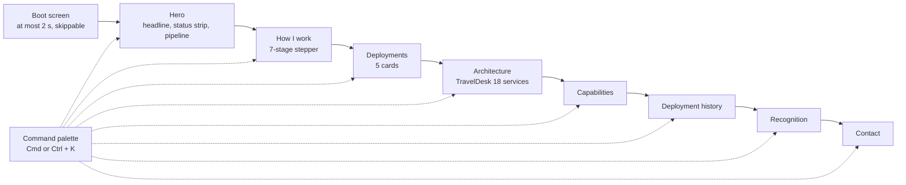

# PRD: harshalsaraogi.com revamp, "Mission Control"

| | |
|---|---|
| Owner | Harshal Saraogi |
| Author | spec-analyst |
| Date | 25 October 2026 |
| Status | Draft for owner sign-off |
| Inputs | `.sdlc/00-inputs/brief.md`, `resume.md`, `testimonials.md`, `current-site.md` |

## Summary

We are rebuilding Harshal Saraogi's personal site as an operator's console called "Mission Control". It is for people who hire Forward Deployed Engineers at AI companies, and for the leaders and recruiters around them. The site must show, in ten seconds, that Harshal works inside a company, understands its problem, builds working software fast with AI agents, and then hands it to a team. The current site reads as a generic product manager template, so it does not make that case. He is job hunting now, so the site has to make it.

## Words used in this document

Each term below means exactly this, everywhere in this document.

| Term | Meaning |
|---|---|
| Visitor | Anyone viewing the site. |
| Owner | Harshal Saraogi. Only the owner can approve content or answer open questions. |
| Narrow screen | A browser window less than 768 CSS pixels wide. Phones and small tablets. |
| Wide screen | A browser window 768 CSS pixels wide or wider. |
| 360 px | A browser window exactly 360 CSS pixels wide. The smallest phone we design for. |
| Reduced motion | The visitor has turned on the "reduce motion" setting in their operating system. Browsers report it as `prefers-reduced-motion: reduce`. |
| Mid-range phone | The device and network that Lighthouse uses by default for its mobile test. |
| Content file | The single file under `src/data/` that holds every word, number and link the site shows. |
| Pipeline | Harshal's seven-stage way of working: research, PRD, UX, prototype, Jira and Confluence, QA and UAT, deploy. |
| Packet | A small moving shape on the pipeline that stands for a piece of work moving between stages. |
| Deployment | One of the five platforms shown in the Deployments section. We use the word the way a Forward Deployed Engineer would: a body of work done inside a client. |
| 3D chunk | The JavaScript needed to draw the 3D pipeline. It loads separately, after the page is usable. |
| Confidential name | The name of the incumbent HR software vendor. The brief forbids printing it. The exact string is in `brief.md`, decision 3. |

Each requirement ends with where it came from:

- **From a document**: the brief, the résumé or the testimonials file. Check that we read it correctly.
- **Our decision**: nobody said this; we chose it. **These need the owner's sign-off.**

## Problem

The current site is a reused 3D template. It opens with a loading percentage, a "Welcome" button and an animated avatar. It then shows four hover cards, a carousel and a physics toy of bouncing tool logos. None of this says anything about how Harshal works. The headline calls him a "Product Manager" with "AI/ML delivery" and "product strategy". That describes thousands of people. A Forward Deployed Engineer hiring manager wants to know something narrower. Can this person sit with a customer, work out the real problem, ship software that runs, and leave a team able to carry it on? The current site never answers that. The strongest evidence, such as a 116-page PRD, an 18-service system built solo and 16+ engineers led, is missing from the page.

The current site also carries real risks. Its content file claims numbers that are not on the résumé, such as "30% faster execution" and "60% fewer defects". It ships 57 MB of files, including 39 MB of template images the code never uses and an unused analytics package. Its sitemap uses a relative address that search engines reject, and its README still points to an old Netlify address. If we do nothing, hiring managers skim past a generic page on their phone. Worse, an unsupported number could cost trust in an interview.

## Users and personas

| Who | What they are doing | What they need | The one impression they must leave with |
|---|---|---|---|
| Forward Deployed Engineer or solutions engineering hiring manager at an AI company (first priority) | Judging in under a minute whether to start a conversation. Usually on a laptop. | Proof of hands-on building inside a real enterprise, with AI agents, plus evidence of handover to a team. | "He embeds with the customer, ships working software himself with AI agents, then hands it to a team. That is the job." |
| Product or engineering leader (second priority) | Checking depth: does he understand systems, or only documents? | The architecture, the scale, the stages and gates, the team size. | "He specs like a PM and reasons about systems like an engineer. I could trust him with a client and a codebase." |
| Recruiter skimming on a phone (third priority) | Matching keywords and dates. Wants the résumé and a way to reach him. | Current title, company, dates, promotions, a résumé download, an email address. | "Paytm PM, promoted twice in 9 months each, open to Forward Deployed Engineer roles, and the résumé is one tap away." |
| Owner | Keeps the site current. | Every fact in one content file, so updates do not need code changes. | Not applicable. |

## Goals

Ranked. Each goal has a check a person can do after launch without any analytics.

| Rank | Goal | How we check it | Baseline today |
|---|---|---|---|
| 1 | A stranger gets the positioning in ten seconds. | The ten-second test below: at least 4 of 5 people pass. | Not measured. The current hero does not mention working inside a company, shipping software or AI agents. |
| 2 | Every claim is backed by the résumé. | Every number in the content file also appears in `resume.md`. Target: 100%. | At least 4 numbers in today's content file are not in the résumé: 30%, 25%, 60% and 50%. |
| 3 | Confidential material never appears. | A text search of the source, the built site and the résumé PDF finds 0 matches for the confidential name and 0 matches for "Abha Sinha". | 0 matches today, but the new content talks about the HR replacement, which raises the risk. |
| 4 | Fast on a mid-range phone. | Lighthouse mobile Performance at least 90. First Contentful Paint under 1.5 s. Initial JavaScript at most 300 kB gzip. | Non-3D JavaScript is about 133 kB gzip. The 3D chunks add 928 kB and 178 kB gzip. The built folder is 57 MB. |
| 5 | Usable by keyboard, screen reader and reduced-motion visitors. | Lighthouse Accessibility at least 95. The keyboard walk-through and reduced-motion walk-through below both pass. | Not measured. |
| 6 | Shares and indexes correctly at the new domain. | Google's Rich Results Test finds a valid Person. LinkedIn's Post Inspector shows the title, description and image. | No canonical link, no `og:url`, no `og:image`, and a sitemap with a relative address. |

### Launch checks a person can run

1. **Ten-second test.** Show the site on a phone to 5 people who have not seen it. Let the boot screen finish. Hide the screen after 10 seconds. Ask: "What does this person do?" A person passes if their answer mentions building or shipping software and also mentions AI. The test passes if at least 4 of 5 people pass, and at least 3 of 5 also mention working with or inside companies or clients.
2. **Lighthouse, mobile, on the live URL.** Performance at least 90. Accessibility at least 95. Best Practices at least 95. SEO 100.
3. **Bundle sizes.** Read the build output. Initial JavaScript at most 300 kB gzip. 3D chunk at most 400 kB gzip. Built folder under 5 MB.
4. **Confidentiality search.** Search the source, the build output and the extracted text of the résumé PDF. There must be 0 matches, ignoring case, for the confidential name, for the same name with a space, and for "Abha Sinha".
5. **Keyboard walk-through.** Using only the keyboard, a tester skips the boot screen. They open the palette, copy the email, and jump to Contact. They open a deployment's details, explore the architecture diagram and download the résumé. They must always see where focus is.
6. **360 px walk-through.** At 360 px, no section scrolls sideways and all text is readable without zooming.
7. **Reduced-motion walk-through.** With reduced motion on, nothing on the page moves by itself. No 3D file downloads.
8. **Build health.** `npm run lint` and `tsc -b` report 0 errors. `npm run build` succeeds.

## Not doing

- **"Ask the agent" chat.** It needs a server and an API key. It is phase 2 in the brief.
- **A content management system.** The owner edits the content file.
- **A blog, case-study pages or any second page.** The site is one page with anchors. Nothing in the brief needs a separate address, and one page keeps the 10-second story in one scroll.
- **Analytics of any kind.** No tracking script, no analytics backend, no analytics keys. We remove the installed analytics package.
- **A contact form.** A form needs a server or a third-party service. Email, LinkedIn and phone links are enough.
- **3D on narrow screens or with reduced motion.** The 3D chunk never downloads there.
- **Screenshots of internal Paytm documents.** Artifacts appear as text and numbers.
- **Light theme, theme switcher or other languages.** English only, dark graphite only.
- **Redesigning the résumé PDF.** We publish the owner's file as supplied.
- **Hosting setup.** DNS, HTTPS certificates and redirects from old addresses are human actions on the hosting account. "Depends on" lists what the owner must set up.

## User journeys



### Happy path: hiring manager on a laptop

1. The boot log runs for less than 2 seconds, then the hero appears.
2. They read the headline and the three-item status strip. The 3D pipeline fades in behind the text, with amber packets moving from research to deploy.
3. They click the "Prototype" stage in the pipeline. The page moves to How I work with that stage open. It shows the 8-module Cloud Commerce prototype built in 3 months.
4. In Deployments they open TravelDesk's details, then follow its link to the architecture diagram.
5. They hover over the Spring Boot gateway and its edges light up.
6. They press `Cmd+K`, choose "Copy email", and see "Email copied".

### Happy path: recruiter on a phone

1. They tap the boot screen, which ends at once.
2. The headline and the first status item fit on the first screen. The pipeline is a lightweight drawing, not 3D.
3. They scroll to Deployment history and see both "Promoted in 9 months" markers.
4. They tap "Download résumé" in Contact.

### When 3D cannot run

A visitor's laptop has no WebGL, or the 3D chunk fails to load on a slow network. The drawn version of the pipeline stays in place. No error appears. Every section works as normal.

### When copying the email is blocked

The browser refuses clipboard access. The palette shows the email address as selectable text with a "Write an email" link. The visitor still reaches Harshal.

### When JavaScript does not run

A link-preview bot, a search crawler without JavaScript, or a visitor with scripts off loads the page. They still get the title, description, Open Graph tags and Person data. They also see a short text version with name, positioning line, email, LinkedIn and a résumé link.

## What it must do

We group requirements by section. Every requirement is one testable statement. IDs are permanent: never renumber; add new ones at the end.

### The whole page

- **FR-1** The site is a single page at `https://harshalsaraogi.com/`. Its sections appear in this order: boot screen, hero, How I work, Deployments, Architecture, Capabilities, Deployment history, Recognition, Contact. _From a document (brief)._
- **FR-2** Each section has a fixed anchor: `#top`, `#how-i-work`, `#deployments`, `#architecture`, `#capabilities`, `#history`, `#recognition`, `#contact`. Opening the site with an anchor in the address lands on that section once the boot screen ends. _Our decision._
- **FR-3** Every word, number and link the visitor sees comes from the content file. Changing a value there changes it on the page with no other edit. _From a document (brief)._
- **FR-4** At 360 px, no section scrolls sideways. _From a document (brief)._
- **FR-5** At 360 px, body text is at least 16 CSS pixels and mono labels are at least 12 CSS pixels. _Our decision._
- **FR-6** With reduced motion, no element moves, fades, slides or types itself out. All text is visible as soon as the page loads. _From a document (brief)._
- **FR-7** Text never stays hidden while waiting for a reveal animation. If the animation code fails to load, the text is still visible. _Our decision._
- **FR-8** Smooth scrolling applies only on wide screens with a mouse or trackpad, and only without reduced motion. Everywhere else the page uses the browser's normal scrolling. _Our decision._
- **FR-9** The custom cursor appears only with a mouse or trackpad and only without reduced motion. On touch screens and with reduced motion, the normal system cursor shows. _Our decision._
- **FR-10** Electric cyan appears only on structure: lines, edges, borders, system diagrams and data. _From a document (brief, decision 2)._
- **FR-11** Warm amber appears only on agent activity: running states, live badges and moving packets. _From a document (brief, decision 2)._
- **FR-12** The page background is a near-black graphite, not navy. _From a document (brief, decision 2)._
- **FR-13** Body text uses Geist. Every label, status line, metric and caption uses Geist Mono. _From a document (brief, decision 2)._
- **FR-14** Nothing on the page moves unless it stands for work happening, a visitor action, or the boot log. There is no decorative motion. _From a document (brief)._

### Boot screen

- **FR-15** On the first page load in a browser session, a full-screen boot log appears before the hero. It uses Geist Mono and prints its lines one after another. _From a document (brief)._
- **FR-16** The boot screen ends no more than 2 seconds after it appears. It never waits for the 3D chunk. _From a document (brief)._
- **FR-17** Any key press, click or tap ends the boot screen at once. _From a document (brief)._
- **FR-18** The boot screen shows a visible "Skip" button. It is the first thing that keyboard focus reaches. _Our decision._
- **FR-19** Every boot log line states a fact from the content file. The proposed lines are under "Content". _Our decision._
- **FR-20** Reloading the page or coming back in the same browser session does not show the boot screen again. _Our decision._
- **FR-21** With reduced motion, the boot screen never appears. _Our decision._
- **FR-22** At 360 px, boot lines wrap inside the screen, and the Skip button is at least 44 by 44 CSS pixels. _Our decision._
- **FR-23** When the boot screen ends, keyboard focus moves to the start of the page. The next Tab press reaches the "Skip to content" link. _Our decision._

### Navigation

- **FR-24** A navigation bar stays visible at the top while the visitor scrolls. _From a document (current site)._
- **FR-25** The navigation bar holds Harshal's name, which links to `#top`. It also holds links to the seven sections after the hero and a button that opens the command palette. _Our decision._
- **FR-26** The first Tab press on the page reaches a "Skip to content" link. Activating it moves focus to the main content. _Our decision._
- **FR-27** The link for the section currently in view is visibly marked and announced as the current location to screen readers. _Our decision._
- **FR-28** Activating a section link moves the page to that section and moves keyboard focus to the section's heading. _Our decision._
- **FR-29** On narrow screens, the section links sit behind a menu button, and the bar is no more than 64 CSS pixels tall. _Our decision._
- **FR-30** The narrow-screen menu closes when the visitor picks a link, presses Escape or taps the menu button again. Focus then returns to the menu button. _Our decision._
- **FR-31** With reduced motion, section jumps are instant and the menu opens without animation. _From a document (brief)._

### Command palette

- **FR-32** Pressing `Cmd+K` on macOS or `Ctrl+K` elsewhere opens the command palette from anywhere on the page. Pressing it again closes it. _From a document (brief)._
- **FR-33** The palette button in the navigation bar opens the palette, so touch visitors can use it. _Our decision._
- **FR-34** The palette lists exactly these commands: one "Go to" command for each of the 8 anchors in FR-2, "Download résumé", "Copy email" and "Open LinkedIn". _From a document (brief)._
- **FR-35** Typing in the palette filters the commands by name, ignoring case. When nothing matches, the palette shows "No matching command". _Our decision._
- **FR-36** The Up and Down arrow keys move the highlight. Enter runs the highlighted command. _Our decision._
- **FR-37** Escape closes the palette. Focus then returns to whatever had focus before it opened. _Our decision._
- **FR-38** While the palette is open, Tab stays inside it and the page behind does not scroll. Screen readers announce it as a dialog named "Command palette". _Our decision._
- **FR-39** "Copy email" copies `saraogiharshal@gmail.com` and shows "Email copied" for at least 2 seconds. Screen readers announce the same message. _From a document (brief)._
- **FR-40** If the browser blocks the copy, the palette shows the email address as selectable text and a "Write an email" link instead. _Our decision._
- **FR-41** "Download résumé" downloads the résumé PDF from `harshalsaraogi.com` under the file name `Harshal_Saraogi_Resume.pdf`. _From a document (brief)._
- **FR-42** "Open LinkedIn" opens `https://www.linkedin.com/in/harshal-saraogi-b07260194/` in a new tab. _From a document (résumé)._
- **FR-43** A "Go to" command closes the palette and behaves exactly like the matching navigation link in FR-28. _Our decision._
- **FR-44** At 360 px, the palette fills the screen width, and every command row is at least 44 CSS pixels tall. _Our decision._
- **FR-45** With reduced motion, the palette opens and closes without animation. _From a document (brief)._

### Hero

- **FR-46** The hero shows, in this order: a mono eyebrow label, the headline, a one-sentence sub-line, the status strip and two buttons. _From a document (brief) and our decision._
- **FR-47** The headline is the page's only top-level heading. _Our decision._
- **FR-48** The two hero buttons are "See deployments", which jumps to `#deployments`, and "Download résumé". _Our decision._
- **FR-49** The status strip shows exactly the three items set out under "Content", in Geist Mono. _From a document (brief)._
- **FR-50** At 360 px and 640 px tall, the headline and the first status item are fully visible without scrolling once the boot screen ends. _Our decision._
- **FR-51** On a wide screen with WebGL and without reduced motion, the hero shows the pipeline as a 3D graph. It has 7 stage nodes in the order in the "Words used" table, joined left to right. _From a document (brief)._
- **FR-52** In the 3D graph, amber packets move along the edges from research towards deploy. _From a document (brief)._
- **FR-53** The headline and status strip appear before the 3D chunk starts downloading. _From a document (brief)._
- **FR-54** Until the 3D graph is ready, a drawn (SVG) version of the same pipeline fills the same space. Swapping one for the other does not move any other content. _Our decision._
- **FR-55** On narrow screens, the hero shows the drawn version with moving packets. The 3D chunk is never downloaded. _From a document (brief)._
- **FR-56** With reduced motion, the hero shows the drawn version with still packets. The 3D chunk is never downloaded. _From a document (brief); see "Problems with the plan", item 3._
- **FR-57** If WebGL is missing or the 3D chunk fails to load, the drawn version stays in place and no error message appears. _Our decision._
- **FR-58** Every stage node shows its name as a text label, in both versions. _Our decision._
- **FR-59** Hovering over a stage node, or moving keyboard focus to it, shows the stage name and its one-line artifact from the "How I work" content table. _Our decision._
- **FR-60** Clicking a stage node, or pressing Enter on it, moves to `#how-i-work` with that stage selected. _Our decision._
- **FR-61** Keyboard focus can reach all 7 stage nodes in pipeline order, in both versions. _From a document (brief)._
- **FR-62** Screen readers get a text list of the 7 stages in order instead of the graphic. _Our decision._

### How I work

- **FR-63** This section shows the 7 pipeline stages as a stepper, in pipeline order. _From a document (brief)._
- **FR-64** Each stage shows its name, what happens there, the real artifact and its numbers. The text matches the "How I work" content table exactly. _From a document (brief, résumé)._
- **FR-65** On wide screens, one stage is selected at a time. Stage 1 is selected when the page loads, and selecting a stage shows its panel. _Our decision._
- **FR-66** On wide screens, the Left and Right arrow keys move between stages and the selection follows. Screen readers announce the stages as tabs. _Our decision._
- **FR-67** On narrow screens, the 7 stages appear as a vertical list with every panel's text visible. No tapping is needed to read them. _Our decision._
- **FR-68** The section names the three build tools once: Claude Code, Cursor and Codex. _From a document (résumé)._
- **FR-69** With reduced motion, changing the selected stage swaps the panel instantly. _From a document (brief)._

### Deployments

- **FR-70** This section shows 5 deployment cards in this order: TravelDesk, HRMS, BSS, Cloud Commerce, AI Operations platform. It replaces the carousel. _From a document (brief)._
- **FR-71** Each card shows a name, a one-line description, a status badge, stack chips and headline metrics, as in the "Deployments" content table. _From a document (brief)._
- **FR-72** Each status badge shows exactly one of four values: "UAT", "In development", "Prototype delivered" or "Scoping". _From a document (brief)._
- **FR-73** The "UAT" and "In development" badges are amber with a live dot, because that work is running. "Prototype delivered" and "Scoping" badges are not amber. _Our decision._
- **FR-74** Each card has a "Details" button. Activating it shows that card's detail bullets. Cards start closed. _From a document (brief)._
- **FR-75** Opening one card's details does not close another card's details. Screen readers announce whether each card is open or closed. _Our decision._
- **FR-76** All 5 cards are visible by scrolling down. There is no sideways swiping and no automatic advance. _Our decision._
- **FR-77** At 360 px, the cards stack in a single column. _Our decision._
- **FR-78** The TravelDesk card has a "See the architecture" link that moves to `#architecture`. _Our decision._
- **FR-79** With reduced motion, details open instantly and live dots do not pulse. _From a document (brief)._

### Architecture

- **FR-80** This section shows an interactive SVG diagram of TravelDesk. It has exactly 18 service nodes: 1 Next.js front end, 1 Spring Boot API gateway and 16 domain services. _From a document (brief, résumé)._
- **FR-81** The diagram also shows 3 live integration nodes: "Enterprise HRIS", "Quest2Travel" (corporate travel vendor) and "SAP". _From a document (résumé)._
- **FR-82** The diagram shows "EBIX forex" and "Recharge" as dashed nodes labelled "Phase 2". _Our decision, from the résumé._
- **FR-83** The HR integration node always reads "Enterprise HRIS". It never names the vendor. _From a document (brief, decision 3)._
- **FR-84** Hovering over a node, or moving keyboard focus to it, lights up that node's edges and the nodes at their other ends. All other nodes and edges dim. _From a document (brief)._
- **FR-85** The highlighted node shows a caption with its name and one-line role. _Our decision._
- **FR-86** Keyboard focus reaches every node in this order: front end, gateway, domain services, integrations. Escape clears the highlight. _Our decision._
- **FR-87** On touch screens, tapping a node highlights it as in FR-84. Tapping empty space clears it. _Our decision._
- **FR-88** On narrow screens, the section shows a grouped list instead of the diagram. The groups are front end, gateway, domain services and integrations. Tapping an entry shows what it connects to. _Our decision._
- **FR-89** Screen readers always get the grouped list from FR-88, on every screen size. _Our decision._
- **FR-90** With reduced motion, highlights change instantly and no edge shows flowing motion. _From a document (brief)._
- **FR-91** The section states the facts set out under "Content", including "multi-tenant from day one" and "built and deployed solo". _From a document (résumé)._

### Capabilities

- **FR-92** This section shows four groups: Product, Technical, AI-native build, and Delivery and tools. It replaces the physics spheres. _From a document (brief)._
- **FR-93** Each group lists its skills exactly as the résumé lists them, with no additions. _From a document (résumé)._
- **FR-94** Each group shows one proof line from the "Capabilities" content table. Each proof line links to the section that backs it. _Our decision._
- **FR-95** On wide screens the four groups sit side by side. On narrow screens they stack. _Our decision._
- **FR-96** Nothing in this section moves except an optional reveal on scroll. With reduced motion, there is no reveal. _From a document (brief)._

### Deployment history

- **FR-97** This section shows a timeline of the 4 employers, newest first. Each role shows title, company, location, dates and 2 or 3 highlights from the "Deployment history" content table. _From a document (brief, résumé)._
- **FR-98** The Paytm entry and the ANS Commerce entry each carry a visible marker reading "Promoted in 9 months". _From a document (brief)._
- **FR-99** The section ends with an education block: 2 degrees, 5 certifications and 1 research publication. _From a document (résumé)._
- **FR-100** The research publication link opens the journal PDF in a new tab. _From a document (résumé)._
- **FR-101** At 360 px, the timeline is a single column with dates above titles. _Our decision._
- **FR-102** With reduced motion, the timeline line does not draw itself. _From a document (brief)._

### Recognition

- **FR-103** This section shows exactly 5 quotes: ITC, Whites, Amul, Ekart and Alma Mater Store, in that order. _From a document (testimonials)._
- **FR-104** Each quote shows the attribution in the "Recognition" content table. _From a document (testimonials)._
- **FR-105** Quote text is word for word from `testimonials.md`. The site may shorten a quote only with an ellipsis. It never rewords one. _Our decision._
- **FR-106** The ITC card shows the suggested pull-quote, with a "Read the full note" button that shows the full text. _From a document (testimonials) and our decision._
- **FR-107** The Ekart card shows the 3 bullets chosen under "Content", followed by the closing sentence. _From a document (testimonials) and our decision._
- **FR-108** No screenshot, logo, phone number or email address of any quote author appears. _From a document (brief, decision 4)._
- **FR-109** All 5 quotes are visible by scrolling, with no automatic advance. At 360 px they stack in a single column. _Our decision._
- **FR-110** Screen readers announce each quote as a quotation, with its source. _Our decision._

### Contact

- **FR-111** This section shows an amber badge reading "Open to Forward Deployed Engineer roles", with a live dot. _From a document (brief)._
- **FR-112** The section shows the email address as a mail link with a copy button next to it. _From a document (résumé)._
- **FR-113** The section shows links to LinkedIn and to GitHub (`https://github.com/letshackit`). Both open in a new tab. _From a document (résumé)._
- **FR-114** The section shows the phone number as a call link, and the location "Delhi NCR, India". _From a document (résumé); see assumption A-1._
- **FR-115** The section has a "Download résumé" button that behaves as FR-41. _From a document (brief)._
- **FR-116** A footer below Contact shows Harshal's name, the current year and a "Back to top" link. _Our decision._
- **FR-117** At 360 px, every contact link and button is at least 44 by 44 CSS pixels. _Our decision._
- **FR-118** With reduced motion, the live dot does not pulse. _From a document (brief)._

### Search engines and link previews

- **FR-119** The page has a canonical link to `https://harshalsaraogi.com/`. _From a document (brief, decision 5)._
- **FR-120** The page title and meta description are the texts under "Content". The title is at most 60 characters and the description at most 160. _Our decision._
- **FR-121** The page has Open Graph tags with these values. `og:type` is `website` and `og:url` is the canonical address. `og:title`, `og:description` and `og:site_name` are set, and `og:locale` is `en_IN`. _From a document (brief)._
- **FR-122** The page has an `og:image` given as a full address on `harshalsaraogi.com`. The image is 1200 by 630 pixels, under 300 kB, and has `og:image:alt` text. _Our decision._
- **FR-123** The page has Twitter card tags of type `summary_large_image` with the same title, description and image. _Our decision._
- **FR-124** The page has JSON-LD of type Person with the fields in the "Search" content table. _From a document (brief)._
- **FR-125** `sitemap.xml` lists exactly one address, `https://harshalsaraogi.com/`, with the build date as its last-modified date. _From a document (brief)._
- **FR-126** `robots.txt` allows all crawlers and names `https://harshalsaraogi.com/sitemap.xml`. It has no rules for folders that no longer exist. _From a document (brief)._
- **FR-127** Everything in FR-119 to FR-124 is in the HTML file as the server sends it, before any JavaScript runs. _Our decision._
- **FR-128** When JavaScript is off, the page shows a short text version with name, positioning line, email, LinkedIn and a résumé link. _Our decision._
- **FR-129** The page has an SVG favicon, an Apple touch icon and a `theme-color` that matches the graphite background. _Our decision._
- **FR-130** No file in the repository or the built site contains `letshackit.netlify.app`. The README names `https://harshalsaraogi.com` as the live site. _From a document (brief, decision 5)._

### Confidentiality

- **FR-131** The confidential name never appears in the source, the built site, the meta tags, the JSON-LD or the résumé PDF. Searches ignore case and also try the name with a space. _From a document (brief, decision 3)._
- **FR-132** The site still shows the HR work. It names the vendor only as "the incumbent enterprise HRIS" or "an HRIS vendor". It still says Harshal scoped the replacement for about 50,000 employees and built the integration. _From a document (brief, decision 3)._
- **FR-133** The SBI Life quote and the name of its author never appear anywhere on the site. _From a document (testimonials)._
- **FR-134** "SBI Life" appears only once, as a client name in the Hippo Innovations history entry. _From a document (testimonials)._
- **FR-135** The only email address on the site is `saraogiharshal@gmail.com`. The only phone number is the owner's. _From a document (brief, decision 4)._

### Clean-up

- **FR-136** The implementer deletes these files and folders: `src/components/Character/` and everything in it, `public/models/`, `public/draco/`, `src/applemodel.glb`, `src/model.glb` and `src/normal suit.glb`. _From a document (brief, current site)._
- **FR-137** The implementer deletes these files: `public/Akash_Malhotra.pdf`, `test.js`, `src/components/TechStack.tsx`, `src/components/WorkImage.tsx`, `src/components/Character/exports.ts` and `src/data/boneData.ts`. _From a document (brief, current site)._
- **FR-138** The implementer deletes every file in `public/images/` that the new site does not use. Today the code uses none of them. The folder holds 39 MB of template images. _Our decision._
- **FR-139** The implementer removes these packages from `package.json`: `@react-three/cannon`, `@react-three/rapier`, `@react-three/postprocessing` and `@vercel/analytics`. _From a document (brief) and our decision._
- **FR-140** `package.json` lists no package that the new source does not import. _Our decision._
- **FR-141** The built site folder is under 5 MB in total, including the résumé PDF. _Our decision._
- **FR-142** The implementer rewrites the content file from `resume.md` only. These old claims must go: "30%", "25%", "60%", "50% web traffic", "Introduction to Cybersecurity — Cisco", and the "fintech" and "B2C" framing. _From a document (résumé)._
- **FR-143** The published résumé PDF is the owner's October 2026 version. See open question Q-2. _From a document (résumé header)._

## Content

This section lists exactly what each part of the page says. Every number here appears in `resume.md`. If a number is not in this section, it does not go on the site.

### Copy voice

- First person, plain and specific. Lead with what was built, then the number.
- Mono labels are upper case and short, like an operator's console.
- No hype words: "passionate", "rockstar", "ninja", "synergy", "cutting-edge", "world-class".
- The site never says Harshal's current job title is Forward Deployed Engineer. His title is Product Manager I at Paytm. He is "open to" Forward Deployed Engineer roles. Hiring managers check titles, and a mismatch costs trust.

### Hero headline: options

All three options share the same eyebrow label and sub-line.

Eyebrow (Geist Mono):

```
BUILDER-PM · OPEN TO FORWARD DEPLOYED ENGINEER ROLES
```

Sub-line (Geist):

```
I work inside the business, scope the problem, and build the first working version
myself with Claude Code, Cursor and Codex. Then I hire and lead the engineers who scale it.
```

| Option | Headline | For | Against |
|---|---|---|---|
| A (recommended) | Embedded with the enterprise. Shipping with AI agents. | Says "embedded", the core of the Forward Deployed Engineer job, in the first word. Names AI agents. 8 words; fits 3 lines at 360 px. The sub-line adds the handover. | "Shipping" is a little informal. |
| B | I build what I spec. | The owner's own phrase from the résumé. Short and memorable. | Does not say "enterprise" or "AI". A stranger may read it as a product manager line. That risks the ten-second test. |
| C | From the customer's problem to production, then to a team. | Covers all four parts of the brief's message in one line. | 11 words and no mention of AI in the headline. It reads like a process slide. |

**Recommendation: option A.** The first audience is Forward Deployed Engineer hiring managers. Option A uses their own vocabulary ("embedded") and the brief's key differentiator ("AI agents") before the eye reaches the sub-line. Option B's phrase moves to the How I work section heading, so it is not lost.

### Status strip

Three items, in Geist Mono, each with a label and a value. On narrow screens the items stack, one per line.

Recommended copy:

```
● DEPLOYED    Paytm · Telco SaaS & AI Platforms
● PLATFORMS   3 in flight: TravelDesk (UAT) · BSS (in development) · HRMS (scoping)
● TEAM        16+ engineers led
```

The dot on "DEPLOYED" and "PLATFORMS" is amber because that work is running. The "TEAM" dot is cyan.

The brief's wording was "3 platforms in UAT/dev". The résumé summary says the same. But the résumé's own HRMS entry says "scoping and prototyping", and the HRMS card badge must read "Scoping". The recommended wording keeps the "3" and stays true to every card. Open question Q-3 asks the owner to confirm.

### Boot log

Proposed lines. Each line is a fact from the content file.

```
[boot] harshalsaraogi.com
[ ok ] operator ...... Harshal Saraogi, Product Manager I @ Paytm
[ ok ] pipeline ...... 7 stages: research > PRD > UX > prototype > Jira/Confluence > QA/UAT > deploy
[ ok ] deployments ... 5 loaded: 1 UAT · 1 in development · 1 prototype delivered · 2 scoping
[ ok ] team .......... 16+ engineers led
[ run] status ........ deployed: Paytm Telco SaaS
```

### How I work

Section heading: "I build what I spec." Tools line: "Claude Code · Cursor · Codex".

| Stage | What happens | The real artifact shown | Numbers that appear |
|---|---|---|---|
| 1. Research | Market and vendor study before anything is scoped. | HRMS market study across 12+ vendors (Keka, greytHR, ZingHR, Zoho, Rippling, HiBob, BambooHR, Deel), benchmarked against Workday, Darwinbox and the incumbent enterprise HRIS. | 12+ |
| 2. PRD | The full requirement set, written before build. | TravelDesk 116-page master PRD: travel requests, multi-level approvals, booking coordination, expense claims, OCR receipt capture, policy validation, reimbursement workflow, notifications, admin controls. Also the HRMS 461-page, 13-module PRD. | 116, 461, 13 |
| 3. UX | The product and its screens, designed before code. | "Obsidian Command" design system and a configurable Configuration Engine, generated with Codex (HRMS). Complete product and UX design for BSS. | none |
| 4. Prototype | A working prototype is the alignment artifact, not a slide deck. | Cloud Commerce: 8-module working Node.js prototype built in Cursor within 3 months. It became the reference design for the SAP-to-cloud migration. | 8, 3 months |
| 5. Jira and Confluence | Work broken into stories a team can pick up. | TravelDesk: about 94 source stories consolidated into 56 Jira-ready stories across 10 epics, with Confluence specs. | 94, 56, 10 |
| 6. QA and UAT | Quality and security gates before anything ships. | TravelDesk in organisational UAT. QA coverage and UAT readiness defined per release. Infosec review gates. | none |
| 7. Deploy | Ship it, then hand it to a team. | TravelDesk MVP built and deployed solo, now led by a six-engineer team (2 backend, 2 frontend, 2 QA). BSS: about 60% of the build delivered personally, from local dev to deployment, before hiring the team. | 6, 2, 2, 2, 60% |

### Deployments

| Card | One-line description | Badge | Stack chips | Headline metrics | Detail bullets |
|---|---|---|---|---|---|
| TravelDesk | Corporate travel and expense reimbursement platform. Conceived, architected and built solo. | UAT | Next.js, Spring Boot, Microservices, Multi-tenant, OCR | 116-page PRD · 18 microservices · 56 stories across 10 epics · 6-engineer team | Phase-1 production rollout targeted Jan 2027. Integrated with the enterprise HRIS, Quest2Travel and SAP. Mobile web app and Phase-2 integrations (EBIX forex, Recharge) scoped around infosec review gates. |
| HRMS | In-house HR management system to replace the incumbent enterprise HRIS for about 50,000 employees. | Scoping | Modular monolith, Postgres, Event bus, Transactional outbox, Codex | ~50,000 employees · 461-page, 13-module PRD · 12+ vendors studied · 5 satellite services | India compliance scoped end to end: PF, ESI, PT, LWF, TDS, gratuity, Labour Codes, DPDP Act. Gap analysis found Performance Management is the critical-path module blocking Compensation Planning. Designed to be productised beyond Paytm. UI prototype covers the core HR flows. |
| BSS | Telco business support system. | In development | Node.js, Jira, Confluence | ~60% of build delivered personally | Designed the complete product and UX, built the working Node.js prototype, set up Jira and Confluence. Then hired and onboarded a dedicated engineering team. |
| Cloud Commerce | SaaS prototype for SAP-to-cloud migration (Paytm Telco). | Prototype delivered | Node.js, Cursor, SAP-to-cloud | 8 modules · 3 months · 100+ APIs scoped · ~1 month of discovery and build cut | Scoped integration touchpoints, service boundaries and admin and product modules. Became the reference design for the migration strategy. |
| AI Operations platform | Platform for chatbots, digital avatars and IVR journeys. | Scoping | Local SLMs, OCR pipelines, RBAC | No numbers. The résumé gives none. | Scoped chatbots, digital avatars, IVR journeys, bot configuration, conversation orchestration, RBAC, analytics and reporting, and third-party integrations. Started evaluating locally hosted small language models and OCR pipelines for lower inference cost, data privacy and less dependence on external LLM APIs. |

### Architecture

Heading: "TravelDesk: 18 services, built solo."

Facts shown: Next.js front end. Spring Boot API gateway. 16 domain services. Multi-tenant from day one. Integrated with the enterprise HRIS, Quest2Travel and SAP. Built and deployed the MVP solo with AI-assisted development. Phase 2: EBIX forex and Recharge.

The names of the 16 domain services and the connections between nodes are **not** in the résumé. See open question Q-1.

### Capabilities

| Group | Skills, exactly as the résumé lists them | Proof line | Links to |
|---|---|---|---|
| Product | discovery, market research, MVP scoping, PRDs/BRDs, roadmaps, user journeys, user stories, acceptance criteria, prioritisation, launch planning, stakeholder governance | 461-page, 13-module HRMS PRD, benchmarked across 12+ vendors. | `#deployments` |
| Technical | system design, API design and contracts, data modelling, microservices and modular monoliths, NFRs, AWS, GCP, SAP-to-cloud migration, OCR pipelines, local SLMs | 18-microservice TravelDesk architecture. 100+ APIs scoped for Cloud Commerce. | `#architecture` |
| AI-native build | Claude Code, Cursor, OpenAI Codex, prompt engineering, agentic development workflows, Node.js, Next.js, JavaScript, Python, PostgreSQL, MongoDB, MySQL | TravelDesk MVP built and deployed solo with AI-assisted development. | `#how-i-work` |
| Delivery and tools | Jira, Confluence, Figma, Kanban and Scrum, QA/UAT, release management, infosec review gates, GA4, GTM | 16+ engineers led across Kanban streams. 98% on-time across 20+ concurrent client programmes. | `#history` |

### Deployment history

| Employer | Roles and dates | Highlights shown |
|---|---|---|
| Paytm (One97 Communications), Noida | Product Manager I, Telco SaaS, Cloud Commerce and AI Platforms, Apr 2026 to present. Associate Product Manager, Jul 2025 to Mar 2026. **Promoted in 9 months.** | Owns strategy, scoping and delivery for Cloud Commerce, BSS, TravelDesk, HRMS and the AI Operations platform. Leads execution for 16+ engineers across Kanban streams. Leads technical scoping: API contracts, data models, service boundaries, NFRs. |
| Hippo Innovations, Gurugram | Senior Project Associate, Product Development, Dec 2023 to Jul 2025. | 50+ business use cases turned into PRDs, journeys and roadmaps for 5+ cloud products on AWS and Google Cloud. Introduced structured QA and UAT gates. Primary product contact for enterprise storefront clients including Amul and SBI Life. |
| ANS Commerce (Flipkart Group), Gurugram | Senior Associate Project Manager, Product Development, Jun 2023 to Dec 2023. Associate Project Manager, Web Applications and Product Delivery, Sep 2022 to May 2023. **Promoted in 9 months.** | Led roadmap execution for in-house commerce platforms Kartify and Flipshop. PRDs for Shop by Color, MoEngage, Bose, ITC Fiama D2C and Ekart Logistics. Recognised in writing by ITC, Ekart and Alma Mater. |
| AdsRole, Noida | Assistant Manager, Product Delivery and Web Projects, Jun 2021 to May 2022. | 20+ concurrent client programmes with 98% on-time completion. Weekly calls with US, UK and Australian stakeholders. |

Education block:

- PG Program in Artificial Intelligence and Machine Learning, IIIT Bangalore, Nov 2023 to Aug 2025.
- Bachelor of Computer Applications, Asian School of Business, Noida, Aug 2019 to Apr 2022.
- Certifications: Foundations of Project Management (Google). Python for Data Science (IBM). Executive Certification in Cloud Computing (NIIT). ISO/IEC 27001 Information Security Associate (SkillFront). Google Analytics 360.
- Publication: "Blue Brain: The Stimulation Algorithm", ABS International Journal of Management, linked to the journal PDF address in `resume.md`.

### Recognition

| Order | Quote shown | Attribution shown | Context label |
|---|---|---|---|
| 1 | ITC suggested pull-quote, with the full note behind "Read the full note". | Ankita Mahapatra, Brand Manager – Fiama Innovations & DTC, Personal Care Business Division, ITC Ltd. (exactly as in `testimonials.md`) | Fiama D2C website · ANS Commerce |
| 2 | Full quote. | Abdulhamid Imam, Whites. No title, because none was given. | Substore order functionality · Hippo Innovations |
| 3 | Full quote. | Kaushal Parmar, GCMMF Ltd. (Amul), Anand. | StoreHippo services · Hippo Innovations |
| 4 | 3 bullets: "Requirements and tweaks which we discovered along the way were well addressed"; "Single POC coordinated well with all ANS internal teams"; "Guidance and suggestions received from Shashi, Harshal and other team members". Then the closing sentence. | Rohit Sharma, Director, Ekart. | Ekart Logistics project · ANS Commerce |
| 5 | Full quote. | Sachin Sahni, CEO, Alma Mater Store Pvt. Ltd. | New website · ANS Commerce |

We chose those 3 Ekart bullets because they show working with a client's changing needs, and the third one names Harshal. Several quotes praise "the ANS team" or "Store Hippo". Context labels name the project and employer. They never claim a quote was about Harshal alone.

### Contact

Badge: "Open to Forward Deployed Engineer roles". Email `saraogiharshal@gmail.com`. Phone `+91 84478 56889`. Location "Delhi NCR, India". LinkedIn and GitHub links. "Download résumé" button.

### Search

| Field | Value |
|---|---|
| Title | `Harshal Saraogi — AI-native builder and Product Manager` (55 characters) |
| Meta description | `Harshal Saraogi embeds with enterprise teams, builds working platforms with AI agents, and hands them to engineers. Open to Forward Deployed Engineer roles.` (under 160 characters) |
| JSON-LD `@type` | `Person` |
| `name` | Harshal Saraogi |
| `url` | `https://harshalsaraogi.com/` |
| `jobTitle` | Product Manager |
| `worksFor` | Organization, name "Paytm" |
| `email` | `mailto:saraogiharshal@gmail.com` |
| `telephone` | `+91-84478-56889` (see A-1) |
| `address` | Delhi NCR, IN |
| `alumniOf` | IIIT Bangalore; Asian School of Business, Noida |
| `sameAs` | LinkedIn URL; `https://github.com/letshackit` |
| `knowsAbout` | Forward deployed engineering; Enterprise SaaS; Agentic AI development; Product management; System design; API design; Cloud commerce; SAP-to-cloud migration |
| `description` | Same as the meta description. |

## How well it must work

### Speed

- **NFR-1** First Contentful Paint is under 1.5 seconds in a Lighthouse mobile test. _From a document (brief)._
- **NFR-2** Largest Contentful Paint is at most 2.5 seconds in a Lighthouse mobile test. _Our decision._
- **NFR-3** Cumulative Layout Shift is at most 0.1. _Our decision._
- **NFR-4** Total Blocking Time is at most 200 milliseconds in a Lighthouse mobile test. _Our decision._
- **NFR-5** All JavaScript loaded before the 3D chunk adds up to at most 300 kB gzip. _From a document (brief)._
- **NFR-6** The 3D chunk is at most 400 kB gzip. _Our decision._
- **NFR-7** The 3D chunk starts downloading only after the hero text is on screen. It downloads only on wide screens with WebGL and without reduced motion. _From a document (brief)._
- **NFR-8** On a narrow screen, the first page load transfers at most 1 MB, not counting the résumé PDF. _Our decision._
- **NFR-9** The site serves Geist and Geist Mono from `harshalsaraogi.com`. Text shows in a fallback font while they load, never as blank space. _Our decision._
- **NFR-10** Moving packets, live dots and the 3D graph pause when their section is off-screen or the browser tab is hidden. _Our decision._
- **NFR-11** On the live site, Lighthouse mobile scores are at least 90 for Performance and at least 95 for Accessibility. Best Practices is at least 95, and SEO is 100. _Our decision._

### Accessibility

- **NFR-12** The site meets WCAG 2.2 level AA. _Our decision._
- **NFR-13** Body text has a contrast ratio of at least 4.5 to 1 against its background. That includes cyan or amber text on graphite. _From a document (brief)._
- **NFR-14** Large text, icons, borders of controls and focus indicators have a contrast ratio of at least 3 to 1. _Our decision._
- **NFR-15** Every link, button, stage node, diagram node and command works by keyboard alone. The Tab order follows the visual order. _From a document (brief)._
- **NFR-16** Keyboard focus always shows a visible outline at least 2 CSS pixels thick. No style ever removes it. _From a document (brief)._
- **NFR-17** The page has exactly one header, one navigation, one main and one footer region. Each section has a level-two heading, and heading levels never skip. _Our decision._
- **NFR-18** Every part of the page honours reduced motion, as FR-6 sets out. _From a document (brief)._
- **NFR-19** On a wide screen at 200% browser zoom, no content or function is lost. _Our decision._
- **NFR-20** On narrow screens, every tap target is at least 44 by 44 CSS pixels. _Our decision._
- **NFR-21** The page declares English as its language. Every meaningful graphic has a text alternative, and purely decorative graphics are hidden from screen readers. _Our decision._
- **NFR-22** Nothing on the page flashes more than 3 times in any one second. _Our decision._

### Search

- **NFR-23** Google's Rich Results Test finds a valid Person on the live page, with no errors. _Our decision._
- **NFR-24** Any address on the site other than `/` and its real files returns HTTP status 404. It never returns the home page with status 200. _Our decision._

### Browsers

- **NFR-25** The site works fully in the current and previous major versions of Chrome, Edge, Firefox, Samsung Internet, and Safari on macOS and iOS. _Our decision._
- **NFR-26** In older browsers, all text, links and the résumé download still work, even if motion and 3D do not. _Our decision._

### Hosting, security and privacy

- **NFR-27** The site is static files only. There is no server code and no runtime secret. _From a document (brief)._
- **NFR-28** No API key, token or analytics ID is in the source or the built site. A secret scan of both finds nothing. _From a document (brief)._
- **NFR-29** The page makes no request to any other domain while it loads. The browser contacts another domain only when the visitor clicks an outside link. _Our decision._
- **NFR-30** The site sets no cookies and collects no visitor data. It stores only one browser-session flag to remember that the boot screen has run. _Our decision._
- **NFR-31** Every link that opens a new tab blocks the new page from controlling the site and from seeing the full referring address. _Our decision._
- **NFR-32** The site loads only over HTTPS. A content security policy allows scripts only from `harshalsaraogi.com`. _Our decision._

### Code health

- **NFR-33** `npm run lint` reports 0 errors and `tsc -b` reports 0 errors. _From a document (brief)._
- **NFR-34** `npm run build` succeeds. _From a document (brief)._

## Depends on

| What | Who | Why it matters |
|---|---|---|
| The October 2026 résumé PDF, with the confidential name removed | Owner | The file in the repository is the April 2026 version. See Q-2. |
| The 16 TravelDesk domain service names and their connections | Owner | The architecture diagram cannot be built truthfully without them. See Q-1. |
| Hosting account: custom domain, HTTPS, the 404 rule, security headers, and redirects from `www` and the old Netlify address | Owner (human action) | Agents never deploy. NFR-24 and NFR-32 depend on host settings. |
| Kept tools: Vite, React 18, TypeScript strict mode, GSAP core plugins (ScrollSmoother, ScrollTrigger, SplitText), React Three Fiber for the hero | Architect | Fixed by the brief. |
| Geist and Geist Mono font files | Implementer | Both are open-licence fonts that can be self-hosted. |
| Open Graph image and favicon | Implementer makes them; owner approves | See A-6. |

## Assumptions

| ID | Assumption | What would prove it wrong |
|---|---|---|
| A-1 | The phone number stays on the site and in the Person data, as it is today. The brief clears everything in the résumé except the confidential name. | The owner prefers not to publish a phone number on a public page. Then remove FR-114's phone part and the `telephone` field. |
| A-2 | 768 CSS pixels is the right line between narrow and wide screens for the 3D graph. | Testing shows the 3D graph runs poorly on wide-screen devices such as entry-level laptops. Then the architect adds a performance check. |
| A-3 | `https://github.com/letshackit` is the owner's public GitHub profile and is fit to show. | The owner says the account is private or not representative. |
| A-4 | Artifacts appear as text and numbers, never as screenshots of internal documents. | The owner supplies cleaned images and wants them shown. |
| A-5 | The boot screen should run once per browser session, not on every reload. | The owner wants it on every visit. |
| A-6 | The implementer designs the Open Graph image (name, headline and pipeline motif) and the favicon. The owner approves both. | The owner has a designer or an existing image. |
| A-7 | The seven pipeline stages, in the brief's order, are the same everywhere: boot log, hero and How I work. | The owner wants a separate "handover" stage. |
| A-8 | The host supports custom 404 handling and response headers, as Netlify does. | The owner picks a host without them. Then NFR-24 and NFR-32 need another approach. |
| A-9 | `resume.md` is correct as of October 2026, including "Phase-1 production rollout targeted Jan 2027". | Dates move. The owner updates the content file. |
| A-10 | "Mid-range phone" means Lighthouse's default mobile settings. | The owner names a specific test device. |

## Open questions

Only questions the inputs do not answer. The five owner decisions in the brief are settled and are not reopened here.

| ID | Question | Owner | Blocks what | Default if not answered |
|---|---|---|---|---|
| Q-1 | What are the names of TravelDesk's 16 domain services, and which nodes connect to which? The résumé gives only the counts. Are those names cleared to publish? | Owner | Content for FR-80 to FR-90. The diagram can be built with placeholder data, but it cannot launch without real names. | None. Inventing service names would break the rule that every claim comes from the résumé. |
| Q-2 | Please supply the October 2026 résumé PDF. The file at `public/Harshal_Saraogi_Resume.pdf` dates from April 2026. It shows "Associate Product Manager", has no TravelDesk, HRMS or BSS, and includes the "30%" claim and the Cisco certificate. Does the new PDF have the confidential name removed? | Owner | FR-41, FR-115, FR-131 and FR-143, and so the launch. | None. The site must not offer a résumé that contradicts it. |
| Q-3 | Do you approve the status strip wording "3 in flight: TravelDesk (UAT) · BSS (in development) · HRMS (scoping)" instead of the brief's "3 platforms in UAT/dev"? | Owner | Final copy for FR-49. Does not block build. | Use the recommended wording. |
| Q-4 | Do you approve headline option A? | Owner | Final copy for FR-46. Does not block build. | Use option A. |
| Q-5 | Where is `harshalsaraogi.com` hosted today, and who will set up the redirects from `www` and the old Netlify address? | Owner | The deploy gate only. | None needed before build. |

## Out of scope for v1, candidates for v2

- "Ask the agent" chat using the Claude API, with a small server. From the brief, phase 2.
- One page per deployment, with cleaned artifacts such as PRD excerpts and diagrams.
- Pre-rendering the full page as HTML, so crawlers that do not run JavaScript see every section.
- An "Open GitHub" command in the palette.
- Privacy-friendly visit counting, if the owner later wants numbers. This needs its own decision.
- A one-page résumé made for Forward Deployed Engineer roles.

## Problems with the plan

1. **The résumé PDF is out of date.** `resume.md` says it was transcribed from `public/Harshal_Saraogi_Resume.pdf`. But that file is a 4-page April 2026 version with the old title and old claims. A recruiter who downloads it would see a different person from the one on the page. This is Q-2 and it blocks launch.
2. **The status strip and the HRMS badge disagree in the brief itself.** The brief says "3 platforms in UAT/dev". The résumé says HRMS is "scoping and prototyping". We recommend wording that is true for both (Q-3).
3. **The brief asks for an "animated" drawing when reduced motion is on.** That conflicts with the brief's own rule that reduced motion is honoured everywhere. We resolved it in FR-56: with reduced motion the drawing is still. Animated drawings appear only on narrow screens without reduced motion.
4. **The architecture showcase needs facts we do not have.** The brief asks for 18 services, but the résumé names only 2 of them (Q-1).
5. **The current content file makes claims the résumé does not.** Examples are "60% fewer defects" and a Cisco certificate. FR-142 removes them. A future edit could add such claims back, so reviewers should check every number against `resume.md`.
6. **The clean-up goes beyond the brief's list.** The brief did not mention `public/images/` (39 MB, unused) or the unused analytics package. Removing both matches the brief's intent, but they are our decisions (FR-138, FR-139).
7. **Many requirements are "Our decision".** Interaction details, sizes and budgets were not in the brief. The owner should read every requirement marked "Our decision" before approving.

## Amendments (orchestrator, 2026-10-25T10:13Z)

- **A-PRD-1 — résumé PDF (owner decision, 2026-10-25 09:51Z).** `public/Harshal_Saraogi_Resume.pdf` is the October 2026 résumé and ships exactly as supplied. The owner accepts that it names the HRIS vendor. Therefore FR-131, FR-143 and launch check 4 apply to **site copy, source and build output only**; the PDF is excluded from the confidentiality search. Q-2 is closed.
- **A-PRD-2 — Q-3 and Q-4 defaults adopted** (status strip wording; headline option A). The owner may still change the copy at the final review.
- **A-PRD-3 — Q-1 stays open.** The TravelDesk service names ship behind `status: 'proposed'` (ADR-005) with an on-page banner until the owner confirms. This blocks launch, not build.
