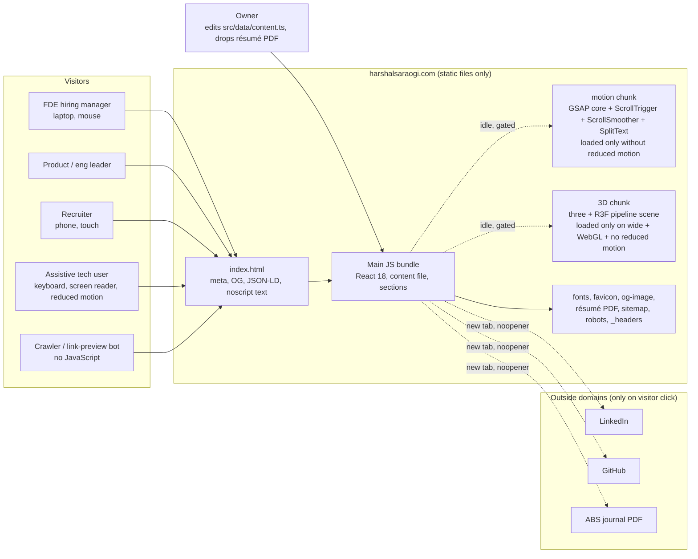
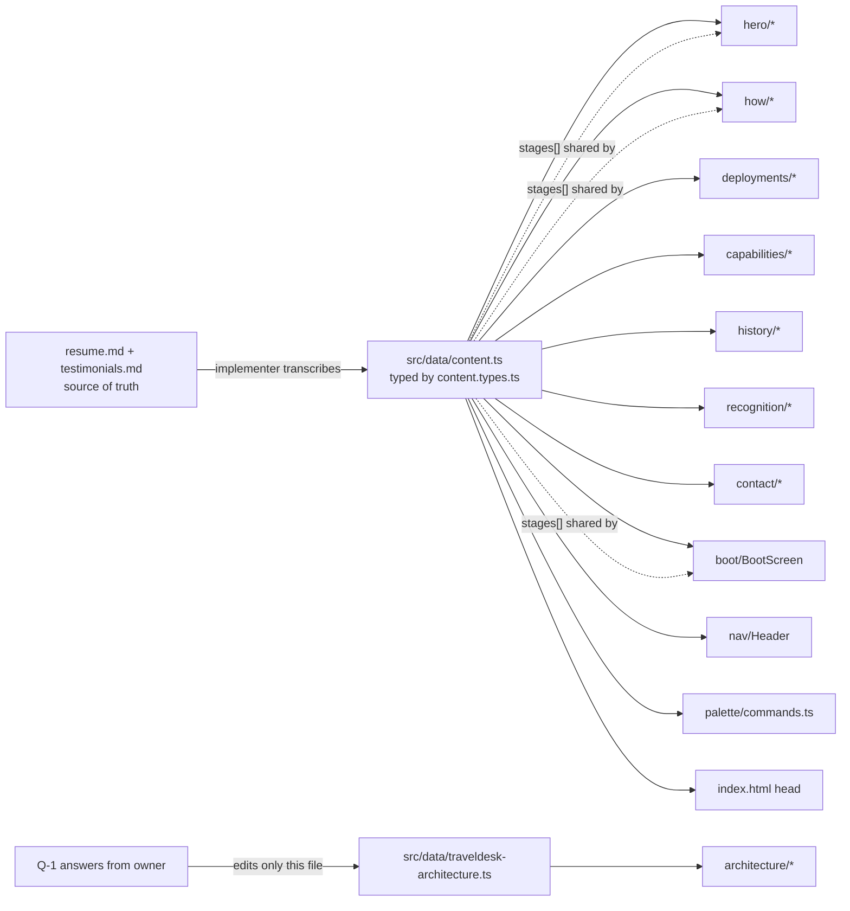
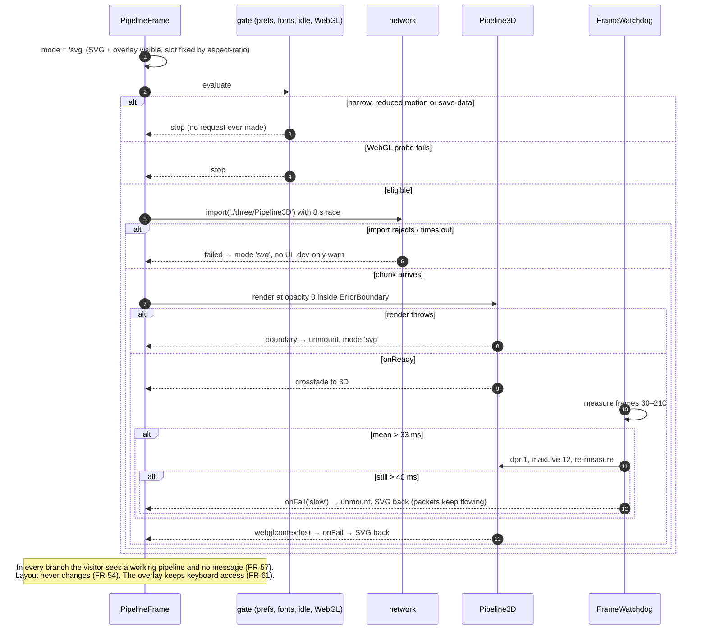

# Architecture and design system — harshalsaraogi.com "Mission Control"

| | |
|---|---|
| Author | architect |
| Date | 2026-10-25 |
| Status | Draft for owner gate (reviewed together with `.sdlc/00-prd.md`) |
| Inputs | `.sdlc/00-prd.md` (FR-1..143, NFR-1..34), `.sdlc/00-inputs/*`, existing `src/` |
| ADRs | `.sdlc/01-adr/ADR-001` … `ADR-008` |

This document is written so that an implementer can build the whole site, including pixel decisions, without asking a question. Where the PRD leaves a choice open, the choice is made here and marked **(architect decision)**. Where a fact is not in the résumé, it is marked **PROPOSED** and must not ship without owner confirmation.

## 0. Measured facts this design rests on

Everything below was measured on 2026-10-25 against the versions installed in this repo (`three 0.168.0`, `@react-three/fiber 8.18.0`, `gsap 3.14.2`, `react 18.3.1`, `vite 5.4`). Scratch builds used the project's own `node_modules`; sizes are gzip -9 of minified output.

| What | gzip | Note |
|---|---|---|
| React + ReactDOM (createRoot, one component) | 45.3 kB | Floor of the main bundle |
| React + GSAP core + ScrollTrigger + ScrollSmoother + SplitText | 98.3 kB | GSAP stack costs 53 kB; ScrollSmoother alone ~4.8 kB |
| React + three + R3F, minimal pipeline-like scene (ring nodes, line edges, instanced spheres) | 262.4 kB | 3D chunk ≈ **217 kB** above React |
| React + plain three, same scene imperative | 162.3 kB | 3D chunk ≈ **117 kB** above React. R3F's `extend(THREE)` defeats tree-shaking of three; that is the 100 kB gap |
| R3F + drei (`Line`, `Html` only) | 270.5 kB | drei adds ~8 kB for those two; neither is needed (see §C) |
| Geist variable, latin subset (fontsource 5.3.0) | 29.4 kB | woff2 file size, not gzip |
| Geist Mono variable, latin subset (fontsource 5.3.0) | 23.1 kB | woff2 |
| Geist / Geist Mono full-charset variable (Vercel `geist` 1.8.2) | 69.6 / 71.1 kB | Rejected: 2.7× the bytes for glyphs the site never uses |
| Current `dist/` (before revamp) | 57 MB | 39 MB unused images, 9.3 MB models |

Other facts checked: GSAP 3.14 ships its own `split-text.d.ts` (the shim `src/types/gsap-splittext.d.ts` is deleted). ScrollSmoother listens to `focusin` and centres any off-screen focused element, with an `onFocusIn` hook (`ScrollSmoother.js` lines 191–200, 945). `public/Harshal_Saraogi_Resume.pdf` was replaced today at 15:07 local (394 kB, October 2026 version). Owner decision (HANDOFF 2026-10-25T09:51Z): the PDF ships exactly as supplied and is **excluded** from the confidentiality search; FR-131..135 apply to site copy, source and build output only.

Budget forecast from these numbers:

| Budget | Target | Forecast | Margin |
|---|---|---|---|
| NFR-5 JS before 3D | ≤ 300 kB gz | React 45 + GSAP 53 (deferred, motion only) + app code ~35 + content ~10 = **~145 kB** | 2× |
| NFR-6 3D chunk | ≤ 400 kB gz | three + R3F + scene code = **~225 kB** | 1.8× |
| NFR-8 narrow first load | ≤ 1 MB | HTML 6 + CSS ~18 + JS ~95–150 + fonts 52 + icons ~2 = **~175–230 kB** | 4× |
| FR-141 built folder | < 5 MB | JS ~1.2 MB raw + PDF 0.4 MB + fonts 0.05 + OG image ≤0.3 = **~2 MB** | 2.5× |

## 1. Context



No server, no API, no analytics, no third-party request during load (NFR-27..29). The only persisted state is one `sessionStorage` flag (NFR-30).

## A. Component map

### A.1 File tree (everything under `src/` is new unless marked *kept*)

```
index.html                         full SEO head, CSP meta, font preloads, noscript text version (FR-119..129)
public/
  fonts/geist-latin-wght-normal.woff2            (vendored, see ADR-004)
  fonts/geist-mono-latin-wght-normal.woff2
  fonts/OFL.txt
  favicon.svg  apple-touch-icon.png  og-image.png
  Harshal_Saraogi_Resume.pdf        (owner-supplied, October 2026)
  robots.txt  sitemap.xml  _headers  404.html
scripts/
  check-budgets.mjs                 gzip budgets for NFR-5/6/8, FR-141; fails the build when exceeded
  check-confidential.sh             grep of src/ and dist/ for the forbidden strings (FR-131, FR-133); the résumé PDF is excluded by owner decision
  write-sitemap.mjs                 writes public/sitemap.xml with today's date (FR-125)
  lighthouse.sh                     builds, previews, runs Lighthouse mobile (NFR-11)
src/
  main.tsx                          createRoot; imports styles/index.css
  App.tsx                           PrefsProvider > UiProvider > [BootScreen | Shell]; hash landing after boot (FR-2)
  config.ts                         ANCHORS, BREAKPOINTS, BUDGET constants, timing constants; nothing else
  app/
    Shell.tsx                       SkipLink, Header, <main id="main"> inside #smooth-wrapper/#smooth-content, Footer, CommandPalette, Toast, Cursor
    providers/PrefsProvider.tsx     reducedMotion, pointerFine, isWide (>=768), isDesktop (>=1024), hidden-tab; all via matchMedia / visibilitychange
    providers/UiProvider.tsx        paletteOpen, activeSection, selectedStage, hoveredStage, toast
  lib/
    scroll.ts                       THE scroll seam: scrollToAnchor(), lockScroll(), attachSmoother() (ADR-002)
    motion.ts                       dynamic-import entry: registers GSAP plugins, creates smoother, binds reveals, timeline draw (ADR-007)
    reveal.ts                       [data-reveal] contract; never hides text before GSAP is present (FR-7)
    visibility.ts                   useOffscreenPause(): IntersectionObserver + document.hidden → data-paused (NFR-10)
    session.ts                      hasBooted()/markBooted() — the single sessionStorage key "hs.boot" (FR-20, NFR-30)
    clipboard.ts                    copyText(): Promise<'copied'|'blocked'> (FR-39, FR-40)
    platform.ts                     isApplePlatform() for the ⌘/Ctrl label
    webgl.ts                        supportsWebGL(): probes a throwaway canvas once, caches result
    pipelineLayout.ts               the ONE geometry source for the hero pipeline, horizontal + vertical variants (FR-54)
    archLayout.ts                   coordinates for the architecture diagram from the data model (FR-80..82)
  data/
    content.types.ts                every type the content file uses
    content.ts                      THE content file (FR-3); rebuilt from resume.md only (FR-142)
    traveldesk-architecture.ts      diagram data model; status: 'proposed' until owner confirms (Q-1, ADR-005)
  components/
    boot/BootScreen.tsx + .css      FR-15..23
    nav/SkipLink.tsx                FR-26
    nav/Header.tsx + .css           FR-24, 25, 27, 28, 33
    nav/MobileMenu.tsx              FR-29, 30, 31
    palette/CommandPalette.tsx + .css   FR-32, 35..38, 43..45
    palette/commands.ts             FR-34, 39..42 (command list built from content)
    hero/Hero.tsx + .css            FR-46..50, 53
    hero/StatusStrip.tsx            FR-49
    hero/PipelineFrame.tsx          the slot both renderers share; gate + crossfade + failure handling (FR-51, 54..57, NFR-7)
    hero/PipelineOverlay.tsx        DOM labels, buttons, tooltip, SR list — the single interaction layer (FR-58..62, ADR-006)
    hero/PipelineSvg.tsx            drawn pipeline, CSS offset-path packets (FR-55, 56)
    hero/three/Pipeline3D.tsx       LAZY CHUNK entry: <Canvas> + scene (FR-51, 52)
    hero/three/Scene.tsx            group with cursor tilt, projects node positions to CSS vars
    hero/three/StageNodes.tsx       ring + disc + glow per stage
    hero/three/Edges.tsx            tube geometry edges + additive glow tubes
    hero/three/Packets.tsx          InstancedMesh packets driven by packetSim
    hero/three/packetSim.ts         framework-free packet simulation (spawn, travel, dwell, recycle)
    hero/three/FrameWatchdog.ts     degrades dpr/packets, then bails to SVG on weak GPUs (A-2)
    how/HowIWork.tsx + .css         FR-63, 64, 68
    how/Stepper.tsx                 tabs on wide, list on narrow (FR-65..67, 69)
    how/StagePanel.tsx
    deployments/Deployments.tsx + .css   FR-70, 76, 77
    deployments/DeploymentCard.tsx       FR-71..75, 78, 79
    architecture/Architecture.tsx + .css FR-80..83, 91
    architecture/ArchDiagram.tsx         SVG boxes + edges, highlight/dim (FR-84, 87, 90)
    architecture/ArchNodeList.tsx        grouped <ol> of <button>s; positioned over the SVG on wide, stacked on narrow (FR-85, 86, 88, 89)
    capabilities/Capabilities.tsx + .css FR-92..96
    history/History.tsx + .css           FR-97, 98, 101, 102
    history/TimelineEntry.tsx
    history/Education.tsx                FR-99, 100
    recognition/Recognition.tsx + .css   FR-103, 109
    recognition/QuoteCard.tsx            FR-104..108, 110
    contact/Contact.tsx + .css           FR-111..115, 117, 118
    contact/Footer.tsx                   FR-116
    ui/Section.tsx                 <section id aria-labelledby> + offscreen pause + reveal hooks (FR-2, NFR-10, NFR-17)
    ui/SectionHeading.tsx          mono eyebrow "NN / NAME" + h2 + optional lead
    ui/Button.tsx                  primary / secondary / link / icon variants
    ui/StatusBadge.tsx             FR-72, 73
    ui/Chip.tsx                    stack chips
    ui/LiveDot.tsx                 amber or cyan dot, pulse only when live and motion allowed (FR-79, 118, NFR-10)
    ui/ExternalLink.tsx            target=_blank + rel="noopener noreferrer" always (NFR-31)
    ui/Icon.tsx                    6 inline SVG icons (arrow-right, arrow-up, external, copy, check, command)
    ui/Toast.tsx                   role="status" message (FR-39)
    ui/Cursor.tsx + .css           FR-9
    ui/ui.css                      shared component styles
  styles/
    index.css                      @import order: fonts, tokens, base, grid, utilities
    fonts.css                      @font-face ×2, font-display: swap, unicode-range latin
    tokens.css                     all custom properties (§B.1–B.4) + reduced-motion overrides
    base.css                       reset, html/body, headings, links, focus ring, sr-only, overflow-x: clip
    grid.css                       .container, .grid-12, schematic background
    utilities.css                  .mono-label, .mono-caption, .mono-metric, .lead, .corner-ticks, .visually-hidden
```

Deleted (FR-136..137 plus architect additions): `src/components/**` (all current files), `src/context/`, `src/data/portfolio.ts`, `src/data/boneData.ts`, `src/types/gsap-splittext.d.ts`, `src/App.css`, `src/assets/react.svg`, `src/*.glb`, `public/models/`, `public/draco/`, `public/images/` (entire folder; nothing is reused), `public/Akash_Malhotra.pdf`, `test.js`, `tsconfig.*.tsbuildinfo` (add to `.gitignore`).

### A.2 What is kept from the current code, and how

| Kept pattern | Where it lives now | Where it goes | Change |
|---|---|---|---|
| `#smooth-wrapper` / `#smooth-content` ScrollSmoother structure | `MainContainer.tsx`, `Navbar.tsx` | `app/Shell.tsx` markup; creation moves to `lib/motion.ts` via `lib/scroll.ts` | Gated (wide + fine pointer + no reduced motion). `smooth: 0.8` not 1.7. `effects: false`. Header, cursor, palette, boot stay outside the wrapper |
| SplitText `.para`/`.title` reveal | `utils/splitText.ts` | `lib/reveal.ts` + `lib/motion.ts` | Becomes `[data-reveal="lines"]` / `[data-reveal="block"]`. Only `lines` type (no per-char), 400 ms, once. Never sets a hidden state before GSAP has loaded (FR-7). Resize handling kept |
| Custom cursor | `Cursor.tsx` | `ui/Cursor.tsx` | Reticle instead of blob; `pointer: fine` and no reduced motion only; system cursor never hidden |
| Single content file | `data/portfolio.ts` | `data/content.ts` + `content.types.ts` | Rebuilt from `resume.md` only; typed; old numbers gone |
| Per-section CSS file | `components/styles/*.css` | co-located `components/<section>/<Section>.css` | Same convention, moved next to its component (ADR-003) |
| Lazy loading with `React.lazy` + `Suspense` | `App.tsx` | `hero/PipelineFrame.tsx` | Gate before import, not after |

### A.3 Lazy chunks

| Chunk | Contents | When it loads | Size (gz, forecast) |
|---|---|---|---|
| entry (`index-*.js`) | React, providers, all sections, content, palette, boot, SVG pipeline, architecture diagram | Immediately | ~95 kB |
| `vendor-react` | react, react-dom (split for cache stability across deploys) | With entry (modulepreload) | 45 kB (counted above) |
| `motion` | gsap, ScrollTrigger, ScrollSmoother, SplitText, `lib/motion.ts` | `import()` from `App` after first paint, only if `!reducedMotion` | ~55 kB |
| `three` | three + @react-three/fiber + `hero/three/*` | `import()` from `PipelineFrame` after hero text paints, fonts ready, idle; only if wide + WebGL + !reducedMotion + !saveData | ~225 kB |

Nothing else is split. The sections are text; splitting them would add requests without saving meaningful bytes.

### A.4 Data flow from the content file



Rules:
1. Components import `content` from `src/data/content.ts` only. No component contains a visible string literal; ARIA strings are composed from content values plus fixed glue words (e.g. `${stage.name}, stage ${i + 1} of 7`). Review checks this.
2. `index.html` is static; its title, description, OG and JSON-LD values are copied from the PRD "Search" table. The build does not inject them (FR-127 requires them in the served HTML; a static copy is the simplest way to guarantee it). A comment in `content.ts` names `index.html` as the second place to update for `meta.*` fields.
3. The seven pipeline stages live once (`content.stages`) and feed the boot log, the hero graph, the stepper and the palette hints (A-7).
4. The architecture diagram reads `traveldesk-architecture.ts` only. Adding or renaming a service or edge there changes the diagram with no code change (FR-3; verified by the layout being computed, §D.2).

Interface stubs the implementer must follow (types only; no logic):

```ts
// src/data/content.types.ts
export type AnchorId = 'top' | 'how-i-work' | 'deployments' | 'architecture' | 'capabilities' | 'history' | 'recognition' | 'contact';
export type DeploymentStatus = 'UAT' | 'In development' | 'Prototype delivered' | 'Scoping';

export interface Stage {           // 7 entries, pipeline order (A-7)
  id: string;                      // 'research' | 'prd' | 'ux' | 'prototype' | 'jira' | 'qa' | 'deploy'
  name: string;                    // "Jira and Confluence"
  shortLabel: string;              // "JIRA /\nCONFLUENCE" — graph label, \n allowed, ≤ 11 chars per line
  what: string;                    // "What happens" column
  artifact: string;                // "The real artifact shown" column, verbatim from the PRD
  numbers: Array<{ value: string; label: string }>;   // [] allowed
}
export interface Metric { value: string; label: string }
export interface Deployment {
  id: string; name: string; description: string; status: DeploymentStatus;
  stack: string[]; metrics: Metric[]; details: string[];
  architectureAnchor?: AnchorId;   // TravelDesk only (FR-78)
}
export interface Capability { id: string; name: string; skills: string[]; proof: string; proofAnchor: AnchorId }
export interface Role { title: string; from: string; to: string }
export interface Employer {
  company: string; location: string; roles: Role[]; promotedIn?: string;   // "9 months" → marker (FR-98)
  highlights: string[];
}
export interface Quote {
  id: string; author: string; title?: string; company: string; context: string;
  pull?: string; full?: string; bullets?: string[]; closing?: string;     // ITC uses pull+full; Ekart uses bullets+closing
}
export interface StatusItem { label: string; value: string; live: boolean }
export interface BootLine { tag: 'boot' | 'ok' | 'run'; key?: string; value: string }
export interface Content {
  meta: { name: string; initials: string; title: string; email: string; phone: string; phoneHref: string; location: string;
          linkedin: string; github: string; resumePath: string; resumeFileName: string; siteUrl: string };
  hero: { eyebrow: string; headline: string; subline: string; status: StatusItem[]; primaryCta: string; secondaryCta: string };
  boot: { lines: BootLine[]; skipLabel: string; anyKeyHint: string };
  nav: Array<{ id: AnchorId; label: string }>;                 // 7 entries after the hero, in page order
  stages: Stage[];
  how: { heading: string; tools: string[] };
  deployments: Deployment[];
  architecture: { heading: string; facts: Array<{ label: string; value: string }>; proposedBanner: string };
  capabilities: Capability[];
  history: { employers: Employer[]; education: { degrees: string[]; certifications: string[];
             publication: { title: string; journal: string; href: string } } };
  recognition: Quote[];
  contact: { badge: string; heading: string; lead?: string; download: string; copyLabel: string; copiedMessage: string;
             writeEmailLabel: string };
  palette: { placeholder: string; empty: string; groups: { navigate: string; actions: string } };
  footer: { backToTop: string };
}
```

```ts
// src/data/traveldesk-architecture.ts — shape only; values in §D.1
export type ArchKind = 'frontend' | 'gateway' | 'domain' | 'integration' | 'integration-phase2';
export type ArchGroupId = 'frontend' | 'gateway' | 'domain' | 'integrations';
export interface ArchNode { id: string; label: string; role: string; kind: ArchKind; group: ArchGroupId; derivedFrom: string }
export interface ArchEdge { from: string; to: string; kind: 'call' | 'event' | 'phase2'; label?: string }
export interface ArchModel {
  status: 'proposed' | 'confirmed';   // 'proposed' renders the banner; launch check requires 'confirmed'
  groups: Array<{ id: ArchGroupId; label: string }>;
  nodes: ArchNode[]; edges: ArchEdge[];
}
```

### A.5 Requirement ownership (every FR and NFR)

Owner = the file whose change would be needed if the requirement changed. Secondary files in brackets.

| ID | Owner | Note |
|---|---|---|
| FR-1 | `app/Shell.tsx` | Section order is the JSX order |
| FR-2 | `ui/Section.tsx` [`App.tsx` hash landing, `config.ts` ANCHORS] | `id` per section; `location.hash` handled after boot |
| FR-3 | `data/content.ts` | Rule A.4.1 |
| FR-4 | `styles/base.css` (`overflow-x: clip` on `html, body, #smooth-content`) [every `*.css`] | Verified by the 360 walk-through |
| FR-5 | `styles/tokens.css` type scale | Body 16, mono-label 12 at 360 |
| FR-6 | `providers/PrefsProvider.tsx` + `tokens.css` reduced-motion block [`lib/motion.ts` not loaded] | Structural: motion chunk never loads |
| FR-7 | `lib/reveal.ts` | No CSS hidden state; GSAP sets `from` only when it runs |
| FR-8 | `lib/scroll.ts` | Gate `isDesktopPointer && !reducedMotion` |
| FR-9 | `ui/Cursor.tsx` | Mounts only if `pointerFine && !reducedMotion` |
| FR-10 | `styles/tokens.css` (`--cyan-*` names) + §B.1 usage rules | Enforced by review |
| FR-11 | `styles/tokens.css` (`--amber-*`) + §B.1 rules | Enforced by review |
| FR-12 | `styles/tokens.css` `--g-0: #0B0C0E` | |
| FR-13 | `styles/fonts.css`, `utilities.css` (`.mono-*`) | |
| FR-14 | §B.5 motion system [`lib/motion.ts`, all CSS animations] | Enforced by the "what never moves" list |
| FR-15 | `boot/BootScreen.tsx` | |
| FR-16 | `boot/BootScreen.tsx` (`config.ts` BOOT_TOTAL_MS = 1700) | Independent of any chunk |
| FR-17 | `boot/BootScreen.tsx` | keydown, pointerdown on window |
| FR-18 | `boot/BootScreen.tsx` | Skip button autofocused on mount |
| FR-19 | `data/content.ts` `boot.lines` | |
| FR-20 | `lib/session.ts` | key `hs.boot` |
| FR-21 | `App.tsx` (`reducedMotion ? <Shell/> : boot gate`) | |
| FR-22 | `boot/BootScreen.css` | flex rows, 44 px button |
| FR-23 | `App.tsx` `#top` sentinel focus | |
| FR-24 | `nav/Header.tsx` + `.css` (`position: fixed`) | Outside `#smooth-wrapper` |
| FR-25 | `nav/Header.tsx` (`content.nav`) | |
| FR-26 | `nav/SkipLink.tsx` | First in DOM after `#top` sentinel |
| FR-27 | `providers/UiProvider.tsx` activeSection (IO) → `Header.tsx` `aria-current="location"` | |
| FR-28 | `lib/scroll.ts` `scrollToAnchor(id, { focus: true })` | Heading gets `tabindex="-1"` |
| FR-29 | `nav/MobileMenu.tsx`, `Header.css` (height 56) | |
| FR-30 | `nav/MobileMenu.tsx` | focus trap + return |
| FR-31 | `lib/scroll.ts` instant path, `tokens.css` RM block | |
| FR-32 | `palette/CommandPalette.tsx` global keydown | |
| FR-33 | `nav/Header.tsx` palette button | |
| FR-34 | `palette/commands.ts` | 11 commands from content |
| FR-35 | `palette/CommandPalette.tsx` | case-insensitive `includes` |
| FR-36 | `palette/CommandPalette.tsx` | roving `aria-activedescendant` |
| FR-37 | `palette/CommandPalette.tsx` | stores `document.activeElement` on open |
| FR-38 | `palette/CommandPalette.tsx` + `lib/scroll.ts lockScroll` | `role="dialog" aria-modal` |
| FR-39 | `palette/commands.ts` + `lib/clipboard.ts` + `ui/Toast.tsx` | |
| FR-40 | `palette/CommandPalette.tsx` fallback row | |
| FR-41 | `palette/commands.ts` (`<a download>`) [`content.meta.resumePath`] | |
| FR-42 | `palette/commands.ts` + `ui/ExternalLink.tsx` | |
| FR-43 | `palette/commands.ts` → `lib/scroll.ts` | Same function as nav |
| FR-44 | `palette/CommandPalette.css` | rows 44 px |
| FR-45 | `tokens.css` RM block (`--d-*: 0ms`) | |
| FR-46 | `hero/Hero.tsx` | DOM order fixed |
| FR-47 | `hero/Hero.tsx` (`<h1>`) [`boot/BootScreen.tsx` uses `<p>` for its headline echo] | |
| FR-48 | `hero/Hero.tsx` | |
| FR-49 | `hero/StatusStrip.tsx` (`content.hero.status`) | |
| FR-50 | `hero/Hero.css` (compact phone layout, §B.7.1) | |
| FR-51 | `hero/three/Pipeline3D.tsx` [`lib/pipelineLayout.ts`] | |
| FR-52 | `hero/three/Packets.tsx` + `packetSim.ts` | |
| FR-53 | `hero/PipelineFrame.tsx` (import after `fonts.ready` + idle) | |
| FR-54 | `hero/PipelineFrame.tsx` (shared slot, `grid-area: 1/1`) + `lib/pipelineLayout.ts` | |
| FR-55 | `hero/PipelineSvg.tsx` (vertical layout, CSS offset-path packets) | |
| FR-56 | `hero/PipelineSvg.tsx` + `tokens.css` RM block | |
| FR-57 | `hero/PipelineFrame.tsx` (ErrorBoundary, timeout, contextlost) | |
| FR-58 | `hero/PipelineOverlay.tsx` | Labels are DOM in both modes |
| FR-59 | `hero/PipelineOverlay.tsx` tooltip | |
| FR-60 | `hero/PipelineOverlay.tsx` → `UiProvider.selectedStage` + `lib/scroll.ts` | |
| FR-61 | `hero/PipelineOverlay.tsx` (`<button>` ×7 in order) | |
| FR-62 | `hero/PipelineOverlay.tsx` (`<ol aria-label>`), canvas/svg `aria-hidden` | |
| FR-63 | `how/Stepper.tsx` | |
| FR-64 | `how/StagePanel.tsx` (`content.stages`) | |
| FR-65 | `how/Stepper.tsx` (default index 0) | |
| FR-66 | `how/Stepper.tsx` (tablist pattern) | |
| FR-67 | `how/Stepper.tsx` narrow mode (`<ol>`) | |
| FR-68 | `how/HowIWork.tsx` (`content.how.tools`) | |
| FR-69 | `how/StagePanel.css` + RM block | |
| FR-70 | `deployments/Deployments.tsx` | |
| FR-71 | `deployments/DeploymentCard.tsx` | |
| FR-72 | `ui/StatusBadge.tsx` (type `DeploymentStatus`) | |
| FR-73 | `ui/StatusBadge.tsx` + `ui/LiveDot.tsx` | |
| FR-74 | `deployments/DeploymentCard.tsx` (`aria-expanded`) | |
| FR-75 | `deployments/DeploymentCard.tsx` (local state per card) | |
| FR-76 | `deployments/Deployments.css` (grid, no overflow-x) | |
| FR-77 | `deployments/Deployments.css` | |
| FR-78 | `deployments/DeploymentCard.tsx` (`architectureAnchor`) | |
| FR-79 | `tokens.css` RM block | |
| FR-80 | `data/traveldesk-architecture.ts` + `architecture/ArchDiagram.tsx` | count asserted in a unit test |
| FR-81 | `data/traveldesk-architecture.ts` | |
| FR-82 | `data/traveldesk-architecture.ts` (`kind: 'integration-phase2'`) + `ArchDiagram.css` dashed | |
| FR-83 | `data/traveldesk-architecture.ts` (`label: 'Enterprise HRIS'`) + `scripts/check-confidential.sh` | |
| FR-84 | `architecture/ArchDiagram.tsx` highlight state | |
| FR-85 | `architecture/ArchNodeList.tsx` caption | |
| FR-86 | `architecture/ArchNodeList.tsx` (DOM order = group order) | |
| FR-87 | `architecture/ArchNodeList.tsx` click toggle + `ArchDiagram.tsx` background tap | |
| FR-88 | `architecture/ArchNodeList.tsx` narrow mode | |
| FR-89 | `architecture/ArchNodeList.tsx` (same DOM on every width) | |
| FR-90 | `tokens.css` RM block, `ArchDiagram.css` | |
| FR-91 | `architecture/Architecture.tsx` (`content.architecture.facts`) | |
| FR-92 | `capabilities/Capabilities.tsx` | |
| FR-93 | `data/content.ts` `capabilities[].skills` | |
| FR-94 | `capabilities/Capabilities.tsx` proof link | |
| FR-95 | `capabilities/Capabilities.css` | |
| FR-96 | `lib/reveal.ts` + RM block | |
| FR-97 | `history/History.tsx`, `TimelineEntry.tsx` | |
| FR-98 | `history/TimelineEntry.tsx` (`promotedIn`) | |
| FR-99 | `history/Education.tsx` | |
| FR-100 | `history/Education.tsx` via `ui/ExternalLink.tsx` | |
| FR-101 | `history/History.css` | |
| FR-102 | `lib/motion.ts` timeline draw + RM block | |
| FR-103 | `recognition/Recognition.tsx` | |
| FR-104 | `recognition/QuoteCard.tsx` | |
| FR-105 | `data/content.ts` `recognition[]` | Verbatim; review against testimonials.md |
| FR-106 | `recognition/QuoteCard.tsx` (`pull` + `full` disclosure) | |
| FR-107 | `recognition/QuoteCard.tsx` (`bullets` + `closing`) | |
| FR-108 | `data/content.ts` (no such fields exist) + review | |
| FR-109 | `recognition/Recognition.css` | |
| FR-110 | `recognition/QuoteCard.tsx` (`<figure><blockquote><figcaption>`) | |
| FR-111 | `contact/Contact.tsx` + `ui/StatusBadge.tsx` live variant | |
| FR-112 | `contact/Contact.tsx` + `lib/clipboard.ts` | |
| FR-113 | `contact/Contact.tsx` + `ui/ExternalLink.tsx` | |
| FR-114 | `contact/Contact.tsx` | A-1 |
| FR-115 | `contact/Contact.tsx` (same anchor element as FR-41) | |
| FR-116 | `contact/Footer.tsx` | year from `new Date()` at render; fine for a static site |
| FR-117 | `contact/Contact.css` | |
| FR-118 | `tokens.css` RM block | |
| FR-119 | `index.html` | |
| FR-120 | `index.html` | |
| FR-121 | `index.html` | |
| FR-122 | `index.html` + `public/og-image.png` (§F.4) | |
| FR-123 | `index.html` | |
| FR-124 | `index.html` JSON-LD | |
| FR-125 | `scripts/write-sitemap.mjs` → `public/sitemap.xml` (runs in `prebuild`) | |
| FR-126 | `public/robots.txt` | |
| FR-127 | `index.html` (static, not injected) | |
| FR-128 | `index.html` `<noscript>` | |
| FR-129 | `public/favicon.svg`, `apple-touch-icon.png`, `index.html` theme-color | |
| FR-130 | `README.md` rewrite + `scripts/check-confidential.sh` (also greps the old host name) | |
| FR-131 | `scripts/check-confidential.sh` [content.ts, index.html, dist/] | Searches source and build output; `public/Harshal_Saraogi_Resume.pdf` is excluded (owner decision 09:51Z) |
| FR-132 | `data/content.ts` (HRMS card, stage 1 artifact) | |
| FR-133 | `data/content.ts` + `scripts/check-confidential.sh` | |
| FR-134 | `data/content.ts` (Hippo highlight only) | |
| FR-135 | `data/content.ts` `meta.email`, `meta.phone` | |
| FR-136 | Implementer clean-up step (§F.2) | |
| FR-137 | Implementer clean-up step (§F.2) | |
| FR-138 | Implementer clean-up step (§F.2): delete the whole folder | |
| FR-139 | `package.json` (§G.2) | |
| FR-140 | `package.json` (§G.2) | |
| FR-141 | `scripts/check-budgets.mjs` | |
| FR-142 | `data/content.ts` | |
| FR-143 | **Owner** (file in `public/`) | Outside the codebase. Resolved 09:37Z: the October 2026 PDF is in place and ships as supplied; it is not scanned |
| NFR-1 | `index.html` (small critical path) + `vite.config.ts` + ADR-008 | |
| NFR-2 | ADR-008 (boot prints the headline) + `scripts/lighthouse.sh` | Risk R-1 |
| NFR-3 | `hero/PipelineFrame.tsx` fixed aspect slot, `fonts.css` size-adjust fallback, `Header.css` fixed height | |
| NFR-4 | `vite.config.ts` chunking + deferred `motion`/`three` imports | |
| NFR-5 | `vite.config.ts` manualChunks + `scripts/check-budgets.mjs` | |
| NFR-6 | same | |
| NFR-7 | `hero/PipelineFrame.tsx` gate | |
| NFR-8 | `scripts/check-budgets.mjs` (sums entry + css + fonts + icons) | |
| NFR-9 | `styles/fonts.css` + `public/fonts/` + preload in `index.html` | |
| NFR-10 | `lib/visibility.ts` + `ui/Section.tsx` + `PipelineFrame.tsx` frameloop | |
| NFR-11 | `scripts/lighthouse.sh` | Run on the live URL at launch |
| NFR-12 | all components; checked by QA with axe + manual | |
| NFR-13 | `styles/tokens.css` (§B.1 ratios) | |
| NFR-14 | `styles/tokens.css` `--border-control`, `--focus` | |
| NFR-15 | `ui/Button.tsx`, `PipelineOverlay.tsx`, `ArchNodeList.tsx`, `CommandPalette.tsx` | |
| NFR-16 | `styles/base.css` `:focus-visible` rule; no `outline: none` anywhere | |
| NFR-17 | `app/Shell.tsx` landmarks + `ui/SectionHeading.tsx` (h2) | |
| NFR-18 | `providers/PrefsProvider.tsx` + `tokens.css` RM block | |
| NFR-19 | fluid layout (`clamp`, no fixed heights on text containers) in every CSS | |
| NFR-20 | `tokens.css` `--tap: 44px` used by Button, nav, palette, overlay, node list | |
| NFR-21 | `index.html lang="en"`, `aria-hidden` on svg/canvas, `aria-label` on overlay lists | |
| NFR-22 | §B.5: pulses at 0.6 Hz, no strobing | |
| NFR-23 | `index.html` JSON-LD | |
| NFR-24 | **Host configuration** (§F.5) + `public/404.html` | Outside the codebase (A-8) |
| NFR-25 | `vite.config.ts` `build.target: ['es2020', 'safari14']` + feature detection | |
| NFR-26 | Progressive enhancement rules in §E.6 | |
| NFR-27 | Whole design | |
| NFR-28 | `scripts/check-confidential.sh` also greps for `key=`, `token`, `analytics` | |
| NFR-29 | `fonts.css` self-host + CSP `connect-src 'self'` | |
| NFR-30 | `lib/session.ts` | |
| NFR-31 | `ui/ExternalLink.tsx` (only way to render `target="_blank"`) | |
| NFR-32 | `public/_headers` + `index.html` CSP meta (§F.5) | Headers need host support |
| NFR-33 | `package.json` scripts, `eslint.config.js` | |
| NFR-34 | `package.json` `build` | |

No requirement is without an owner. Two are owned outside the codebase and are called out for the owner: FR-143 (the PDF's content) and NFR-24 (404 status, host feature).

## B. Design system

The site is an operator's console. Everything that follows serves three rules: **cyan is structure, amber is work happening, graphite is the room.** Mono type is for anything a console would print (labels, status, metrics, captions); Geist is for anything a human wrote.

### B.1 Colour tokens (`src/styles/tokens.css`)

All ratios are WCAG 2.x contrast ratios computed from the hex values below (script in the scratchpad; recompute with any contrast checker).

```css
:root {
  /* Graphite base ramp — neutral, slightly cool, never blue */
  --g-0: #0B0C0E;   /* page background                              */
  --g-1: #121417;   /* cards, panels, boot screen, palette          */
  --g-2: #191C20;   /* raised: card hover, palette highlighted row  */
  --g-3: #22262B;   /* inset: chip background, neutral badge        */
  --g-4: #2C3137;   /* strong hairline, divider on raised surfaces  */

  /* Text ramp */
  --t-1: #ECEEF0;   /* headings, emphasised body, quote text        */
  --t-2: #A9B0B8;   /* body paragraphs, descriptions                */
  --t-3: #8A929C;   /* mono captions, eyebrows, hints               */

  /* Cyan — structure: lines, edges, borders, diagrams, data, controls */
  --cyan-400: #67E8F9;  /* cyan as TEXT (links, "[ ok ]", chip text) */
  --cyan-500: #22D3EE;  /* lines, edges, node strokes, primary button fill, focus ring base */
  --cyan-600: #0891B2;  /* control borders, subdued strokes, quote mark */

  /* Amber — agent activity ONLY: live badges, live dots, packets, "[ run]" */
  --amber-400: #FBBF24; /* amber as TEXT */
  --amber-500: #F59E0B; /* packets, live dots, badge border */
  --amber-600: #D97706; /* packet trail / dim */

  /* Lines and fills (alpha, for decoration only — no contrast requirement) */
  --line-1: rgba(255, 255, 255, 0.08);     /* hairline card borders, dividers */
  --line-2: rgba(34, 211, 238, 0.25);      /* cyan structural lines: rails, spines, frames, chip borders */
  --line-3: rgba(34, 211, 238, 0.45);      /* cyan line, highlighted / hover state */
  --fill-cyan: rgba(34, 211, 238, 0.10);   /* chip background, secondary button hover */
  --fill-amber: rgba(245, 158, 11, 0.14);  /* live badge background */
  --grid-minor: rgba(255, 255, 255, 0.035);
  --grid-major: rgba(255, 255, 255, 0.06);

  /* Semantic aliases — components use these, not the ramp names */
  --bg: var(--g-0);
  --surface: var(--g-1);
  --surface-raised: var(--g-2);
  --surface-inset: var(--g-3);
  --border-control: var(--cyan-600);   /* 1px borders on buttons/inputs — 4.64:1 on --g-2, meets the 3:1 UI rule */
  --focus: var(--cyan-400);            /* focus ring; 13.5:1 on page, 11.8:1 on cards */
  --link: var(--cyan-400);
}
```

Verified contrast (foreground on background):

| Pair | Ratio | Used for | Requirement |
|---|---|---|---|
| `--t-1` on `--g-0` / `--g-1` / `--g-2` / `--g-3` | 16.8 / 15.9 / 14.7 / 13.1 | headings, quote text | ≥ 4.5 ✓ |
| `--t-2` on `--g-0` / `--g-1` / `--g-2` / `--g-3` | 8.9 / 8.4 / 7.8 / 7.0 | body text | ≥ 4.5 ✓ |
| `--t-3` on `--g-0` / `--g-1` / `--g-2` / `--g-3` | 6.2 / 5.9 / 5.4 / 4.8 | mono captions, eyebrows (12–13 px, so the 4.5 rule applies, not the large-text rule) | ≥ 4.5 ✓ |
| `--cyan-400` on `--g-0` / `--g-2` | 13.5 / 11.8 | links, "[ ok ]", chip text | ≥ 4.5 ✓ |
| `--cyan-400` on chip fill (`--fill-cyan` over `--g-1` ≈ `#1A2E35`) | 9.8 | stack chips | ≥ 4.5 ✓ |
| `--amber-400` on `--g-0` / `--g-2` | 11.7 / 10.2 | "[ run]", badge text | ≥ 4.5 ✓ |
| `--amber-400` on live-badge fill (`--fill-amber` over `--g-1` ≈ `#382E1D`) | 8.0 | UAT / In development badges, "Open to" badge | ≥ 4.5 ✓ |
| `--g-0` on `--cyan-500` | 10.8 | primary button text | ≥ 4.5 ✓ |
| `--t-2` on `--g-3` | 7.0 | neutral badge text | ≥ 4.5 ✓ |
| `--cyan-600` (1 px) on `--g-1` / `--g-2` | 5.0 / 4.6 | control borders | ≥ 3 ✓ |
| `--cyan-500` strokes on `--g-1` | 10.2 | diagram node strokes, rails | ≥ 3 ✓ |
| `--amber-500` dot on `--g-2` | 8.0 | live dots (non-text UI) | ≥ 3 ✓ |
| `--focus` ring on `--g-0` (ring sits 2 px outside the control, over the page) | 13.5 | all focus rings | ≥ 3 ✓ |
| Dimmed diagram node text `--t-3` on `--g-2` | 5.4 | architecture diagram, non-neighbour nodes | ≥ 4.5 ✓ |

Rejected: a 45 %-alpha cyan border (2.96:1, fails the 3:1 control rule by a hair) — that is why control borders are solid `--cyan-600`. A text colour darker than `--t-3` (e.g. `#7F8792`, 4.19:1 on `--g-3`) fails on inset surfaces, so `--t-3` is the floor; never add a dimmer text token.

**Success / danger:** none. The boot log's "[ ok ]" is cyan (a finished structural fact) and "[ run]" is amber (work running). No error state exists in v1 (FR-57 forbids a 3D error message; the clipboard fallback is a different view, not an error). Do not add red; if a future requirement needs it, add `--danger: #F87171` (7.1:1 on `--g-0`).

**Where each accent may appear (FR-10, FR-11):**

| Element | Colour | Why |
|---|---|---|
| Pipeline edges, node rings, diagram boxes/edges, stepper rail, timeline spine, corner ticks, frames | cyan | structure |
| Links, proof lines, "[ ok ]", "See the architecture" | cyan-400 | structural reference |
| Primary button fill | cyan-500 | a control is structure the visitor operates |
| Packets (3D and SVG), live dots, "UAT"/"In development" badges, "Open to FDE roles" badge, "[ run]", status strip dots for DEPLOYED and PLATFORMS, the stage node currently receiving a packet | amber | work happening |
| Status strip TEAM dot, "Prototype delivered" dot | cyan | a fact, not running work |
| "Scoping" badge dot | hollow cyan-600 | not yet running |
| Promotion marker, hover states, selected stepper tab, active nav link, focus ring | cyan | visitor-facing structure; **never amber** |

### B.2 Typography

Fonts are self-hosted (ADR-004). Two variable files, latin subset only.

```css
/* src/styles/fonts.css */
@font-face {
  font-family: "Geist";
  src: url("/fonts/geist-latin-wght-normal.woff2") format("woff2");
  font-weight: 100 900; font-style: normal; font-display: swap;
  unicode-range: U+0000-00FF, U+0131, U+0152-0153, U+02BB-02BC, U+02C6, U+02DA, U+02DC, U+0304, U+0308, U+0329,
                 U+2000-206F, U+20AC, U+2122, U+2191, U+2193, U+2212, U+2215, U+FEFF, U+FFFD;
}
@font-face {
  font-family: "Geist Mono";
  src: url("/fonts/geist-mono-latin-wght-normal.woff2") format("woff2");
  font-weight: 100 900; font-style: normal; font-display: swap;
  unicode-range: /* same list */;
}
/* Metric-matched fallbacks so the swap does not shift layout (NFR-3) */
@font-face { font-family: "Geist Fallback"; src: local("Arial"); size-adjust: 104%; ascent-override: 92%; descent-override: 23%; line-gap-override: 0%; }
@font-face { font-family: "Geist Mono Fallback"; src: local("Menlo"), local("Consolas"), local("Courier New"); size-adjust: 100%; ascent-override: 92%; descent-override: 23%; line-gap-override: 0%; }
:root {
  --font-sans: "Geist", "Geist Fallback", system-ui, -apple-system, "Segoe UI", Arial, sans-serif;
  --font-mono: "Geist Mono", "Geist Mono Fallback", ui-monospace, Menlo, Consolas, monospace;
}
```

`index.html` preloads both files: `<link rel="preload" href="/fonts/geist-mono-latin-wght-normal.woff2" as="font" type="font/woff2" crossorigin>` (mono first: it paints the boot screen) and the same for Geist. Stable, unhashed paths under `public/fonts/` make the preload possible. No italics are loaded; the design uses none (quotes are upright).

**Glyph rule:** only characters inside the latin `unicode-range` may be typed as text. In scope: `· — – … “ ” ‘ ’ × ~ ± ↑ ↓ › é`. Out of scope and therefore drawn as SVG/CSS, never typed: `→ ● ▮ ⏎ ≥ ⌘`. The command key label renders as the text `CMD` on Apple platforms and `CTRL` elsewhere (`lib/platform.ts`); the boot cursor is a CSS block; arrows in buttons use `ui/Icon.tsx`.

**Type scale** (fluid; values at 360 px → 1280 px → 1600 px+):

| Role | Family / weight | Size | Line height | Letter spacing | Colour | Case |
|---|---|---|---|---|---|---|
| display (h1, boot headline echo) | Geist 600 | `clamp(2.25rem, 1.35rem + 4vw, 4.5rem)` = 36 → 58 → 72 px | 1.05 | −0.022em | t-1 | sentence |
| h2 (section) | Geist 600 | `clamp(1.75rem, 1.3rem + 2vw, 2.75rem)` = 28 → 40 → 44 px | 1.1 | −0.015em | t-1 | sentence |
| h3 (card title, stage name, role title) | Geist 600 | `clamp(1.25rem, 1.15rem + 0.4vw, 1.375rem)` = 20 → 22 px | 1.25 | −0.01em | t-1 | sentence |
| lead (hero sub-line, section lead) | Geist 400 | `clamp(1.0625rem, 1rem + 0.35vw, 1.25rem)` = 17 → 20 px | 1.5 | 0 | t-2 | |
| body | Geist 400 | `clamp(1rem, 0.95rem + 0.2vw, 1.0625rem)` = 16 → 17 px | 1.6 | 0 | t-2 (t-1 for `<strong>` and quote text) | |
| body-strong | Geist 500 | as body | 1.6 | 0 | t-1 | |
| mono-label | Geist Mono 500 | 0.75rem = 12 px (13 px ≥ 1280) | 1.2 | +0.08em | t-3 (t-1 when active) | UPPER |
| mono-caption | Geist Mono 400 | 0.8125rem = 13 px | 1.5 | +0.02em | t-3 | as written |
| mono-value (status strip values, metric labels) | Geist Mono 400 | 0.875rem = 14 px (15 ≥ 1280) | 1.5 | 0 | t-1 | as written |
| mono-metric (big numbers) | Geist Mono 500 | `clamp(1.5rem, 1.3rem + 1vw, 2rem)` = 24 → 32 px | 1.1 | −0.01em | t-1 | |
| mono-code (boot log) | Geist Mono 400 | 0.875rem = 14 px (15 ≥ 768) | 1.65 | 0 | t-2 | as written |
| button | Geist Mono 500 | 0.8125rem = 13 px | 1 | +0.06em | per variant | UPPER |
| nav link | Geist Mono 500 | 0.75rem = 12 px | 1 | +0.08em | t-2 / t-1 active | UPPER |

Weights loaded: the variable file covers 100–900; the design uses only 400, 500, 600. Never use 700+ (too heavy for Geist at display size on dark). Minimums at 360 px: body 16 px, mono-label 12 px (FR-5). Max line length: 64ch for body, 40ch for lead at display sizes (`max-width` on text columns).

### B.3 Spacing, radius, lines, grid, focus, elevation

```css
:root {
  --s-1: 4px;  --s-2: 8px;  --s-3: 12px; --s-4: 16px; --s-5: 24px;
  --s-6: 32px; --s-7: 48px; --s-8: 64px; --s-9: 96px; --s-10: 128px;
  --section-pad: var(--s-8);              /* 64 at 360; 96 at ≥768; 128 at ≥1280 */
  --gutter: 20px;                          /* 32 at ≥768; 48 at ≥1280 */
  --container: 1280px;
  --header-h: 56px;
  --tap: 44px;                             /* minimum interactive size on touch (NFR-20) */
  --r-1: 4px;  --r-2: 8px;  --r-3: 12px;  --r-pill: 999px;
  --hairline: 1px solid var(--line-1);
  --rule: 1px solid var(--line-2);
}
```

- **Container:** `.container { width: min(100% - 2 * var(--gutter), var(--container)); margin-inline: auto; }`. Twelve-column grid (`.grid-12`, gap 24 px at ≥768, 32 px at ≥1280) is used only by the hero, stepper, deployments and contact; everything else is a single column or a simple `repeat(n, 1fr)`.
- **Radii:** chips and badges `--r-1`; buttons and cards `--r-2`; palette, mobile menu, artifact panels `--r-3`; live badges `--r-pill`. Nothing larger; console surfaces are sharp.
- **Lines:** cards get `--hairline`. Structural elements (pipeline frame, stepper rail, timeline spine, diagram frame, contact panel) get `--rule` in cyan. Hover on cards lifts the surface to `--surface-raised` and the border to `--line-3`; nothing moves.
- **Corner ticks (`.corner-ticks`):** the console-panel signature. Four 10 × 10 px L-shaped marks in `--cyan-500` at 1 px, drawn with `::before`/`::after` on the panel and on an inner wrapper, offset −1 px outside the border. Applied to: hero pipeline frame, the TravelDesk (primary) deployment card, the architecture diagram frame, the contact panel, the boot screen (at the viewport corners, 16 px inset). Not applied anywhere else.
- **Schematic grid background:** `body::before { content: ""; position: fixed; inset: 0; z-index: -1; pointer-events: none; background-image: linear-gradient(to right, var(--grid-minor) 1px, transparent 1px), linear-gradient(to bottom, var(--grid-minor) 1px, transparent 1px), linear-gradient(to right, var(--grid-major) 1px, transparent 1px), linear-gradient(to bottom, var(--grid-major) 1px, transparent 1px); background-size: 24px 24px, 24px 24px, 120px 120px, 120px 120px; mask-image: radial-gradient(ellipse 90% 70% at 50% 0%, #000 30%, transparent 100%); }`. It is fixed, so it never moves (FR-14), and because `#smooth-content` is transformed above it, content slides over a still grid. At 360 px the grid is identical; the mask keeps the lower half of the page plain.
- **Focus ring (NFR-16):** `:focus-visible { outline: 2px solid var(--focus); outline-offset: 2px; border-radius: inherit; }` declared once in `base.css`, never overridden. For elements on a cyan-filled background (primary button), the ring is still cyan-400 but sits 2 px outside over the page background, so contrast is measured against the page. The SVG overlay buttons and diagram node buttons inherit the same rule. No `outline: none` anywhere in the codebase (lint: `no-restricted-syntax` is not practical for CSS; review enforces).
- **Elevation:** none for in-flow surfaces. The only shadows: command palette and mobile menu, `box-shadow: 0 24px 64px rgba(0,0,0,0.6)`, because they float over content.
- **Icons:** 16 px (inline with text) or 20 px (buttons), `stroke: currentColor`, 1.5 px, round caps. Six icons only (`ui/Icon.tsx`).

### B.4 Component recipes (words precise enough to code)

**Status badge (`ui/StatusBadge.tsx`)** — `inline-flex; align-items: center; gap: 6px; height: 24px; padding: 0 10px; border-radius: var(--r-pill); font: mono-label`. Variants by `DeploymentStatus`:
- `UAT`, `In development` (live): background `--fill-amber`, border `1px solid rgba(245,158,11,0.35)`, text `--amber-400`, leading `LiveDot` amber 6 px with pulse ring.
- `Prototype delivered`: background `--surface-inset`, border `--hairline`, text `--t-2`, leading 6 px filled `--cyan-500` dot, no pulse.
- `Scoping`: same as above but the dot is hollow: 6 px, `1px solid var(--cyan-600)`, transparent fill.
- The "Open to Forward Deployed Engineer roles" badge is the live variant at height 32 px, padding 0 14 px, 12 px mono (13 px ≥ 768).

**Live dot (`ui/LiveDot.tsx`)** — a 6 px circle (`--amber-500` or `--cyan-500`) plus, when `live && motion`, an absolutely positioned 6 px ring that scales 1 → 2.4 and fades 0.6 → 0 over 1.6 s, `ease-out`, infinite (0.625 Hz, well under the 3-flash rule, NFR-22). Paused via `[data-paused] .live-dot::after { animation-play-state: paused }` and removed entirely under reduced motion.

**Stack chip (`ui/Chip.tsx`)** — `inline-flex; height: 22px; padding: 0 8px; border-radius: var(--r-1); background: var(--fill-cyan); border: 1px solid var(--line-2); color: var(--cyan-400); font: 12px/1 Geist Mono 400; letter-spacing: 0.02em`. Chips wrap with `gap: 6px`. Rendered inside `<ul aria-label="Stack">` as `<li>`.

**Buttons (`ui/Button.tsx`)** — all `height: 44px; padding: 0 20px; border-radius: var(--r-2); font: button; display: inline-flex; gap: 8px; align-items: center`. Transitions: `background-color, border-color, color` over `--d-fast`. Never `transform`.
- primary: `background: var(--cyan-500); color: var(--g-0); border: 1px solid transparent;` hover `background: var(--cyan-400)`; active `background: var(--cyan-600); color: var(--t-1)`.
- secondary: `background: transparent; color: var(--t-1); border: 1px solid var(--border-control);` hover `background: var(--fill-cyan)`.
- link: `height: auto; padding: 0; color: var(--link); text-decoration: underline; text-underline-offset: 3px; text-decoration-color: var(--line-3);` hover `text-decoration-color: currentColor`. Trailing `arrow-right` icon for in-page jumps, `external` icon for new tabs.
- icon: `width: 44px; padding: 0;` secondary styling; `aria-label` required.

**Section heading (`ui/SectionHeading.tsx`)** — stack, gap `--s-3`: eyebrow row (`24px × 1px` cyan rule, then mono-label `02 / HOW I WORK` in t-3), then `<h2 id="{id}-heading" tabindex="-1">`, then optional lead (max-width 640). Bottom margin `--s-6` (48 ≥ 1280).

**Tooltip (hero stages, `PipelineOverlay`)** — `role="tooltip"`, 240 px max, `--surface-raised`, `--rule` border, `--r-2`, padding 10 × 12, mono-label stage name (t-1) over body 14 px artifact (t-2, 15 px ≥ 1280), positioned 12 px above the node with a 6 px cyan caret. Appears on hover/focus with a 60 ms delay, `--d-fast` fade; disappears on leave/blur/Escape. Always within the frame horizontally (clamped).

**Toast (`ui/Toast.tsx`)** — fixed, bottom 24 px (above iOS home bar: `bottom: calc(24px + env(safe-area-inset-bottom))`), centred, `--surface-raised`, `--rule`, `--r-2`, padding 10 × 14, `check` icon in cyan-400 + mono-caption t-1 `EMAIL COPIED`. `role="status" aria-live="polite"`, visible 2400 ms, `--d-base` fade in/out.

**Cards** — `background: var(--surface); border: var(--hairline); border-radius: var(--r-2); padding: var(--s-5)` (32 px ≥ 1280). Hover: `background: var(--surface-raised); border-color: var(--line-3)`.

### B.5 Motion system

```css
:root {
  --d-fast: 120ms;    /* colour and opacity on hover/focus */
  --d-base: 200ms;    /* open/close, panel swap, toast, tooltip */
  --d-slow: 400ms;    /* reveal on scroll, SVG→3D crossfade */
  --e-out: cubic-bezier(0.2, 0.7, 0.2, 1);
  --e-in-out: cubic-bezier(0.65, 0, 0.35, 1);
}
@media (prefers-reduced-motion: reduce) {
  :root { --d-fast: 0ms; --d-base: 0ms; --d-slow: 0ms; }
  *, *::before, *::after { animation: none !important; transition-duration: 0ms !important; scroll-behavior: auto !important; }
}
```

The one rule: **motion = work happening.** Each animation below names the work it stands for; anything that cannot name one is not built.

| Moves | Stands for | Spec | Pauses off-screen |
|---|---|---|---|
| Packets (3D, SVG) | work flowing through the pipeline | §C.3 / §C.5; linear speed | yes |
| Stage node pulse | a packet arriving at a stage | ring opacity 0.7 → 1 → 0.7 over 250 ms | yes |
| Live dots | a platform or the owner's status being live | §B.4 LiveDot, 1.6 s loop | yes |
| Boot log lines | the console booting | §E.1 cadence | n/a |
| Stepper panel swap | visitor chose a stage | outgoing panel `opacity 1→0` 100 ms, incoming `opacity 0→1, translateY 6px→0` 200 ms `--e-out` | n/a |
| Card details open/close | visitor opened details | `grid-template-rows: 0fr → 1fr` 200 ms `--e-in-out`, content `opacity` 150 ms | n/a |
| Palette, mobile menu, tooltip, toast | visitor action | `opacity 0→1, translateY −4px→0` over `--d-base` | n/a |
| Section reveal | the visitor scrolling into a section | headings: SplitText lines, each line `y 100% → 0` inside an `overflow: hidden` wrapper, 400 ms `--e-out`, 60 ms stagger, once. Blocks: `opacity 0→1, y 8px→0`, 400 ms, once | n/a (once) |
| Timeline spine draw | progress through the career as the visitor scrolls | `scaleY 0 → 1`, `transform-origin: top`, scrubbed to scroll between the section's top hitting 70 % of the viewport and its bottom hitting 30 % | n/a (scrubbed) |
| Hero text entrance | the console coming up after boot | eyebrow, h1, sub-line, strip, buttons: `opacity 0→1, y 12px→0`, 400 ms, 70 ms stagger, CSS keyframes keyed on `[data-entered]` | n/a |
| SVG → 3D crossfade | the renderer upgrading | SVG `opacity 1→0`, canvas `0→1`, 400 ms, same slot | n/a |
| Cursor reticle | follows the pointer | rAF lerp 0.18; grows on interactive targets over `--d-fast` | n/a |
| Cursor tilt of the 3D scene | the visitor's pointer | lerp 0.08 per frame toward ±6° Y / ∓3° X | yes |
| Smooth scrolling | the visitor's scroll | ScrollSmoother `smooth: 0.8` | n/a |

**What never moves:** the background grid; the header (no hide-on-scroll, no shrink); nav links (no underline slide; the active indicator changes instantly); headings after their reveal; cards on hover (colour only); text (no marquee, no looping words, no typewriter outside the boot log); stack chips and badges (except the live dot); the architecture diagram edges (highlight is a colour change; no dash flow even with motion allowed, because a highlight is a visitor action, not work); the status strip; numbers (no count-up).

**Reduced-motion matrix** (FR-6, NFR-18). "Still" means the final state is rendered on first paint.

| Section / element | With motion | With reduced motion |
|---|---|---|
| Boot screen | runs ≤ 1.7 s | never mounts (FR-21) |
| Hero text | staggered entrance | still |
| Hero pipeline, wide | 3D, packets flowing, cursor tilt | SVG, 3 packets drawn still at 20 / 50 / 80 % of the path, no 3D download (FR-56) |
| Hero pipeline, narrow | SVG, packets flowing via CSS offset-path | SVG, still packets |
| Stage tooltip | 120 ms fade | instant |
| Status strip dots | pulse | solid dot, no ring |
| Section reveals | lines/blocks reveal once | none; everything visible (FR-96) |
| Stepper | 200 ms swap | instant (FR-69) |
| Deployment details | 200 ms expand | instant (FR-79) |
| Live badges | pulse | solid |
| Architecture highlight | 120 ms colour transition | instant (FR-90) |
| Timeline spine | scroll-scrubbed draw | fully drawn (FR-102) |
| Palette / menu / toast | 200 ms | instant (FR-45, FR-31) |
| Contact badge dot | pulse | solid (FR-118) |
| Smooth scroll | ScrollSmoother on desktop pointer devices | native, instant jumps (FR-8, FR-31) |
| Cursor | reticle | system cursor only (FR-9) |
| GSAP | loaded after first paint | never loaded (ADR-007) |

Reduced motion is read once from `matchMedia('(prefers-reduced-motion: reduce)')` and also observed for changes (`change` listener) so toggling the OS setting mid-visit stops animations without reload; the 3D chunk, once loaded, is unmounted on change-to-reduce.

### B.6 Breakpoints and layout grammar

| Name | Range | Columns | Gutter | Section pad | Notes |
|---|---|---|---|---|---|
| phone | 360–767 | 1 | 20 | 64 | "Narrow screen" in the PRD. Menu button. SVG pipeline, vertical. Grouped architecture list |
| tablet | 768–1023 | 1–2 | 32 | 96 | Full nav links fit from 900; below that still the menu button. SVG pipeline horizontal; 3D may load (wide + WebGL). Architecture diagram, vertical layout, fits without scrolling |
| desktop | 1024–1599 | 12 | 48 | 128 | Stepper as tabs; 2-up card grids; diagram horizontal |
| wide | 1600+ | 12 | 48 | 128 | Container caps at 1280; the hero band caps at 420 px tall; nothing stretches further |

`PrefsProvider` exposes `isWide` (≥768), `isDesktop` (≥1024) and `pointerFine` (`(pointer: fine)`) via `matchMedia` listeners. CSS uses the same pixel values from `config.ts` (mirrored by hand; keep them in sync — a comment in both places says so).

### B.7 Per-section visual specification

Each section is `<section id="…" aria-labelledby="…-heading" class="section">` with `padding-block: var(--section-pad)`, except the hero (`min-height: 100svh` minus nothing; the header overlays it with `padding-top: var(--header-h)`).

#### B.7.1 Hero (`#top`)

Element hierarchy, in DOM order (FR-46): eyebrow (mono-label, t-3, with a 6 px amber live dot before it because "open to roles" is a live state) → `<h1>` display → sub-line lead (max-width 40ch) → status strip → button row (primary "See deployments" with arrow-right icon, secondary "Download résumé") → pipeline frame.

Status strip: `<dl>` of three rows; each row `grid-template-columns: 16px 112px 1fr` (dot, label, value); label mono-label t-3; value mono-value t-1. Rows separated by `--hairline`. At ≥1024 the three rows become three columns (`grid-template-columns: repeat(3, auto); gap: 40px`) in one line with vertical hairlines between them; the PLATFORMS value may wrap to 2 lines there — allow it.

Layout:

- **360 px:** single column. Header 56. Eyebrow at top + 24. h1 36 px, 3 lines ("Embedded with the enterprise. / Shipping with / AI agents." roughly). Sub-line 17 px. Strip stacked (3 rows, ~26 px each). Buttons stacked full-width (44 px each, 12 px gap). FR-50 check at 360 × 640: 56 + 24 + 18 + 12 + 114 (h1) + 16 + 78 (sub) + 20 + 26 (first strip row) = 364 px < 640 ✓, with margin for a 2-line eyebrow. The pipeline frame follows below the fold: vertical layout, `aspect-ratio: 360 / 480`, 320 px wide → 427 px tall.
- **768 px:** same stack, h1 ~44 px on 2 lines, buttons inline. Frame below: horizontal layout `aspect-ratio: 1000 / 340`, 704 px wide → 239 px tall. Labels on 2 lines where `shortLabel` has `\n`.
- **1280 px:** text block `max-width: 880px`, strip in one line, buttons inline. Frame full container width (1184 px) → 403 px tall. Frame top margin 48 px.
- **1600+:** container 1280, frame 1280 × 435 → capped `max-height: 420px`, so `max-width: 1235px`, centred.

Hero height: `min-height: 100svh` so the frame sits at or below the fold on laptops; the section may be taller than the viewport, which is acceptable (FR-50 only constrains the phone).

Frame (`hero/PipelineFrame.tsx`): `position: relative; display: grid; border: var(--rule); border-radius: var(--r-2); background: rgba(18,20,23,0.6)` with corner ticks; children (`PipelineSvg`, `Pipeline3D` canvas, `PipelineOverlay`) all `grid-area: 1 / 1` so they stack in the identical box (FR-54). A mono-caption rail at the frame's top-left inside the border: `PIPELINE · 7 STAGES · LIVE` with an amber dot when packets run (`STILL` under reduced motion). The overlay owns pointer events; the canvas receives pointer moves for tilt via a listener on the frame, not on the canvas.

Desktop wireframe (1280):

```
┌──────────────────────────────────────────────────────────────────────────────────────┐
│ [HS] Harshal Saraogi      HOW I WORK  DEPLOYMENTS  ARCHITECTURE  CAPABILITIES  HISTORY  RECOGNITION  CONTACT   [CMD K] │ 56px fixed
├──────────────────────────────────────────────────────────────────────────────────────┤
│                                                                                      │
│  ● BUILDER-PM · OPEN TO FORWARD DEPLOYED ENGINEER ROLES          (mono 13, amber dot)│
│                                                                                      │
│  Embedded with the enterprise.                                   (Geist 600, 58px)   │
│  Shipping with AI agents.                                                            │
│                                                                                      │
│  I work inside the business, scope the problem, and build the first working version  │
│  myself with Claude Code, Cursor and Codex. Then I hire and lead the engineers who   │
│  scale it.                                                       (lead 20px, 40ch)   │
│                                                                                      │
│  ● DEPLOYED  Paytm · Telco SaaS & AI Platforms │ ● PLATFORMS  3 in flight: TravelDesk (UAT) · BSS (in development) · HRMS (scoping) │ ● TEAM  16+ engineers led │
│                                                                                      │
│  [ SEE DEPLOYMENTS → ]   [ DOWNLOAD RÉSUMÉ ]                                         │
│                                                                                      │
│ ┌ PIPELINE · 7 STAGES · ● LIVE ──────────────────────────────────────────────────┐   │
│ ╵                                                                                ╵   │
│    (01)━━━━●━━━(02)━━━━━━━(03)━━●━━━━(04)━━━━━━━(05)━━━●━━━(06)━━━━━━━(07)        │   │ 1184 × 403
│  RESEARCH      PRD        UX      PROTOTYPE    JIRA /     QA / UAT    DEPLOY      │   │
│                                                CONFLUENCE                          │   │
│ ╷                                                                                ╷   │
│ └────────────────────────────────────────────────────────────────────────────────┘   │
└──────────────────────────────────────────────────────────────────────────────────────┘
   ━━ cyan edges (tube + glow)   ● amber packets   (0n) cyan ring nodes with mono "01" inside; labels are DOM buttons
```

Phone wireframe (360):

```
┌──────────────────────────────────┐
│ [HS] Harshal Saraogi   [⌕] [MENU]│ 56
├──────────────────────────────────┤
│ ● BUILDER-PM · OPEN TO FORWARD   │ mono 12
│   DEPLOYED ENGINEER ROLES        │
│                                  │
│ Embedded with the                │ 36px
│ enterprise. Shipping             │
│ with AI agents.                  │
│                                  │
│ I work inside the business,      │ 17px
│ scope the problem, and build the │
│ first working version myself …   │
│                                  │
│ ● DEPLOYED   Paytm · Telco SaaS  │ ← visible at 640 tall
│              & AI Platforms      │
│ ─────────────────────────────── │
│ ● PLATFORMS  3 in flight: …      │
│ ─────────────────────────────── │
│ ● TEAM       16+ engineers led   │
│                                  │
│ [      SEE DEPLOYMENTS →       ] │ 44
│ [      DOWNLOAD RÉSUMÉ         ] │ 44
│                                  │
│ ┌ PIPELINE · 7 STAGES · ● LIVE ┐ │
│ │ (01)  RESEARCH                │ │
│ │  ┃●                           │ │
│ │ (02)  PRD                     │ │ vertical layout
│ │  ┃                            │ │ 320 × 427
│ │ (03)  UX                      │ │
│ │  ┃  ●                         │ │
│ │ (04)  PROTOTYPE               │ │
│ │  ┃                            │ │
│ │ (05)  JIRA / CONFLUENCE       │ │
│ │  ┃●                           │ │
│ │ (06)  QA / UAT                │ │
│ │  ┃                            │ │
│ │ (07)  DEPLOY                  │ │
│ └───────────────────────────────┘ │
└──────────────────────────────────┘
```

#### B.7.2 How I work (`#how-i-work`)

Heading "I build what I spec." Lead: none. Tools line under the heading: mono-caption `CLAUDE CODE · CURSOR · CODEX` in t-3 inside a hairline pill row, each tool preceded by a 4 px cyan square (FR-68, named once).

- **≥1024 (tabs):** `Stepper` renders a `role="tablist"` rail: 7 tabs across the full container width, `grid-template-columns: repeat(7, 1fr)`. A 1 px cyan rule (`--line-2`) runs under the tab row; each tab has an 8 px dot centred on that rule (hollow `--cyan-600` 1 px; selected: filled `--cyan-500` with a 16 px `--fill-cyan` halo). Tab content: mono-label number `01` over `shortLabel` (mono-label, t-3; selected t-1). Tabs are `<button role="tab" aria-selected aria-controls id>` with roving `tabindex`; Left/Right/Home/End move selection (FR-66). Below the rail, 48 px gap, then the panel: `grid-template-columns: 5fr 7fr; gap: 32px`. Left: h3 `stage.name`, body `stage.what`. Right: artifact card (`--surface`, `--r-3`, padding 32, `--rule` border): eyebrow mono-label `ARTIFACT`, body-strong `stage.artifact` in t-1, then the numbers row: each `Metric` as mono-metric value + mono-caption label, `gap: 32px`, wrapping. Panel height is `min-height: 280px` so switching stages does not jump the page.
- **768–1023:** same tabs; the panel becomes a single column (h3, body, artifact card).
- **360:** no tabs. `<ol class="stepper-list">` of 7 items; each item: left rail (16 px wide: a 1 px cyan line with the stage dot) + content (mono-label `01 · RESEARCH`, h3 name, body what, artifact card with numbers). All visible (FR-67). The item matching `selectedStage` (from the hero) gets a `--line-3` border and receives focus on arrival.

`selectedStage` is shared through `UiProvider`; the hero sets it and calls `scrollToAnchor('how-i-work', { focus: false })`, then the Stepper moves focus to the selected tab (wide) or list item (narrow) after the scroll completes (FR-60).

#### B.7.3 Deployments (`#deployments`)

Heading "Deployments." Lead: "Five platforms, scoped and built inside Paytm. Status is the real status." **(architect-proposed copy, owner to approve; lives in content.ts.)**

- **≥1024:** TravelDesk is the primary card: spans 12 columns, corner ticks, metrics in a 4-up row. The other four cards sit in a `repeat(2, 1fr)` grid below, `gap: 24px`. Card height is content-driven; the grid uses `align-items: start` so an open details panel does not stretch its neighbour.
- **768–1023:** all cards full width, stacked, `gap: 24px`.
- **360:** stacked, `gap: 16px`, padding 20.

Card anatomy (`DeploymentCard`), top to bottom: header row (`display: flex; justify-content: space-between; align-items: flex-start; gap: 16px`): left = mono-label `DEPLOYMENT 01` (t-3) over h3 name; right = StatusBadge. Then description (body, t-2). Then chips (`ul`, gap 6, margin-top 16). Then metrics (`dl`, `grid-template-columns: repeat(auto-fit, minmax(140px, 1fr)); gap: 16px 24px; margin-top: 24px; padding-top: 16px; border-top: var(--hairline)`): `dt` mono-metric value, `dd` mono-caption label. Omitted when `metrics` is empty (AI Operations). Then the action row (margin-top 24, gap 16): secondary button `DETAILS` with `aria-expanded` and a chevron icon that rotates 180° (a visitor action; allowed), and for TravelDesk the link button `SEE THE ARCHITECTURE →`. Then the details region (`id`, `role="region"`, `aria-labelledby` the button): `<ul>` of body bullets, each with a 4 px cyan square marker, padding-top 16, hairline above. Cards start closed; each card's state is local (FR-75).

Desktop wireframe (TravelDesk card, 1184 px):

```
┌ ╴                                                                                        ╶ ┐
│  DEPLOYMENT 01                                                        (● UAT)            │
│  TravelDesk                                                                              │ h3 22px
│  Corporate travel and expense reimbursement platform. Conceived, architected and built solo. │
│                                                                                          │
│  [Next.js] [Spring Boot] [Microservices] [Multi-tenant] [OCR]                            │ chips
│  ─────────────────────────────────────────────────────────────────────────────────────── │
│  116            18               56 / 10              6                                  │ mono-metric 32px
│  page PRD       microservices    stories / epics      engineer team                      │ mono-caption
│                                                                                          │
│  [ DETAILS ˅ ]     SEE THE ARCHITECTURE →                                                │
└ ╴                                                                                        ╶ ┘
   (open:)
│  ───────────────────────────────────────────────────────────────────────────────────── │
│  ▪ Phase-1 production rollout targeted Jan 2027.                                        │
│  ▪ Integrated with the enterprise HRIS, Quest2Travel and SAP.                           │
│  ▪ Mobile web app and Phase-2 integrations (EBIX forex, Recharge) scoped around infosec review gates. │
```

Phone wireframe (320 px card):

```
┌────────────────────────────────┐
│ DEPLOYMENT 01                  │
│ TravelDesk                     │ h3 20px
│ (● UAT)                        │ badge wraps under the title
│ Corporate travel and expense   │
│ reimbursement platform.        │
│ Conceived, architected and     │
│ built solo.                    │
│ [Next.js] [Spring Boot]        │
│ [Microservices] [Multi-tenant] │
│ [OCR]                          │
│ ────────────────────────────── │
│ 116           18               │ 2-up metrics
│ page PRD      microservices    │
│ 56 / 10       6                │
│ stories/epics engineer team    │
│                                │
│ [ DETAILS ˅ ]                  │ 44, full width
│ SEE THE ARCHITECTURE →         │ 44 tall link row
└────────────────────────────────┘
```

#### B.7.4 Architecture (`#architecture`)

Heading "TravelDesk: 18 services, built solo." Facts strip (FR-91): a `<dl>` styled like the hero status strip, 7 rows (FRONT END, GATEWAY, DOMAIN SERVICES, TENANCY, INTEGRATIONS, PHASE 2, BUILD) — two columns at ≥1024 (`grid-template-columns: 1fr 1fr`), one column below. Then, when `model.status === 'proposed'`, a banner: `--fill-amber` background, amber-400 mono-label `SERVICE NAMES PROPOSED — PENDING CONFIRMATION` (the owner cannot miss it in any preview; it is removed by setting `status: 'confirmed'`). Then the diagram frame (`--rule`, corner ticks, `--surface` at 60 %). Then the caption bar (wide only): fixed `min-height: 48px`, mono-caption, `aria-live="polite"`: default `Hover or focus a service to trace its connections.`; highlighted: `APPROVAL WORKFLOW — Routes travel requests and claims through multi-level approvals · connects to: Travel request, Booking coordination, Reimbursement, Notifications`. Then the legend row: four swatches (front end, gateway, domain service, integration) + "dashed = Phase 2".

Layouts: see §D.3. Narrow (< 768): the `ArchNodeList` renders as four titled groups (`<h3>` mono-label group names), each `<button>` row 48 px tall with a chevron; activating a row expands a "Connects to" list beneath it (`aria-expanded`). The SVG is not rendered at all below 768 (FR-88).

#### B.7.5 Capabilities (`#capabilities`)

Heading "Capabilities." `grid-template-columns: repeat(4, 1fr); gap: 24px` at ≥1024; `repeat(2, 1fr)` at 768; one column at 360. Each group is a card: mono-label `01 / PRODUCT` (t-3), h3 group name, then skills as an inline `<ul>` (body 16, t-2, each `<li>` followed by a `·` separator drawn with `::after` in `--cyan-600`, except the last), then a hairline, then the proof: mono-label `PROOF` over a link-button line in cyan-400 (body 16) with arrow-right. The skill lists are verbatim résumé strings (FR-93). Nothing moves except the block reveal.

#### B.7.6 Deployment history (`#history`)

Heading "Deployment history." At ≥768: `grid-template-columns: 180px 24px 1fr`. Column 1: dates in mono-caption, right-aligned (`Apr 2026 — present` on top of `Jul 2025 — Mar 2026` for two roles). Column 2: the spine — a 1 px `--cyan-500` line, with a 10 px dot per employer (filled `--cyan-500`, 2 px `--g-0` gap ring). Column 3: entry — h3 role title(s) (two roles: both titles, each with its date range in mono-caption beside it on wide), mono-caption `PAYTM (ONE97 COMMUNICATIONS) · NOIDA`, then the promotion marker when present: a pill `--surface-inset`, `--rule` border, cyan-400 mono-label `↑ PROMOTED IN 9 MONTHS` (arrow drawn with `Icon`), then `<ul>` highlights (body). Entries separated by 48 px. At 360: `grid-template-columns: 16px 1fr`; the date moves above the title as a mono-caption (FR-101); the spine is the 16 px column.

Education block: heading h3 "Education and certifications" with a hairline above; three cards at ≥1024 (`repeat(3, 1fr)`): DEGREES (2 items), CERTIFICATIONS (5 items), PUBLICATION (title in t-1, journal in t-2, "Open the journal PDF" external link). Stacked below 1024.

#### B.7.7 Recognition (`#recognition`)

Heading "Recognition." Lead: "Written by clients, published as written." **(architect-proposed copy.)** Grid at ≥1024: ITC spans both columns on the first row; the remaining four in `repeat(2, 1fr)`; `gap: 24px`. At 768: `repeat(2, 1fr)` with ITC spanning both. At 360: one column.

Quote card: `<figure class="quote card">`: a 40 px cyan-600 `“` glyph (Geist 600, line-height 1, opacity 0.9) top-left; `<blockquote>` body 17 px t-1, `max-width: 60ch`; then `<figcaption>`: name (body-strong), title + company (body 15 px t-2, 16 at 360 is not required because it is not body copy? It is text a visitor reads, so keep 16 px: body size everywhere), then mono-caption context `FIAMA D2C WEBSITE · ANS COMMERCE`. ITC: `pull` shown; secondary small button `READ THE FULL NOTE` (`aria-expanded`) expands the `full` text below with the same grid-rows animation as card details. Ekart: `<ul>` of 3 bullets, then `closing` as a final paragraph. Whites: no title line (FR-104). No images anywhere in this section (FR-108).

#### B.7.8 Contact (`#contact`) and footer

Heading "Contact." Lead: "Email is the fastest channel." **(architect-proposed copy.)** The contact panel: `--surface`, `--rule`, corner ticks, padding 32 (48 ≥ 1024); `grid-template-columns: 7fr 5fr; gap: 48px` at ≥1024, one column below.

Left column: the live badge `● OPEN TO FORWARD DEPLOYED ENGINEER ROLES` (FR-111), then a `<dl>` of rows (`grid-template-columns: 96px 1fr auto`, row height ≥ 44): EMAIL → `<a href="mailto:">` body t-1 + icon button `copy` (44 × 44, `aria-label="Copy email address"`, swaps to `check` for 2 s and fires the toast); PHONE → `tel:` link; LOCATION → text; LINKEDIN → external link with icon; GITHUB → external link with icon. Right column: primary button `DOWNLOAD RÉSUMÉ` (full width of the column; `<a download>`), secondary `OPEN LINKEDIN`, and under them mono-caption `PDF · October 2026 · 0.4 MB` (the size and date are content fields so the owner updates them with the file). At 360, buttons are full width and every row is ≥ 44 px tall (FR-117).

Footer (`<footer>`): hairline above, `padding: 24px 0`, flex space-between: mono-caption `HARSHAL SARAOGI © 2026` and a link button `BACK TO TOP ↑` (arrow icon) that calls `scrollToAnchor('top', { focus: true })`.

#### B.7.9 Header, mobile menu, palette, boot, cursor

Specified in §E with their state machines; visual values:

- **Header:** `position: fixed; inset: 0 0 auto 0; height: 56px; z-index: 50; background: rgba(11,12,14,0.85); backdrop-filter: blur(8px); border-bottom: var(--hairline)`. Inner `.container` flex. Left: monogram box 24 × 24 (`--rule` border, `--r-1`, mono-label `HS` in cyan-400) + name (Geist 500 15 px, t-1) as one link to `#top`. Centre (≥900 px): the 7 nav links, mono 12 px, `padding: 0 12px`, `height: 56px`, t-2; active: t-1 + a 2 px `--cyan-500` bar at the bottom edge of the header. Right: palette button (secondary, height 32, `CMD K` / `CTRL K` with the `command` icon; on < 900 px it is an icon button `aria-label="Open command palette"`), then on < 900 px the `MENU` button (secondary, height 32, min-width 44, `aria-expanded`, `aria-controls`).
- **Mobile menu:** `position: fixed; top: 56px; left: 0; right: 0; background: var(--surface); border-bottom: var(--rule); box-shadow` (the only other shadow); list of 7 links, each a 48 px row (mono-label, t-1, hairline between), plus an 8th row "COMMAND PALETTE". Max height `calc(100svh - 56px)`, scrollable.
- **Palette:** `position: fixed; z-index: 60; top: 15vh; left: 50%; transform: translateX(-50%); width: min(560px, 100% - 16px); background: var(--surface); border: var(--rule); border-radius: var(--r-3); box-shadow`. Backdrop `rgba(11,12,14,0.6)`. Input row 52 px: a `›` prompt glyph in cyan-400 (mono 15), the input (mono-value 15 px, t-1, placeholder t-3 "Type a command…"), no visible border (hairline below). List: group headers mono-label t-3 (`NAVIGATE`, `ACTIONS`), rows 44 px (`padding: 0 16px; display: grid; grid-template-columns: 20px 1fr auto; gap: 12px`): icon (arrow-right for Go to, external, copy, download), label (Geist 15 px t-1), hint (mono-caption t-3: `#deployments`, `PDF`, `NEW TAB`). Highlighted row: `--surface-raised` + 2 px cyan bar on the left edge. Footer row 36 px: mono-caption t-3 `↑↓ MOVE · ENTER RUN · ESC CLOSE`. At 360: `top: 8px; width: calc(100% - 16px); max-height: calc(100svh - 16px)`; list scrolls.
- **Boot screen:** `position: fixed; inset: 0; z-index: 100; background: var(--g-0)` with corner ticks 16 px inside the viewport. Content in `.container`, `padding-top: 48px` (24 at 360). Skip button top-right (secondary, `SKIP`, min 44 × 44; a mono-caption `ANY KEY` hint beside it at ≥768). Log: `<ol>` lines mono-code; each line `display: grid; grid-template-columns: 64px 128px 1fr` at ≥768 (tag, key, value) with a dotted leader (`border-bottom: 1px dotted var(--g-4)` on a flex filler) between key and value; at 360 the value wraps onto its own line under the key (`grid-template-columns: 64px 1fr`). Tags: `[boot]` t-3, `[ ok ]` cyan-400, `[ run]` amber-400, pending `[ .. ]` t-3. A 9 × 16 px cyan block cursor (CSS, `animation: blink 1s steps(1) infinite` → 1 Hz) after the newest line. From 1050 ms the headline echo appears below the log: the eyebrow (mono-label) + the headline as a `<p class="display">` (not `<h1>`, FR-47) — this is the LCP element (ADR-008).
- **Cursor:** a 20 px ring, `1px solid var(--cyan-500)` at 0.8 opacity, with a 2 px centre dot, `mix-blend-mode: normal`, `pointer-events: none`, `z-index: 90`; follows the pointer with rAF lerp 0.18. Over interactive elements (`a, button, [role=button], [role=tab], [role=option]`) it grows to 32 px with `--fill-cyan` fill; over text blocks (`p, li, blockquote, h1-h3`) it shrinks to a 4 px dot. Hidden until the first `pointermove`, hidden again on `pointerleave` of the document and whenever a touch event occurs. Never sets `cursor: none`.

## C. The hero pipeline graph

### C.1 Rendering approach — decision

**React Three Fiber with three, no drei, no post-processing; a DOM overlay owns all interaction; an SVG twin occupies the same slot everywhere else.** Full reasoning in ADR-001. The short form:

| Option | 3D chunk (gz, measured) | What it costs us | Why not / why |
|---|---|---|---|
| Pure SVG only (no 3D) | 0 | The brief's approved concept names a 3D graph; depth and cursor tilt are the "console" cue on desktop | Rejected for the wide screen; **it is the renderer everywhere else** |
| 2D canvas | ~4 kB | Hand-written rendering, hit-testing and resize; no depth; blurry at fractional DPR unless managed; no real benefit over SVG | Rejected |
| Plain three | ~117 kB | Imperative lifecycle (renderer, resize, dispose, context loss), a hand-rolled bridge to React state for hover/focus, more code for the sonnet-tier implementer to get wrong | Viable; 100 kB cheaper. Rejected on implementation risk, not on size |
| **R3F + three** | **~217 kB** | 100 kB more on a lazy, gated chunk; R3F's `extend(THREE)` keeps all of three | **Chosen.** Declarative scene, `useFrame`, automatic resize/DPR/dispose, `frameloop` switching for NFR-10, React state for hover. Fits NFR-6 with 1.8× margin. The brief names R3F |
| R3F + drei | ~225 kB | drei's `Line` (Line2) and `Html` would be the only uses; both are replaced by tube geometry and the DOM overlay we need for accessibility anyway. drei pins three/R3F versions | **Dropped** (FR-139/140) |

The decision is reversible in one file: `hero/three/*` is the only place R3F appears; `PipelineFrame` only knows the props contract in §C.6.

### C.2 One geometry source for both renderers (`lib/pipelineLayout.ts`)

```ts
export interface PipelineLayout {
  orientation: 'horizontal' | 'vertical';
  viewBox: readonly [number, number];
  nodes: ReadonlyArray<{ x: number; y: number }>;         // 7, viewBox units, pipeline order
  edges: ReadonlyArray<{ from: number; to: number; d: string }>;   // 6, SVG path data (quadratic)
  packetPath: string;                                      // the 6 edges joined, for offset-path
  label: 'below' | 'right';
}
export const HORIZONTAL: PipelineLayout;  // viewBox 1000×340; nodes x = 80 + i*140, y = 170; label below
export const VERTICAL: PipelineLayout;    // viewBox 360×480;  nodes x = 40,  y = 48 + i*64;  label right
export function toWorld(n: { x: number; y: number }, layout: PipelineLayout): [x: number, y: number, z: 0];
export function toPercent(n: { x: number; y: number }, layout: PipelineLayout): { left: string; top: string };
```

- Edge path (horizontal): `M x1 170 Q (x1+x2)/2 153 x2 170` — a 17-unit upward bow. Vertical: `M 40 y1 Q 57 (y1+y2)/2 40 y2`.
- World mapping (3D uses HORIZONTAL only): the frame aspect is 1000:340 = 2.941. World width 10.4 units spans the viewBox width; `X = x / 1000 * 10.4 − 5.2`, `Y = −(y / 340 * 3.536 − 1.768)`, `Z = 0`. So node i sits at `X = −4.368 + i * 1.456`, `Y = 0`.
- The 3D edge is `QuadraticBezierCurve3(A, M, B)` with `M = midpoint + (0, +0.18, −0.35)`: the same 0.18 upward bow as the SVG (17.3 viewBox units) plus a dip away from the viewer that the SVG cannot show and that is invisible at rest (it projects to a ~2 % scale change). This keeps the two renderers aligned to within a few pixels at rest, which is what FR-54 needs.
- Nodes stay at Z = 0 deliberately: depth comes from the pointer tilt and the edge dip, not from node offsets, so the crossfade never shows nodes jumping.

### C.3 Scene specification (`hero/three/*`)

**Canvas** (`Pipeline3D.tsx`): `<Canvas dpr={[1, 1.5]} flat gl={{ antialias: true, alpha: true, powerPreference: 'low-power', stencil: false, depth: true }} camera={{ fov: 28, near: 0.1, far: 50, position: [0, 0, 7.09] }} frameloop={paused ? 'never' : 'always'} onCreated={({ gl }) => gl.setClearColor(0x000000, 0)} style={{ position: 'absolute', inset: 0 }} aria-hidden />`. The canvas element gets `tabindex="-1"` removed (R3F sets none) and `pointer-events: none`; the frame element handles pointer events.

**Camera fit** (`CameraRig.tsx`): on every resize, `distance = (10.4 / aspect) / (2 * tan(14°))` → 7.09 at aspect 2.941. The frame always has this aspect (CSS `aspect-ratio: 1000 / 340`, `max-height: 420px` with matching `max-width`), so in practice the value is constant; the formula exists so a future layout change does not break fit.

**Stage nodes** (`StageNodes.tsx`), one `<group>` per stage at `toWorld(node)`:
- disc: `circleGeometry [0.21, 48]`, `meshBasicMaterial color=#121417` — opaque, hides edges and packets passing behind the node.
- ring: `ringGeometry [0.21, 0.26, 48]`, `meshBasicMaterial color=#22D3EE transparent opacity=0.95`.
- glow: `ringGeometry [0.26, 0.42, 48]`, `meshBasicMaterial color=#22D3EE transparent opacity=0.12 blending=AdditiveBlending depthWrite=false`.
- arrival ring (amber): `ringGeometry [0.27, 0.30, 48]`, `meshBasicMaterial color=#F59E0B transparent opacity=0` — pulses `0 → 0.9 → 0` over 250 ms when `packetSim` reports an arrival at this stage (work arriving: the only amber on a node).
- hover/focus (driven by `hoveredStage` ref from the overlay): ring+disc `scale` lerps to 1.12, glow opacity to 0.35, lerp factor 0.25 per frame (~120 ms to settle).
- The stage number is not a texture; it is the DOM overlay's `<span>` centred on the node. No text in WebGL.

**Edges** (`Edges.tsx`), six, built once in `useMemo`, disposed in effect cleanup:
- core: `TubeGeometry(curve, 24, 0.012, 6, false)`, `meshBasicMaterial color=#22D3EE transparent opacity=0.6`.
- glow: `TubeGeometry(curve, 24, 0.040, 6, false)`, `meshBasicMaterial color=#22D3EE transparent opacity=0.10 blending=AdditiveBlending depthWrite=false`.
- Tubes replace `Line`/`Line2`: WebGL `linewidth` is 1 px on nearly every platform, and tubes give a real 2–3 px glowing line without three-stdlib.

**Packets** (`Packets.tsx` + `packetSim.ts`):
- `instancedMesh [sphereGeometry 0.045 10 10, meshBasicMaterial #F59E0B, 24]` for bodies and `instancedMesh [sphereGeometry 0.11 8 8, meshBasicMaterial #F59E0B transparent opacity=0.18 additive depthWrite=false, 24]` for glow. `frustumCulled = false`.
- `packetSim.ts` is framework-free and unit-testable: `createSim(edgeLengths: number[], opts) → { step(dt): Arrival[]; packets: Packet[] }`. `Packet = { edge: number; t: number; dwell: number; alive: boolean }`. Parameters (in `config.ts`): spawn interval 800 ms ± 300 ms uniform; speed 1.1 world units/s (edge ≈ 1.46 units → ≈ 1.3 s per edge); node dwell 250 ms (emits `Arrival { stage }`); max live 24; after the dwell at stage 7 the packet is recycled. `dt` is clamped to 50 ms so a tab switch does not teleport packets. Steady state ≈ 13 live packets.
- Each frame: `sim.step(delta)`; for each packet `curves[edge].getPointAt(t)` → `dummy.position` → `setMatrixAt`; dead instances get scale 0; `instanceMatrix.needsUpdate = true`.

**Cursor tilt** (`Scene.tsx`): the frame listens to `pointermove` (only when `pointerFine`); pointer position inside the frame normalised to [−1, 1] → target `rotation.y = px * 0.105` (6°), `rotation.x = −py * 0.052` (3°) on the root `<group>`; lerp 0.08 per frame; `pointerleave` → target 0. Rotation of the group (not the camera) so projection of node positions stays trivial.

**Node projection → CSS variables** (the contract with the overlay): after each frame in which the group rotation changed by more than 1e-4 rad, or on resize, or on the first frame, project the 7 node world positions: `v.copy(pos).applyMatrix4(group.matrixWorld).project(camera)`; write `frame.style.setProperty('--px-' + i, ((v.x + 1) / 2 * 100).toFixed(2) + '%')` and `--py-i` with `((1 − v.y) / 2 * 100)`. The SVG renderer writes the same variables once from `toPercent(node)`. The overlay positions each stage button at `left: var(--px-i); top: var(--py-i); transform: translate(-50%, -50%)`.

**Idle behaviour:** packets keep flowing (that is the work). No auto-orbit, no breathing, no idle camera drift (FR-14).

**Pause when hidden (NFR-10):** `useOffscreenPause(frameRef, 0.1)` returns `paused` when less than 10 % of the frame is visible or `document.hidden`; `Pipeline3D` sets `frameloop="never"` and `packetSim` is not stepped; on resume, `invalidate()` and `frameloop="always"`. Packets resume where they were.

**Weak-GPU watchdog** (`FrameWatchdog.ts`, A-2): measures mean frame time over frames 30–210 after `onReady`. If > 33 ms: set `dpr` to 1 and `maxLive` to 12, re-measure 180 frames. If still > 40 ms: call `onFail('slow')` → `PipelineFrame` returns to SVG for this page load (no storage; a reload retries, which is acceptable).

**Context loss:** `gl.domElement.addEventListener('webglcontextlost', e => { e.preventDefault(); onFail('contextlost'); })`. No restore attempt.

**Cleanup:** JSX-declared geometries/materials are disposed by R3F on unmount; `useMemo`'d `TubeGeometry`s and curves are disposed explicitly. On `reducedMotion` flipping to `reduce` mid-visit the frame unmounts the canvas and shows the still SVG.

### C.4 Interaction wiring (FR-58..62) — `hero/PipelineOverlay.tsx`

The same component renders in both modes; the renderer underneath is `aria-hidden`.

```html
<ol class="pipeline-overlay" aria-label="Pipeline stages, in order">
  <li>
    <button type="button" class="stage" data-stage="0" aria-label="Research, stage 1 of 7"
            aria-describedby="stage-tip-0">
      <span class="stage-num" aria-hidden="true">01</span>
      <span class="stage-label">RESEARCH</span>
    </button>
    <div role="tooltip" id="stage-tip-0" class="stage-tip" hidden>
      <span class="mono-label">Research</span>
      <span class="body-sm">Market and vendor study before anything is scoped … (stage.artifact)</span>
    </div>
  </li>
  … ×7
</ol>
```

- Hit area: the button is at least 44 × 44 px centred on the node and extends over the label (`padding` to cover it); background transparent; the `.stage-num` is positioned at the node centre (12 px mono t-1), the `.stage-label` 30 px below the centre (horizontal) or 36 px to the right (vertical), mono-label t-3, two lines allowed via `white-space: pre-line` on `shortLabel`.
- Hover (`pointerenter`, pointer fine) and `focus` → `UiProvider.hoveredStage = i` → 3D ring highlight via ref / SVG `.is-hover` class on node i → tooltip shown after 60 ms. `pointerleave` / `blur` / `Escape` → clear.
- Click / Enter / Space → `UiProvider.selectedStage = i` then `scrollToAnchor('how-i-work', { focus: false })`; `Stepper` focuses the matching tab or list item when the scroll settles (FR-60).
- Tab order = DOM order = pipeline order (FR-61). Nothing in the canvas or SVG is focusable (`tabindex` absent, `focusable="false"` on the svg).
- Screen readers read the `<ol>` as a seven-item list (FR-62); the tooltip text is the accessible description.
- On touch, hover never fires; a tap activates (FR-60). The tooltip is not needed on touch because the stepper shows the same text.

### C.5 The SVG twin (`hero/PipelineSvg.tsx`) — FR-54..57

```html
<svg viewBox="0 0 1000 340" preserveAspectRatio="xMidYMid meet" aria-hidden="true" focusable="false" class="pipeline-svg">
  <g class="edges">
    <path class="edge-glow" d="…"/> <path class="edge" d="…"/>   ×6
  </g>
  <g class="nodes">
    <g class="node" data-stage="0" style="transform-box: fill-box; transform-origin: center">
      <circle class="node-glow" cx cy r="30"/> <circle class="node-disc" cx cy r="22"/> <circle class="node-ring" cx cy r="22"/>
    </g>  ×7
  </g>
  <g class="packets">
    <circle class="packet-glow" r="11" style="offset-path: path('…packetPath…'); animation-delay: -0s"/>
    <circle class="packet"      r="5"  style="offset-path: path('…'); animation-delay: -0s"/>   ×4 pairs, delays 0, −2.25s, −4.5s, −6.75s
  </g>
</svg>
```

- Styles: `.edge { stroke: var(--cyan-500); stroke-width: 1.5; fill: none; opacity: .6 } .edge-glow { stroke: var(--cyan-500); stroke-width: 6; opacity: .1 } .node-disc { fill: var(--g-1) } .node-ring { fill: none; stroke: var(--cyan-500); stroke-width: 1.5 } .node-glow { fill: var(--cyan-500); opacity: .12 } .node.is-hover { transform: scale(1.12); transition: transform var(--d-fast) } .node.is-hover .node-glow { opacity: .35 } .packet { fill: var(--amber-500) } .packet-glow { fill: var(--amber-500); opacity: .18 }`.
- Motion: `.packet, .packet-glow { offset-rotate: 0deg; animation: packet-travel 9s linear infinite; } @keyframes packet-travel { from { offset-distance: 0% } to { offset-distance: 100% } }`. Four packets, 2.25 s apart. No SVG filters (they are expensive on phones); glow is a second shape.
- Fallback for browsers without `offset-path` (Safari < 16): `@supports not (offset-path: path("M0 0")) { .packet { animation: none } }` and the four packets are placed by inline `cx/cy` at 20 / 40 / 60 / 80 % of the path (precomputed in `pipelineLayout.ts` with `getPointAtLength` at build time — simply stored constants). Still packets are acceptable there (NFR-26).
- Reduced motion (FR-56): `animation: none` via the global RM rule, and the same still positions are applied through `[data-rm] .packet { offset-distance: var(--still) }` with `--still` = 20 / 50 / 80 % (3 packets; the 4th hidden).
- Pause (NFR-10): `[data-paused] .packet, [data-paused] .packet-glow { animation-play-state: paused }` from `useOffscreenPause` on the frame.
- Narrow screens use `VERTICAL` (FR-55); wide screens use `HORIZONTAL`; both come from `pipelineLayout.ts`.

### C.6 Loading strategy (FR-53, FR-57, NFR-5..7)

`PipelineFrame` state: `mode: 'svg' | 'loading' | '3d'` plus `failed: boolean`.

1. Mount with `mode = 'svg'`. The SVG is in the entry bundle (~3 kB gz). The overlay renders at once. The frame's size is fixed by CSS `aspect-ratio`, so nothing will move later (FR-54, NFR-3).
2. Effect, runs once: if `!isWide || reducedMotion || navigator.connection?.saveData === true` → stay `svg` forever. (The chunk is never requested: `import()` is only reached past this guard, and Vite adds no preload for dynamic imports.)
3. Else `await document.fonts.ready` (hero text is painted in Geist before any 3D bytes are requested — FR-53), then `requestIdleCallback` (fallback `setTimeout(…, 300)`), then `supportsWebGL()` (1 × 1 canvas, `webgl2` then `webgl`, `failIfMajorPerformanceCaveat: true`; result cached). If false → stay `svg`.
4. `mode = 'loading'`; `const mod = await Promise.race([import('./three/Pipeline3D'), timeout(8000)])`. Rejection or timeout → `failed = true`, `mode = 'svg'`. Dev-only `console.warn`; nothing in production (FR-57).
5. Render `<ErrorBoundary onError={fail}><Pipeline3D … onReady onFail /></ErrorBoundary>` stacked in the same grid cell with `opacity: 0`. On `onReady` (fired after `onCreated` and the first `useFrame`): `mode = '3d'`; CSS crossfade 400 ms: canvas `opacity 0 → 1`, SVG `1 → 0` then `visibility: hidden` (kept mounted but inert, so a later failure can show it instantly). The overlay is unaffected; its CSS variables switch source without a visible jump because the projected positions match the static ones to within a few pixels at rest.
6. Any later `onFail` (watchdog, context loss, boundary) → unmount `Pipeline3D`, SVG back to `opacity 1`, `failed = true`. No retry in this page load.

Props contract: `Pipeline3DProps = { layout: PipelineLayout; frameEl: HTMLElement; hoveredStage: React.MutableRefObject<number | null>; onArrive?: (stage: number) => void; paused: boolean; pointerFine: boolean; onReady(): void; onFail(reason: 'contextlost' | 'slow' | 'error'): void }`.

What ships in the `three` chunk: `three` (whole library, ~150 kB gz, because R3F extends every class), `@react-three/fiber` + `react-reconciler`, `zustand`, `its-fine`, `suspend-react`, `react-use-measure` (~60 kB gz together), and `hero/three/*` (~6 kB). Forecast **~223 kB gz** against the 400 kB ceiling. Not shipped: `@react-three/drei`, `three-stdlib`, postprocessing, physics.

## D. The TravelDesk architecture diagram (FR-80..91)

### D.1 Data model and the PROPOSED decomposition (Q-1)

> **PROPOSED — owner must confirm or replace before launch.** The résumé states only: Next.js front end, Spring Boot API gateway, 16 domain services, multi-tenant from day one, integrations with the enterprise HRIS, Quest2Travel and SAP, Phase 2 EBIX forex and Recharge, and the PRD scope list (travel requests, multi-level approvals, booking coordination, expense claims, OCR receipt capture, policy validation, reimbursement workflow, notifications, admin controls). The 16 names below are derived from that scope list one noun at a time. They are a placeholder that lets the diagram be built and reviewed. The same label sits in `src/data/traveldesk-architecture.ts` (`status: 'proposed'`) and renders as an on-page banner until the owner sets `status: 'confirmed'`. The launch checklist must refuse `'proposed'`.

| # | id | Label | Role (one line, shown in the caption) | Derived from (résumé text) |
|---|---|---|---|---|
| 1 | `travel-request` | Travel request | Creates and tracks travel requests for employees | "travel requests" |
| 2 | `approval` | Approval workflow | Routes requests and claims through multi-level approvals | "multi-level approvals" |
| 3 | `booking` | Booking coordination | Coordinates bookings against approved requests | "booking coordination" |
| 4 | `expense` | Expense claims | Captures and manages expense claims | "expense claims" |
| 5 | `ocr` | Receipt capture & OCR | Extracts receipt data from uploaded images | "OCR receipt capture" |
| 6 | `policy` | Policy validation | Validates requests and claims against travel policy | "policy validation" |
| 7 | `reimbursement` | Reimbursement workflow | Runs the reimbursement process after approval | "reimbursement workflow" |
| 8 | `notification` | Notifications | Sends email and in-app notifications on workflow events | "notifications" |
| 9 | `identity` | Identity & access | Authentication and role-based access | implied by "multi-tenant", "admin controls" (enterprise baseline) |
| 10 | `tenant` | Tenant management | Tenant provisioning and isolation | "multi-tenant from day one" |
| 11 | `employee` | Employee directory | Employee, manager and cost-centre data for routing | implied by HRIS integration and approvals |
| 12 | `hris-adapter` | HRIS adapter | Syncs employee data from the enterprise HRIS | "integrated with the enterprise HRIS" |
| 13 | `vendor-adapter` | Travel vendor adapter | Exchanges bookings with the corporate travel vendor | "a corporate travel vendor (Quest2Travel)" |
| 14 | `sap-adapter` | SAP finance adapter | Posts approved reimbursements to SAP | "and SAP" |
| 15 | `admin` | Admin & configuration | Policies, approval chains, tenant settings | "admin controls" |
| 16 | `audit` | Audit & reporting | Audit trail and reporting across tenants | **weakest inference** (enterprise norm; not in the résumé) |

Rows 9, 11 and 16 are inferences, not résumé nouns; if the owner must cut anything, cut those first and replace with real names.

Other nodes: `frontend` "Next.js front end" (kind `frontend`), `gateway` "Spring Boot API gateway" (`gateway`), `hris` "Enterprise HRIS" (`integration`; FR-83 fixes this label), `quest2travel` "Quest2Travel" (`integration`), `sap` "SAP" (`integration`), `ebix` "EBIX forex" (`integration-phase2`), `recharge` "Recharge" (`integration-phase2`).

Proposed edges (`kind`): `frontend→gateway` call; `gateway→<every domain>` call (rendered as the backplane, §D.3); `travel-request→approval` call; `approval→booking` call; `booking→vendor-adapter` call; `vendor-adapter→quest2travel` call; `expense→ocr` call; `ocr→policy` call; `policy→approval` call; `approval→reimbursement` call; `reimbursement→sap-adapter` call; `sap-adapter→sap` call; `identity→employee` call; `employee→hris-adapter` call; `hris-adapter→hris` call; `tenant→admin` call; `reimbursement→notification` event; `admin→audit` event; `reimbursement→audit` event; `gateway→ebix` phase2; `gateway→recharge` phase2. Phase-2 nodes connect only to the gateway because the résumé says nothing more; the dashed style says "planned".

The data file header comment, verbatim:

```ts
/**
 * TravelDesk architecture model.
 * STATUS: PROPOSED — owner must confirm or replace before launch (PRD Q-1, ADR-005).
 * The résumé names only the front end, the gateway, the count of 16 domain services,
 * three live integrations and two Phase-2 integrations. Every domain service name and
 * every edge below is a proposal derived from the résumé's scope list, NOT a fact.
 * Set `status: 'confirmed'` only after the owner has replaced or approved every entry.
 * Never add a label that names the HRIS vendor (FR-83).
 */
```

### D.2 Layout algorithm (`lib/archLayout.ts`)

`layoutArch(model, orientation) → { viewBox: [w, h]; boxes: Map<id, { x, y, w, h }>; bus: { trunk: Segment; spine: Segment; rows: Segment[] }; edges: Array<{ id: string; from; to; d: string; kind }> }`.

Fixed slots, computed from the model (so renaming or reordering a service in the data file re-lays out with no code change; adding a 17th domain service adds a row; FR-3):

**Horizontal (≥ 1024 px).** Node box 180 × 52, `rx 6`. `viewBox 1160 × (40 + rows * 72 + 24)` = 1160 × 620 for 8 rows.
- `frontend` at (20, 284); `gateway` at (250, 284). Phase-2 nodes under the gateway: `ebix` (250, 420), `recharge` (250, 492), dashed edges straight up to the gateway.
- Spine x = 470. Domain nodes fill two columns, column-major in data order: column A x = 500, column B x = 704; row r at y = 40 + r × 72 (r = 0..7). Data order is chosen so column A reads as the request-and-claim flow (travel-request, approval, booking, expense, ocr, policy, reimbursement, notification) and column B as platform and adapters (identity, tenant, employee, hris-adapter, vendor-adapter, sap-adapter, admin, audit).
- Integrations column x = 960: `hris` at row 3 (y 256), `quest2travel` row 4 (y 328), `sap` row 5 (y 400) — beside their adapters (B3, B4, B5).
- Backplane: trunk `(430, 310) → (470, 310)`; spine `(470, 66) → (470, 570)`; one row line per row `(470, yc) → (884, yc)` where `yc = y + 26`. Row lines are drawn **before** nodes so node fills hide them; they show in the 24-unit gap between the columns and reach the right edge of column B.
- Point-to-point edges: adjacent rows in one column → straight vertical line between box edges. Same column, non-adjacent → quadratic curve bowing to the column's outer side (column A: left, B: right) by `24 + 12 × rowSpan` units. Across columns → straight line from the right edge of the left box to the left edge of the right box (the 24-unit gap keeps it short). To an integration → straight horizontal. Phase 2 → straight, dashed.
- `edge.d` is returned as SVG path data; the renderer draws it verbatim.

**Vertical (768–1023 px).** Node box 180 × 52. `viewBox 720 × 920`.
- `frontend` centred (270, 20); `gateway` (270, 110); phase-2 boxes beside the gateway at (20, 110) and (520, 110), dashed edges horizontal.
- Horizontal bus at y = 200 from x = 110 to 610, with a trunk down from the gateway; two vertical column buses at x = 250 and x = 470 from y = 200 to 760 drawn behind nodes.
- Domain columns x = 160 and 380, rows y = 230 + r × 72 (r 0..7).
- Integrations row y = 840: (20, 840), (270, 840), (520, 840). Adapters in column B connect downward.
- Same edge rules; outer side for column A is left, B is right.

**Narrow (< 768 px):** no SVG; `ArchNodeList` renders the grouped list (FR-88).

### D.3 Rendering, highlight and dim (`ArchDiagram.tsx` + `ArchNodeList.tsx`)

The frame is `position: relative; aspect-ratio: vbW / vbH`. Inside: the `<svg aria-hidden focusable="false">` (boxes, backplane, edges — no text) and, on top, the `ArchNodeList` `<ol>` whose buttons are absolutely positioned over their boxes: `left: x/vbW·100%; top: y/vbH·100%; width: 180/vbW·100%; height: 52/vbH·100%`. Button text is the node label (Geist 13 px 500, centred, 2-line max, `padding: 0 8px`), so labels are crisp DOM text at every zoom and the SVG carries no `<text>`.

Node box styles by `kind`: `frontend` fill `--g-2`, stroke `--cyan-500` 1.5; `gateway` fill `--fill-cyan`, stroke `--cyan-500` 1.5; `domain` fill `--g-2`, stroke `--cyan-600` 1; `integration` fill `--g-1`, stroke `--t-3` 1; `integration-phase2` fill transparent, stroke `--cyan-600` 1 dashed `4 3`, label t-3. Edges: `call` stroke `--cyan-500` 1.25 opacity 0.45; `event` same but dashed `2 4`; `phase2` stroke `--cyan-600` dashed `6 4`. Backplane: stroke `--cyan-500` 1 opacity 0.35.

State: `highlighted: id | null`, `pinned: boolean` (in `ArchDiagram`, lifted to `Architecture.tsx`).

| Event | Effect |
|---|---|
| `pointerenter` on a button (pointer fine) | `highlighted = id` unless pinned |
| `pointerleave` | clear unless pinned |
| `focus` on a button | `highlighted = id`, `pinned = false` |
| `blur` | clear unless pinned |
| `click` / Enter / Space | toggle `pinned` for this id (touch and mouse; FR-87) |
| `Escape` (keydown on the list container or the frame) | clear, unpin (FR-86) |
| `pointerdown` on the SVG background `<rect>` | clear, unpin (FR-87) |

Highlight set = the node, every edge touching it, every node at the other end, and — for a domain node — the gateway with its backplane path to that node (trunk + spine segment + row line up to the node's left edge, drawn as one polyline on top); for the gateway — everything it routes to (all domain nodes, the frontend, the phase-2 nodes) and the whole backplane. Styles: highlighted node stroke `--cyan-400` 2, fill `--g-3`, label t-1; highlighted edge stroke `--cyan-400` 2 opacity 1; everything else moves to the dim style: box stroke `rgba(255,255,255,0.08)`, fill `--g-1`, label `--t-3` (5.4:1 on `--g-2`, still readable — dimming is by colour, never by opacity, so text contrast stays within WCAG), edges opacity 0.12. Transition `--d-fast` on colours only (FR-90: no dash flow ever, even with motion allowed — a highlight is a visitor action, not work).

Caption (FR-85): `Architecture.tsx` renders `<p class="arch-caption">` under the frame (wide only): `${node.label} — ${node.role} · connects to: ${neighbours.join(', ')}` or the default sentence. Not `aria-live` (focus already announces the button's description; pointer hover is not an accessible event).

Accessible description per button: `aria-describedby` → a visually hidden `<span id="arch-desc-{id}">`: `${kind label}. ${role}. Connects to: ${neighbour labels}.` — identical text in both modes (FR-89).

Narrow list mode (FR-88): the same `<ol>` with `position: static`; four `<li>` groups each with a `<h3 class="mono-label">` (FRONT END, API GATEWAY, DOMAIN SERVICES (16), INTEGRATIONS) and a nested `<ul>`; each row is the same `<button aria-expanded>` (48 px tall, label left, chevron right); the description span becomes a visible `<div>` under the row when expanded, listing "Connects to" as a bulleted list. Only one row open at a time. Nothing else changes, so screen readers get the identical structure on every width (FR-89).

## E. Boot screen, navigation, command palette, scrolling, cursor

### E.1 Boot screen (`boot/BootScreen.tsx`, `lib/session.ts`)

Mount decision in `App.tsx`, evaluated once on first render: `showBoot = !prefs.reducedMotion && !hasBooted()`. `hasBooted()` reads `sessionStorage.getItem('hs.boot') === '1'` inside `try/catch` (Safari private mode and disabled storage throw; a throw means "show the boot once, cannot remember" — acceptable). `markBooted()` is called when the boot ends. That key is the only persisted state on the site (NFR-30).

While the boot is mounted: `<Shell>` renders beneath it (so fonts, layout and the hero's SVG are ready when the curtain lifts), `document.body` has class `is-booting` (`overflow: hidden`), and `scroll.ts` is told not to install the smoother until boot ends.

State machine: `running → ending → done`. Timeline (all constants in `config.ts`):

| t (ms) | Event |
|---|---|
| 0 | Mount. `<ol>` empty except line 1 `[boot] harshalsaraogi.com`. Skip button receives focus (`autoFocus` + `focus()` in effect; FR-18). |
| 150, 300, 450, 600, 750 | Lines 2–6 appear, each first with tag `[ .. ]` (t-3) and the key; 100 ms later the tag flips to `[ ok ]` (cyan-400) or `[ run]` (amber-400) and the value appears. Lines come from `content.boot.lines` (FR-19). |
| 1050 | The headline echo fades in under the log (eyebrow + headline as `<p class="display">`), 200 ms. This is the LCP candidate (ADR-008). |
| 1500 | `ending`: the screen fades out over 200 ms; `markBooted()`; hero gets `data-entered` so its entrance animation starts. |
| 1700 | `done`: unmount. ≤ 2000 ms (FR-16). |

Interrupts (FR-17): any `keydown` (except modifier-only keys), `pointerdown` or `touchstart` on `window`, or the Skip button → jump to `ending` immediately (the remaining lines are not printed; the fade still runs, 200 ms; reduced motion never reaches here). Listeners are attached in an effect and removed on unmount. The `keydown` that skips is consumed (`preventDefault`) so Space on the Skip button does not also scroll.

After `done` (FR-23, FR-2): `document.body.classList.remove('is-booting')`; focus moves to the `#top` sentinel (`<div id="top" tabindex="-1">` as the first child of `<body>`'s React root, before the skip link); if `location.hash` names a known anchor, `scrollToAnchor(hash, { instant: true, focus: true })`; then `scroll.ts` installs the smoother (desktop pointer + motion only). The next Tab lands on the skip link because it is the next focusable element in DOM order.

When the boot is skipped by configuration (reduced motion, or already booted this session): `Shell` renders directly, `data-entered` is set at mount so the hero shows its final state at once (FR-6), and the hash landing runs in the same effect.

Markup: `<div class="boot" role="dialog" aria-modal="true" aria-label="Site starting">` containing a visually hidden `<p>` "The site is starting. Press Skip or any key to continue.", the Skip `<button>`, the `<ol aria-hidden="true">` (so screen readers are not read six lines of console noise; the facts are all repeated in the page), and the headline echo (`aria-hidden="true"`; the real `<h1>` is in the hero).

### E.2 Header and navigation (`nav/*`, `providers/UiProvider.tsx`)

- `Header` is outside `#smooth-wrapper` (fixed elements must not sit inside the transformed content). Links are real anchors (`href="#deployments"`) so they work without JavaScript and for crawlers; the click handler calls `event.preventDefault()` then `scrollToAnchor(id, { focus: true })`.
- Active section (FR-27): one `IntersectionObserver` in `UiProvider` over all eight sections with `rootMargin: '-40% 0px -55% 0px'` and `threshold: 0`; the last section whose box intersects that 5 %-tall band is `activeSection`. The observer works under ScrollSmoother because the content is transformed within the viewport and IO measures the rendered box. The matching link gets `aria-current="location"` and the visual bar. Hero in view → no link is current.
- Section headings carry `tabindex="-1"`; `scrollToAnchor(..., { focus: true })` focuses the heading after the scroll settles (FR-28), with `preventScroll: true` so native focus scrolling does not fight the smoother.
- URL: `history.replaceState(null, '', '#' + id)` on every programmatic jump (no native hash jump, no history spam).
- Mobile menu (FR-29..31): `Header` holds `menuOpen`; `MobileMenu` is a `role="dialog" aria-modal="true" aria-label="Sections"` panel; opening moves focus to its first link; Tab is trapped (first/last link wrap); `Escape`, a link activation, or the menu button closes it and returns focus to the menu button; `lockScroll(true)` while open. At ≥ 900 px the menu is not rendered and the links show inline. Under reduced motion `--d-base` is 0 so it opens without animation.

### E.3 Command palette (`palette/*`)

- Open/close triggers: global `keydown` on `window` where `(e.metaKey || e.ctrlKey) && !e.shiftKey && !e.altKey && e.key.toLowerCase() === 'k'` → `preventDefault()` and toggle (FR-32); the header button (FR-33); the mobile menu's "COMMAND PALETTE" row.
- On open: remember `document.activeElement`; `lockScroll(true)`; render the dialog; focus the input. On close: unlock; restore focus to the remembered element (FR-37); if the element was the mobile menu's row, focus the menu button instead.
- Markup: `<div class="palette-backdrop" onPointerDown={close}><div role="dialog" aria-modal="true" aria-label="Command palette"> <input role="combobox" aria-expanded="true" aria-controls="palette-list" aria-activedescendant={activeId} aria-autocomplete="list"> <ul id="palette-list" role="listbox"> <li role="option" id aria-selected>…` grouped by `role="group" aria-label` for NAVIGATE / ACTIONS.
- Commands (`commands.ts`, FR-34), built once from `content`: 8 × `goto` (label `Go to ${nav.label}` / "Go to top", hint `#id`), `resume` ("Download résumé", hint "PDF"), `copy-email` ("Copy email", hint the address), `linkedin` ("Open LinkedIn", hint "NEW TAB"). Exactly 11. Each `{ id, group, label, hint, icon, run(ctx): Promise<void> }`.
- Filtering (FR-35): `label.toLowerCase().includes(query.trim().toLowerCase())`; empty query shows all; no match renders a single `<li role="option" aria-disabled="true">` with `content.palette.empty` ("No matching command").
- Keys (FR-36, 37, 38): ArrowDown/ArrowUp move `activeIndex` with wrap; Home/End; Enter runs the active command; Escape closes; Tab and Shift+Tab are trapped between the input and the list (the input is the only tabbable element; the list is navigated by arrows, so Tab simply stays on the input). While open, `lockScroll` keeps the page still in both scroll modes.
- `goto` (FR-43): close the palette **first** (so focus restoration does not fight the heading focus), then `scrollToAnchor(id, { focus: true })`.
- `copy-email` (FR-39, 40): `copyText(email)` → `'copied'` → close the palette, `Toast.show(content.contact.copiedMessage)` for 2400 ms (`role="status"`); → `'blocked'` (not a secure context, permission denied, or no `navigator.clipboard`) → the palette does not close; it swaps its list for the fallback row: a `readonly` `<input value={email}>` auto-selected, and a link button "Write an email" (`mailto:`). Escape still closes.
- `resume` (FR-41): clicks a hidden `<a href={content.meta.resumePath} download={content.meta.resumeFileName}>` rendered once in `Shell`. Same element is used by the hero and contact buttons (FR-115).
- `linkedin` (FR-42): `window.open(url, '_blank', 'noopener,noreferrer')`.

### E.4 Scrolling: ScrollSmoother, anchors, focus (`lib/scroll.ts`, `lib/motion.ts`) — ADR-002

`scroll.ts` is the only module that knows whether a smoother exists. Public surface:

```ts
export type ScrollMode = 'native' | 'smoother';
export function getMode(): ScrollMode;
export function attachSmoother(instance: ScrollSmoother | null): void;      // called by motion.ts after creation
export function scrollToAnchor(id: AnchorId, opts?: { instant?: boolean; focus?: boolean }): Promise<void>;
export function lockScroll(on: boolean): void;      // palette, menu, boot
export function refresh(): void;                    // after layout changes (details opened); no-op in native mode
```

- Creation (in `motion.ts`, which only loads without reduced motion): `if (prefs.isDesktop && prefs.pointerFine) ScrollSmoother.create({ wrapper: '#smooth-wrapper', content: '#smooth-content', smooth: 0.8, effects: false, normalizeScroll: false, ignoreMobileResize: true, onFocusIn: () => !ui.paletteOpen && !ui.menuOpen })`. Touch devices and tablets without a fine pointer get native scrolling (FR-8). `#smooth-wrapper`/`#smooth-content` exist in the markup in both modes; without a smoother they are plain divs with no styles.
- `scrollToAnchor` in smoother mode: `const y = smoother.offset(el, 'top ' + HEADER_H + 'px'); gsap.to(smoother, { scrollTop: y, duration: instant ? 0 : 0.6, ease: 'power2.out', onComplete })` — using a tween (not `smoother.scrollTo`) so there is a reliable completion callback; then `heading.focus({ preventScroll: true })`. Native mode: `el.scrollIntoView({ behavior: instant || reducedMotion ? 'auto' : 'smooth', block: 'start' })` with `scroll-margin-top: calc(var(--header-h) + 16px)` on sections, then focus after `scrollend` (or a 650 ms fallback timer where `scrollend` is unsupported).
- Keyboard safety with the smoother: ScrollSmoother's own `focusin` handler centres any focused element that is off-screen (verified in the installed source), so Tab navigation through the page stays in sync. Our `onFocusIn` returns `false` while the palette or menu is open so the dialog's focus does not scroll the page behind it.
- `lockScroll(true)`: smoother mode → `smoother.paused(true)`; native → `document.documentElement.style.overflow = 'hidden'` plus `scrollbar-gutter: stable` on `html` so the layout does not shift. `lockScroll(false)` reverses.
- `refresh()`: `ScrollTrigger.refresh()` after a details panel or the ITC full note finishes opening (`transitionend`), so the smoother's content height is correct. `autoResize: true` (default) also covers it; the explicit call removes the one-frame lag.
- Reveals (`reveal.ts`): elements opt in with `data-reveal="lines"` (headings; SplitText `type: 'lines'`, `linesClass: 'reveal-line'`, each line wrapped in an `overflow: hidden` mask) or `data-reveal="block"`. `motion.ts` creates `ScrollTrigger`s (`start: 'top 85%'`, `once: true`) and sets the `from` state at that moment, never before; if `motion.ts` never loads, nothing is hidden (FR-7). `SplitText.revert()` on resize beyond 120 px width change, then re-split (ported from the current `splitText.ts`).
- Removing ScrollSmoother later is a change to `motion.ts` (drop `create`) and nothing else; `scroll.ts` already handles `getMode() === 'native'`.

### E.5 Cursor (`ui/Cursor.tsx`)

Mounts only when `prefs.pointerFine && !prefs.reducedMotion` (FR-9); unmounts if either changes. One `pointermove` listener on `document` updates a target; a rAF loop lerps the reticle position (0.18) and writes `transform: translate3d()`; the loop stops when the reticle has settled (`|Δ| < 0.1 px`) to save battery and restarts on the next move. `pointerover` with `closest('a, button, [role="button"], [role="tab"], [role="option"]')` toggles the `is-target` class; `closest('p, li, blockquote, h1, h2, h3')` toggles `is-text`. Any `touchstart` hides it for the rest of the session. It is `aria-hidden`, `pointer-events: none`, and the system cursor is never hidden.

### E.6 Progressive enhancement rules (NFR-25, 26)

- Build target `['es2020', 'safari14']`; no polyfills shipped. Browsers older than that get the `<noscript>`-free static HTML plus whatever runs; text, links and the résumé download are plain HTML and always work.
- Feature guards: `IntersectionObserver` missing → sections are never marked offscreen and the active-link indicator stays on "top"; `requestIdleCallback` → `setTimeout`; `navigator.clipboard` → the fallback row; `sessionStorage` → `try/catch`; `offset-path` → `@supports`; `matchMedia` listeners → `addEventListener('change')` with the `addListener` fallback for Safari 13; WebGL → the SVG; `scrollend` → timer; `backdrop-filter` → the header's 85 % graphite is readable without it.
- Every `target="_blank"` goes through `ui/ExternalLink.tsx`, which always sets `rel="noopener noreferrer"` (NFR-31).

## F. Build and delivery

### F.1 `vite.config.ts`

```ts
import { defineConfig } from 'vite';
import react from '@vitejs/plugin-react';

export default defineConfig({
  plugins: [react()],
  build: {
    target: ['es2020', 'safari14'],
    sourcemap: false,
    cssCodeSplit: true,
    assetsInlineLimit: 4096,
    chunkSizeWarningLimit: 800,           // three is ~700 kB raw; the real gate is scripts/check-budgets.mjs
    rollupOptions: {
      output: {
        manualChunks(id) {
          if (id.includes('node_modules/three/') || id.includes('node_modules/@react-three/') ||
              id.includes('node_modules/react-reconciler') || id.includes('node_modules/zustand') ||
              id.includes('node_modules/its-fine') || id.includes('node_modules/suspend-react') ||
              id.includes('node_modules/react-use-measure')) return 'three';
          if (id.includes('node_modules/gsap')) return 'motion';
          if (id.includes('node_modules/react/') || id.includes('node_modules/react-dom/') ||
              id.includes('node_modules/scheduler')) return 'vendor-react';
        },
      },
    },
  },
  server: { host: true },
  preview: { port: 4173 },
});
```

`package.json` scripts: `"prebuild": "node scripts/write-sitemap.mjs"`, `"build": "tsc -b && vite build && node scripts/check-budgets.mjs"`, `"lint": "eslint .", "typecheck": "tsc -b"`, `"check:confidential": "sh scripts/check-confidential.sh"`, `"lighthouse": "sh scripts/lighthouse.sh"`, `"verify": "npm run lint && npm run typecheck && npm run build && npm run check:confidential"`.

`scripts/check-budgets.mjs` reads `dist/assets/*.js|css`, gzips each with `zlib.gzipSync({ level: 9 })`, and fails (exit 1) if: sum of all JS except the `three-*.js` chunk > 300 kB (NFR-5); `three-*.js` > 400 kB (NFR-6); `index.html` + CSS + entry JS + `vendor-react` + `motion` + both font files + favicon > 1 MB (NFR-8, the narrow-screen first load with motion allowed); total size of `dist/` > 5 MB (FR-141). It prints the table either way so the implementer pastes it into the handoff.

### F.2 Clean-up list (FR-136..140 and architect additions)

Delete: `src/components/` (entire current tree), `src/context/`, `src/data/portfolio.ts`, `src/data/boneData.ts`, `src/types/gsap-splittext.d.ts`, `src/App.css`, `src/assets/`, `src/applemodel.glb`, `src/model.glb`, `src/normal suit.glb`, `public/models/`, `public/draco/`, `public/images/` (whole folder), `public/Akash_Malhotra.pdf`, `test.js`, `tsconfig.app.tsbuildinfo`, `tsconfig.node.tsbuildinfo` (and add `*.tsbuildinfo` to `.gitignore`), `.DS_Store` files (add to `.gitignore`; already listed). Remove packages per §G.2. Rewrite `README.md` (live site `https://harshalsaraogi.com`, new structure, scripts; no Netlify URL — FR-130). Rewrite `public/robots.txt` and generate `public/sitemap.xml`.

### F.3 `index.html` (FR-119..129, NFR-21, NFR-32)

```html
<!doctype html>
<html lang="en">
<head>
  <meta charset="utf-8" />
  <meta name="viewport" content="width=device-width, initial-scale=1" />
  <meta http-equiv="Content-Security-Policy"
        content="default-src 'self'; script-src 'self'; style-src 'self' 'unsafe-inline'; img-src 'self' data:; font-src 'self'; connect-src 'self'; object-src 'none'; base-uri 'self'; form-action 'none'; upgrade-insecure-requests" />
  <title>Harshal Saraogi — AI-native builder and Product Manager</title>
  <meta name="description" content="Harshal Saraogi embeds with enterprise teams, builds working platforms with AI agents, and hands them to engineers. Open to Forward Deployed Engineer roles." />
  <link rel="canonical" href="https://harshalsaraogi.com/" />
  <meta name="theme-color" content="#0B0C0E" />
  <link rel="icon" href="/favicon.svg" type="image/svg+xml" />
  <link rel="apple-touch-icon" href="/apple-touch-icon.png" />
  <link rel="preload" href="/fonts/geist-mono-latin-wght-normal.woff2" as="font" type="font/woff2" crossorigin />
  <link rel="preload" href="/fonts/geist-latin-wght-normal.woff2" as="font" type="font/woff2" crossorigin />
  <meta property="og:type" content="website" />
  <meta property="og:url" content="https://harshalsaraogi.com/" />
  <meta property="og:title" content="Harshal Saraogi — AI-native builder and Product Manager" />
  <meta property="og:description" content="…same as meta description…" />
  <meta property="og:site_name" content="Harshal Saraogi" />
  <meta property="og:locale" content="en_IN" />
  <meta property="og:image" content="https://harshalsaraogi.com/og-image.png" />
  <meta property="og:image:width" content="1200" /> <meta property="og:image:height" content="630" />
  <meta property="og:image:alt" content="Harshal Saraogi — Embedded with the enterprise. Shipping with AI agents. A seven-stage pipeline from research to deploy." />
  <meta name="twitter:card" content="summary_large_image" />
  <meta name="twitter:title" content="…" /> <meta name="twitter:description" content="…" /> <meta name="twitter:image" content="https://harshalsaraogi.com/og-image.png" />
  <script type="application/ld+json">{ "@context": "https://schema.org", "@type": "Person", … per the PRD "Search" table, sameAs: [LinkedIn, GitHub] }</script>
</head>
<body>
  <div id="root"></div>
  <noscript>
    <main class="noscript">
      <h1>Harshal Saraogi</h1>
      <p>Embedded with the enterprise. Shipping with AI agents. Product Manager I at Paytm; open to Forward Deployed Engineer roles.</p>
      <p><a href="mailto:saraogiharshal@gmail.com">saraogiharshal@gmail.com</a> · <a href="https://www.linkedin.com/in/harshal-saraogi-b07260194/">LinkedIn</a> · <a href="/Harshal_Saraogi_Resume.pdf">Download résumé (PDF)</a></p>
    </main>
  </noscript>
  <script type="module" src="/src/main.tsx"></script>
</body>
</html>
```

Notes: the CSP `<meta>` is the host-independent baseline; `style-src 'unsafe-inline'` is required because GSAP and the cursor write inline `style` attributes. JSON-LD is a data block, not executed, so `script-src 'self'` does not block it. Vite emits only external module scripts and an external CSS file, so no nonce is needed. The `<noscript>` block is styled by a few rules in `base.css` (which loads regardless of JS because Vite links the CSS from `<head>`). The headline text in `<noscript>` and the meta tags must be updated by hand when `content.ts` changes; `content.ts` carries a comment saying so.

### F.4 OG image, favicon

- `public/favicon.svg`: a 32 × 32 mark — a cyan ring (stroke 2.5, r 10, `#22D3EE`) with a 4 px amber dot (`#F59E0B`) at the 3 o'clock point on a graphite square (`#0B0C0E`, rx 6). The same mark is the header monogram's shape reference. `public/apple-touch-icon.png`: 180 × 180 PNG of the same mark on graphite (no transparency).
- `public/og-image.png` 1200 × 630 (FR-122): graphite background with the schematic grid, the mark top-left, the headline in Geist 600 at 72 px over two lines, the eyebrow line in Geist Mono 28 px cyan, and a simplified 7-node pipeline (cyan rings, 3 amber packets) along the bottom third. Authored as `design/og-image.svg` (committed, fonts converted to outlines or the two woff2 files embedded as base64 in the SVG) and rasterised once with any tool (`npx --yes @resvg/resvg-js-cli design/og-image.svg public/og-image.png`, or a browser screenshot). PNG of flat colours is ~60–120 kB; the 300 kB limit holds. Owner approves (A-6).

### F.5 Hosting assumptions (Q-5, A-8) and the 404 / headers story

The site is a `dist/` folder. Any static host works; the following are written for Netlify/Cloudflare Pages conventions and have documented equivalents for Vercel:

- `public/_headers`: for `/*` → `Content-Security-Policy` (same value as the meta, plus `frame-ancestors 'none'`), `Strict-Transport-Security: max-age=31536000; includeSubDomains`, `X-Content-Type-Options: nosniff`, `Referrer-Policy: strict-origin-when-cross-origin`, `Permissions-Policy: camera=(), microphone=(), geolocation=()`; for `/fonts/*` and `/assets/*` → `Cache-Control: public, max-age=31536000, immutable`; for `/` and `/index.html` → `Cache-Control: public, max-age=0, must-revalidate`. (Vercel: the same in `vercel.json` `headers`.)
- `public/404.html`: a minimal graphite page (inline CSS, no JS) "Nothing is deployed at this address." with a link to `/`. Netlify and Cloudflare Pages serve it with status 404 automatically for unknown paths (NFR-24). The implementer must **not** add an SPA rewrite rule (`/* → /index.html 200`); the site has one route. For Vercel, no `rewrites`, and a `404.html` is honoured the same way.
- Redirects from `www.harshalsaraogi.com` and the retired Netlify address: owner actions on the host (`_redirects` line `https://www.harshalsaraogi.com/* https://harshalsaraogi.com/:splat 301!` is provided as a template; the Netlify-side redirect is configured in that old project, not here).
- HTTPS: provided by the host; `upgrade-insecure-requests` in the CSP and HSTS in headers (NFR-32).

### F.6 Checking Lighthouse locally (NFR-11)

`scripts/lighthouse.sh`:

```sh
#!/bin/sh
set -e
npm run build
npx vite preview --port 4173 --strictPort &
PID=$!
sleep 2
npx --yes lighthouse http://localhost:4173/ --form-factor=mobile --screenEmulation.mobile \
  --throttling-method=simulate --only-categories=performance,accessibility,best-practices,seo \
  --output=html --output=json --output-path=./.sdlc/reports/lighthouse-mobile \
  --chrome-flags="--headless=new"
kill $PID
node -e "const r=require('./.sdlc/reports/lighthouse-mobile.report.json');const c=r.categories;console.log({perf:c.performance.score*100,a11y:c.accessibility.score*100,bp:c['best-practices'].score*100,seo:c.seo.score*100,fcp:r.audits['first-contentful-paint'].displayValue,lcp:r.audits['largest-contentful-paint'].displayValue,cls:r.audits['cumulative-layout-shift'].displayValue,tbt:r.audits['total-blocking-time'].displayValue})"
```

Run it with a fresh Chrome profile (Lighthouse does so by default), so the boot screen runs — that is the honest first-visit measurement. The local number is a proxy; NFR-11 is judged on the live URL after deploy. The Best Practices category penalises a missing CSP header only on the live site; locally the meta CSP counts.

## G. Risks and dependencies

### G.1 Risks, ranked

| # | Risk | Likelihood / impact | Mitigation | Early-warning signal |
|---|---|---|---|---|
| R-1 | **LCP > 2.5 s on first visit because the boot screen delays the hero** (NFR-2 vs FR-15/16). Lighthouse runs with an empty session, so it always sees the boot | High / medium (fails a "our decision" NFR, not a brief constraint) | Boot ends by printing the headline in display size at 1.05 s, making it the LCP element (ADR-008); boot total 1.7 s; entry JS kept ~95 kB; fonts preloaded with `swap` | `scripts/lighthouse.sh` LCP > 2.3 s locally; entry chunk > 120 kB gz in the build table |
| R-2 | **Q-1 service names never confirmed**; the diagram ships with invented facts, or the section is cut late | Medium / high (credibility) | Data model + layout algorithm accept any list without code change; on-page PROPOSED banner until `status: 'confirmed'`; launch check refuses `'proposed'`; three inferred names flagged for first removal | Owner has not answered by the time the implementer reaches build step 3 |
| R-3 | **ScrollSmoother breaks keyboard/anchor behaviour** (focus desync, jumps, `find in page`, iOS quirks) | Medium / high (NFR-15, FR-28) | Gated to desktop + fine pointer + motion; `smooth: 0.8`; single seam `scroll.ts`; tween-based jumps with completion callbacks; `onFocusIn` guard; removal is a one-file change (ADR-002) | Keyboard walk-through (PRD check 5) fails at any step; any `scrollTop` mismatch reported by QA |
| R-4 | **3D chunk hurts weak laptops or fails** (A-2, context loss, 8 s download on slow Wi-Fi) | Medium / medium | Gate (wide + WebGL + motion + no save-data), fonts-first then idle, 8 s timeout, watchdog degrade-then-bail, silent SVG fallback, `frameloop='never'` off-screen | Watchdog bail rate in dev testing on an Intel-iGPU laptop; chunk > 260 kB gz |
| R-5 | **FCP > 1.5 s on mobile** (brief hard target) | Medium / high | Entry ~95 kB; GSAP and three deferred; CSS ~18 kB; fonts `swap`; no third-party requests; the boot screen itself is the first paint | Lighthouse FCP > 1.3 s locally; entry gz > 120 kB |
| R-6 | Content drift: numbers not in the résumé creep back in (PRD problem 5) | Medium / high | `content.ts` is the only string source; review rule "every number appears in resume.md"; `check-confidential.sh` also greps for the retired claims (`30%`, `25%`, `60% fewer`, `50% web`, `Cisco`) | Any grep hit in `npm run verify` |
| R-7 | Host lacks 404 / header control (NFR-24, NFR-32; Q-5) | Low / low | Meta CSP works anywhere; `_headers` + `404.html` provided; owner's hosting checklist | Owner names a host without header support |

### G.2 Dependency table

| Package | Action | Reason | Approx. gz cost |
|---|---|---|---|
| `react`, `react-dom` 18.3 | keep | Fixed by the brief | 45 kB (entry) |
| `gsap` 3.14 (core, ScrollTrigger, ScrollSmoother, SplitText) | keep | Fixed by the brief; reveals, smoother, timeline draw | 53 kB (`motion` chunk, deferred, not under reduced motion) |
| `three` 0.168 | keep | Hero 3D | ~150 kB (`three` chunk, lazy, gated) |
| `@react-three/fiber` 8.18 | keep | ADR-001 | ~60 kB with its deps (`three` chunk) |
| `@types/three` | keep, **move to devDependencies** | Types only | 0 |
| `@react-three/drei` | **remove** | Only `Line`/`Html` would be used; replaced by tubes and the DOM overlay | −8 kB and no version coupling |
| `three-stdlib` | **remove** | Only needed by drei | 0 |
| `@react-three/rapier`, `@react-three/cannon`, `@react-three/postprocessing` | **remove** (FR-139) | Physics scene and post-processing are gone | large (rapier ships a 1.5 MB wasm) |
| `@vercel/analytics` | **remove** (FR-139) | No analytics | 0 at runtime, but a policy breach if kept |
| `@gsap/react` | **remove** | Not imported today; `motion.ts` manages GSAP lifecycles directly | 0 |
| `react-icons` | **remove** | Six inline SVG icons in `ui/Icon.tsx` | −(2–10 kB) |
| `react-fast-marquee` | **remove** | Marquee was decorative motion (FR-14) | −2 kB |
| `vite` 5.4, `@vitejs/plugin-react`, `typescript` 5.5, `eslint` 9 stack | keep | Toolchain | dev only |
| Geist / Geist Mono font files | **vendor** (no package) | ADR-004; copied from `@fontsource-variable/geist{,-mono}` 5.3.0 latin subset, OFL licence file alongside | 52 kB of woff2, not JS |
| `lighthouse` | not added; run via `npx` | One-off checks | dev only |

Net runtime dependency list after the change: `react`, `react-dom`, `gsap`, `three`, `@react-three/fiber`. Nothing else (FR-140).

## H. Data flows

### H.1 Primary journey — first visit on a desktop with WebGL

```mermaid
sequenceDiagram
  autonumber
  participant V as Visitor (laptop)
  participant H as index.html
  participant E as entry JS (React, content, sections)
  participant B as BootScreen
  participant S as Shell / Hero (SVG)
  participant M as motion chunk (GSAP)
  participant T as three chunk (R3F)
  V->>H: GET /
  H-->>V: HTML with meta, JSON-LD, CSS link, font preloads, noscript
  H->>E: module script
  E->>B: mount (no reduced motion, no hs.boot flag)
  E->>S: mount beneath the boot (SVG pipeline, overlay, all sections)
  Note over B: 0–750 ms: six log lines<br/>1050 ms: headline echo (LCP)<br/>1500 ms: fade, markBooted()
  B-->>S: data-entered, focus #top, hash landing
  E->>M: import() after first paint (motion allowed)
  M-->>S: register plugins, create ScrollSmoother (desktop + fine pointer), bind reveals
  S->>T: fonts.ready → idle → supportsWebGL() → import() (wide, no save-data)
  T-->>S: onReady after first frame
  S->>S: crossfade SVG → canvas (400 ms); overlay reads --px-i from the projector
  V->>S: hover stage 4 → tooltip "Prototype — 8-module Cloud Commerce…"
  V->>S: click stage 4
  S->>S: selectedStage = 3; scrollToAnchor('how-i-work'); Stepper focuses tab 4
  V->>S: Cmd+K → "Copy email" → clipboard → toast "Email copied"
```

### H.2 Most dangerous failure path — the 3D upgrade goes wrong



A second dangerous path, the clipboard: `copyText()` → `navigator.clipboard` missing or `writeText` rejects → the palette swaps to the selectable address and the mailto link without closing (FR-40). The site never shows an error toast.

## I. Technology selection

| Concern | Choice | Alternatives considered | Why | What we give up |
|---|---|---|---|---|
| Framework / build | React 18 + Vite 5 + TS strict (kept) | Astro (static-first), Preact | Fixed by the brief; the team's existing patterns | Astro would pre-render every section as HTML for crawlers (PRD v2 candidate) and cut ~40 kB |
| Hero 3D | R3F + three, no drei (ADR-001) | Plain three (−100 kB), SVG only (−217 kB), 2D canvas | Declarative scene, lifecycle and `frameloop` for free; fits NFR-6 with 1.8× margin | 100 kB on a lazy chunk; three is not tree-shaken under R3F |
| Edge lines in 3D | `TubeGeometry` + additive glow tubes | `Line2` (three-stdlib / drei), `LineBasicMaterial` | Real width without extra deps; 1 px WebGL lines look wrong at DPR 1.5 | 6 × 2 small meshes instead of one line object (negligible) |
| Labels and interaction in both graphs | DOM overlay (`<ol>` of `<button>`s) positioned via CSS variables (ADR-006) | drei `Html`; SVG `<text>` + `tabindex` on SVG elements; canvas hit-testing | One accessible structure for both renderers and both diagrams; crisp text; real focus rings; no SVG focus quirks in Safari | Positions must be kept in sync (projector writes CSS vars every tilt frame) |
| Scrolling | GSAP ScrollSmoother, gated (ADR-002) | Native scroll + `scroll-behavior: smooth`; Lenis | Fixed by the brief; native `focusin` handling checked in source; 5 kB | A transformed-content model that every scroll-aware feature has to respect; isolation via `scroll.ts` |
| Motion loading | `motion` chunk via dynamic `import()` after first paint, never under reduced motion (ADR-007) | Static import | Makes FR-6 structurally true; −53 kB for reduced-motion visitors; no TBT at start | A 100–300 ms window where the smoother is not yet installed (hidden by the boot; harmless otherwise) |
| Styling | Plain CSS, custom-property tokens, one file per section, co-located (ADR-003) | CSS Modules; Tailwind; vanilla-extract | Repo convention; GSAP/SplitText selector hooks are trivial; ~12 components, prefixed classes | No compile-time scoping; discipline on class prefixes |
| Fonts | Self-hosted variable latin subsets from fontsource, vendored under `public/fonts` (ADR-004) | `geist` npm package (full charset); `@fontsource-variable/*` as a dependency; Google Fonts (forbidden by NFR-29) | 52 kB total, preloadable stable URLs, OFL | Non-latin glyphs render in the fallback font (none are used); `→` and `●` must be drawn, not typed |
| SVG packet motion | CSS `offset-path` keyframes | GSAP MotionPath (needs the motion chunk on phones); SMIL `animateMotion` (deprecated in Chrome's roadmap, works today); JS rAF | Zero JS, pausable via `animation-play-state`, honours the global RM rule | Safari < 16 shows still packets |
| Architecture diagram | SVG from a data model with a fixed-slot layout (`archLayout.ts`) | Force layout (d3-force, +20 kB, non-deterministic); hand-placed coordinates in the data | Owner edits names only; deterministic; two orientations | Less "organic"; a 17th service adds a row rather than reflowing |
| State | React context ×2 (`Prefs`, `Ui`) | zustand (already in the three chunk), Redux | Four or five pieces of UI state; context is enough; no new dependency in the entry | Context re-renders are coarse; components subscribe to small contexts to limit it |
| Session flag | `sessionStorage` one key | cookie (forbidden), `localStorage` (would persist across visits) | Matches A-5 and NFR-30 | Private-mode browsers may show the boot on every reload (acceptable) |
| Budget enforcement | `scripts/check-budgets.mjs` in `npm run build` | `size-limit`, `bundlesize` (new dev deps); Vite's warning only | Zero dependencies; exact NFR numbers; fails the build | Hand-written script to maintain |
| Lighthouse | `npx lighthouse` on `vite preview` | Lighthouse CI (`@lhci/cli`) | One-off local checks; no CI exists | No historical tracking |

## J. Integration contracts (every boundary crossing)

| Boundary | Protocol / shape | Auth | Idempotency | Timeout / retry | Failure semantics |
|---|---|---|---|---|---|
| Browser → host (`/`, `/assets/*`, `/fonts/*`, `/*.pdf`) | HTTPS static GET; immutable hashed assets, revalidated HTML | none | GET | browser defaults | Host 404 page for unknown paths (NFR-24); missing font → fallback font via `font-display: swap` |
| `content.ts` → every component | ES module import of one frozen `Content` object (typed by `content.types.ts`); `Object.freeze` in dev | n/a | n/a | n/a | Type errors fail `tsc -b`; a missing field is a build error, never a runtime blank |
| `traveldesk-architecture.ts` → `archLayout.ts` → `ArchDiagram`/`ArchNodeList` | `ArchModel` in; `layoutArch(model, orientation)` pure function out | n/a | pure | n/a | Unit test asserts 18 service nodes (1+1+16), 3 live + 2 phase-2 integrations, every edge endpoint exists, no label contains the forbidden string |
| `PipelineFrame` → `three` chunk | dynamic `import()`; props `Pipeline3DProps` (§C.6); events `onReady`, `onFail(reason)`, `onArrive(stage)`; CSS variables `--px-i/--py-i` written on the frame element | n/a | re-mount safe | 8 s race on import; no retry in the page load | Any failure → SVG mode, silent (FR-57) |
| `App` → `motion` chunk | dynamic `import('./lib/motion')` → `init({ prefs, ui })`; returns `{ smoother?: ScrollSmoother; refresh(): void; dispose(): void }` | n/a | `init` guarded against double call | none; on rejection the site runs in native mode with no reveals | Never hides content (FR-7) |
| Components → `scroll.ts` | `scrollToAnchor(id, opts): Promise<void>`, `lockScroll(on)`, `refresh()` | n/a | idempotent | jump tween 600 ms; native fallback timer 650 ms | Always resolves; focus still moves |
| Palette → commands | `Command.run(ctx: { close(): void; toast(msg): void; scrollToAnchor })` | n/a | each command safe to repeat | clipboard write is awaited; no retry | `'blocked'` → fallback view (FR-40) |
| Components → browser APIs | `sessionStorage` (try/catch), `navigator.clipboard` (secure context only), `matchMedia` ×4 (`(prefers-reduced-motion: reduce)`, `(pointer: fine)`, `(min-width: 768px)`, `(min-width: 1024px)`), `IntersectionObserver`, `document.fonts.ready`, `requestIdleCallback`, WebGL probe, `history.replaceState` | n/a | n/a | n/a | Every call has a documented fallback (§E.6) |
| Site → outside domains | `<a target="_blank" rel="noopener noreferrer">` only, on click (LinkedIn, GitHub, journal PDF); `mailto:`, `tel:` | n/a | n/a | n/a | No load-time requests (NFR-29); CSP `connect-src 'self'` enforces it |
| Owner → repo | edits `content.ts`, `traveldesk-architecture.ts`, replaces `public/Harshal_Saraogi_Resume.pdf`, updates `index.html` meta when `meta.*` changes | git | n/a | n/a | `npm run verify` (lint, types, build, budgets, confidentiality) is the gate |

## K. Cross-cutting

- **Authentication / authorisation:** none. Static public site; no user state, no forms, no secrets (NFR-27, 28).
- **Logging:** none in production. `import.meta.env.DEV` guards a handful of `console.warn`s (3D fallback reasons, watchdog decisions, clipboard block). No error reporting service.
- **Tracing / analytics:** none (PRD "Not doing").
- **Configuration:** `src/config.ts` holds breakpoints (mirrored in CSS by hand), anchors, boot timings, packet parameters, budgets. No environment variables; `import.meta.env` is not used except `DEV`.
- **Secrets:** none exist; `scripts/check-confidential.sh` also greps `src/` and `dist/` for `apikey|api_key|token=|analytics` as a belt-and-braces secret scan (NFR-28).
- **Security headers:** meta CSP in HTML (baseline) + `_headers` on the host; HSTS; `rel="noopener noreferrer"` enforced by `ExternalLink`.
- **Privacy:** one `sessionStorage` key; no cookies; no fingerprinting; the WebGL probe uses `failIfMajorPerformanceCaveat` only.
- **Accessibility regime:** landmarks (`header`, `nav`, `main`, `footer` exactly once), one `h1`, `h2` per section, `h3` inside; skip link; focus ring never removed; dialogs trap focus and restore it; every graphic has either `aria-hidden` (decorative twin) or a text equivalent (overlay lists); reduced motion structural; 44 px targets on touch; 200 % zoom works because nothing has fixed heights except the header and the frame slots, which scale with width.
- **Internationalisation:** English only; `lang="en"`; `en_IN` locale in OG.
- **Migration strategy:** this is a rebuild, not a migration. Order: (1) land tokens/fonts/base + content + Shell with all sections as readable text (M1 below) on a branch; (2) delete the old tree in the same PR so no dead code ships; (3) the content file is written fresh from `resume.md`, never copied from `portfolio.ts`; (4) `README`, `robots.txt`, `sitemap.xml` replaced; (5) the owner's résumé PDF stays as supplied. No data migrates because there is none.
- **Testing shape (for QA to detail):** unit tests for `packetSim`, `archLayout`, `pipelineLayout`, `commands` filtering, `clipboard` fallback, `session`; a DOM test for the palette keyboard model; `scripts/check-*.{mjs,sh}` as build gates; manual walk-throughs 5–7 from the PRD; Lighthouse local then live.

## L. Build sequence (something demoable at every step)

| Step | Builds | Demo at the end of the step | Gate |
|---|---|---|---|
| 0 | Branch; delete the old tree (§F.2); prune packages (§G.2); `vite.config.ts`; `index.html` head; fonts vendored; `styles/*` tokens, base, grid, utilities; `config.ts`; `content.types.ts` + `content.ts` from `resume.md`; `traveldesk-architecture.ts` (proposed) | `npm run verify` green on an empty page with the grid and fonts | lint + tsc + build + budgets |
| 1 | `Shell`, `Header` (static links), `SkipLink`, `Section`, `SectionHeading`, `ui/*` primitives, every section as **plain readable content** (hero text + status strip, stepper in list mode everywhere, deployment cards with details, architecture facts + grouped list, capabilities, history, recognition, contact, footer). No motion, no 3D, no palette | **M1 "readable console":** the whole page, correct at 360 / 768 / 1280 / 1600, keyboard-navigable, Lighthouse baseline (expect Perf ≥ 95 here) | PRD checks 5 (partial), 6; axe clean |
| 2 | `pipelineLayout.ts`, `PipelineSvg`, `PipelineOverlay` (+ tooltip), `PipelineFrame` in SVG-only mode; `Stepper` tabs mode + `selectedStage` link; `StatusBadge`, `Chip`, `LiveDot` with pulses | Hero pipeline drawn with moving packets on every device; stage click lands on the stepper | FR-54..62 manual check |
| 3 | `archLayout.ts`, `ArchDiagram`, `ArchNodeList` wide mode, highlight/dim, caption, PROPOSED banner | Interactive TravelDesk diagram; keyboard order; touch toggle | FR-80..91; unit test on counts |
| 4 | `scroll.ts` (native mode), `BootScreen`, `session.ts`, `CommandPalette` + `commands.ts`, `Toast`, `clipboard.ts`, `MobileMenu`, active-section IO, hash landing, `Cursor` | Boot → hero → palette → copy email → jump; mobile menu; focus restoration | PRD check 5 full keyboard walk-through |
| 5 | `motion.ts` (dynamic), ScrollSmoother gated, reveals, timeline draw, `refresh()` hooks; reduced-motion matrix verified | Desktop smooth scroll with reveals; reduced-motion run shows nothing moving | PRD check 7; FR-6/7 |
| 6 | `three/*`: `Pipeline3D`, nodes, edges, packets, `packetSim`, tilt, projector, watchdog, crossfade, gate | 3D hero on desktop; SVG on phone; chunk ≤ 400 kB; no layout shift on swap | NFR-5..7, FR-51..57 |
| 7 | `check-confidential.sh`, `write-sitemap.mjs`, `robots.txt`, `_headers`, `404.html`, favicon, OG image, README; `lighthouse.sh` run; final `npm run verify` | Launch candidate; Lighthouse report in `.sdlc/reports/` | PRD checks 1–8; owner answers Q-1 (`status: 'confirmed'`) and approves OG/favicon (A-6) |

Steps 2, 3 and 4 are independent of each other once step 1 is done and may be parallelised across implementers; 5 depends on 4 (`scroll.ts`), 6 on 2.

## M. Open items for the owner and the next agents

| Item | Who | Blocks |
|---|---|---|
| Confirm or replace the 16 PROPOSED service names and edges (§D.1); then set `status: 'confirmed'` | Owner | Launch (not build) |
| Résumé PDF: resolved. The October 2026 version is in `public/` and ships as supplied (owner decision 09:51Z); `check-confidential.sh` must exclude it, and the PRD launch check 4 and FR-131/FR-143 wording need the orchestrator's amendment to match | Orchestrator (PRD amendment) | Nothing |
| Approve the architect-proposed copy marked in §B.7 (Deployments lead, Recognition lead, Contact heading/lead, boot/tooltip glue words) | Owner | Content file final |
| Approve the favicon mark and the OG image (A-6) | Owner | Launch |
| Name the host (Q-5) so `_headers`/`404.html` can be checked against it | Owner | Deploy gate |
| NFR-2 (LCP ≤ 2.5 s) is at risk on first visit by design of FR-15; accept the ADR-008 approach or relax NFR-2 to "measured with the boot already seen" | Owner | None; measured in step 7 |
| **db-designer:** not applicable (no database). **api-designer:** not applicable (no API). The "contracts" gate stays `n/a` as `gates.json` already says | — | — |
